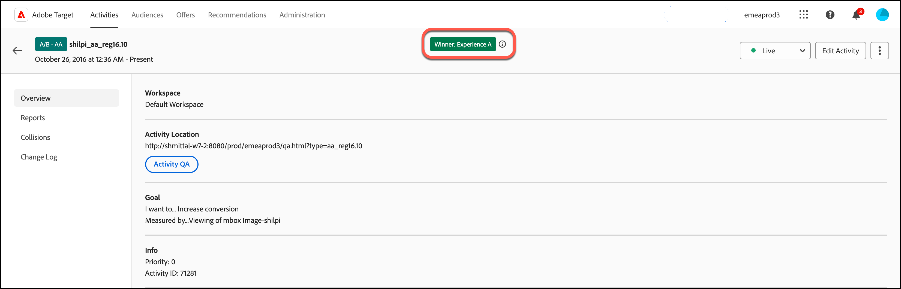

# 解释[!UICONTROL 自动分配]报告 {#interpret-auto-allocate-reports}

>[!BEGINSHADEBOX]

**在此页面上：**&#x200B;了解如何识别&#x200B;**[!UICONTROL 自动分配]**&#x200B;活动（由&#x200B;**[!UICONTROL 自动分配]**&#x200B;提供统计保证）的入选体验，以及如何读取报告中的提升和置信度数字。

>[!ENDSHADEBOX]

[!DNL Adobe Target]中&#x200B;**[!UICONTROL 自动分配]** A/B活动的报告显示该活动是否已找到入选者，以及[!DNL Target]对该结果的信心如何。 入选者徽章、提升度和置信度等指标可帮助您解释结果。

许多营销人员犯了一个错误，即在结果指示明确的入选者之前过早声明入选体验。 [!DNL Target]使您更容易确定入选者。 有关声明入选者的一般信息，请参阅[A/B测试常见的十个隐患以及如何避免它们](/help/main/c-activities/t-test-ab/common-ab-testing-pitfalls.md)。

## 确定入选的体验 {#identify-winner}

当您使用&#x200B;**[!UICONTROL 自动分配]**&#x200B;功能时，[!DNL Target]会在活动页面的顶部显示一个徽章。 在活动达到最低转化次数，且具有足够的置信度之前，该标记会一直指示“还没有入选者”。

在宣布明确的入选者后，[!DNL Target]会显示“入选者：体验&#x200B;*X*”徽章。

入选者徽章还会显示在&#x200B;**[!UICONTROL 活动]**&#x200B;列表中的活动信息弹出窗口中，因此您无需打开&#x200B;**[!UICONTROL 自动分配]**&#x200B;活动即可查看其状态。

>[!NOTE]
>
>**[!UICONTROL 自动分配]**&#x200B;活动旨在从所有选项中找出最佳体验，而不仅仅是与控制体验进行成对比较。

## [!UICONTROL 自动分配]的统计保证 {#statistical-guarantees}

在A/B活动结束时，**[!UICONTROL 自动分配]**&#x200B;可确保确定的入选者的有效误报率为5%。 这意味着确定的入选者实际不是所有活动体验中的最佳体验的概率仅为 5%。

对于[A/A测试](/help/main/c-activities/t-test-ab/aa-testing.md) （具有相同的体验），[!DNL Target]结束测试的时间不到5%。 A/A测试的预期行为是无限期运行，因此入选者徽章不应出现。

### 置信度和p值 {#confidence-p-values}

[!DNL Target]没有对&#x200B;**[!UICONTROL 自动分配]**&#x200B;使用基于p值的置信度。 **[!UICONTROL 自动分配]**&#x200B;活动中的&#x200B;**[!UICONTROL 置信度]**&#x200B;列显示体验在1%的错误容限内成为入选者的概率。 该算法在最佳和次最佳转化率之间使用1%的最小可检测效果，并使用[Bernstein不等式](https://en.wikipedia.org/wiki/Bernstein_inequalities_%28probability_theory%29)来计算此概率。

普通A/B测试基于p值计算置信度，它“松散地”计算给定体验与控制体验不同的概率。 这些 p 值只能用于确定体验是否与控制体验存在差异。 它们不能用于确定某个体验是否与其他体验（而非控制体验）不同。

>[!IMPORTANT]
>
>[!DNL Target]在预定义的最小转化次数后显示入选者。 但是，确定入选者的最终决定应始终基于[!DNL Adobe Target]样本量计算器的结果。 [!DNL Target]不考虑站点的基本转化率以及输入计算器以确定活动持续时间的其它重要方面。 因此，根据最低转化次数，[!DNL Target]可能显示比保修更早的入选者。 有关详细信息，请参阅[样本量计算器](/help/main/c-activities/t-test-ab/sample-size-determination.md#section_6B8725BD704C4AFE939EF2A6B6E834E6)。

## 了解提升度和置信度报表 {#lift-confidence}

**[!UICONTROL 自动分配]**&#x200B;活动的&#x200B;**[!UICONTROL 报表]**&#x200B;选项卡显示以下数字：

| 图 | 描述 |
|---|---|
| **控制体验** | 第一个体验（默认情况下名为体验A）始终定义为&#x200B;**[!UICONTROL 报表]**&#x200B;选项卡上的“控制”体验。 在用于确定体验性能的建模中，此体验不会被视为真正的统计控制，而是会被视为报表中某些数字的参考或基准。 |
| **提升度** | “提升”值以及每个体验95%的边界始终根据定义的“控制”体验进行计算。 “控制”体验不能具有相对于自身的提升，因此报告会显示该体验的空白“ — ”值。 与A/B测试不同，在&#x200B;**[!UICONTROL 自动分配]**&#x200B;测试中，如果体验的执行效果比定义的控制更好，则不会报告提升值为负。 而是显示“ — ”。 |
| **置信度间隔** | 显示的&#x200B;**[!UICONTROL 置信区间]**&#x200B;条表示某个体验的平均估计转化率周围的95%置信区间。 这些栏采用颜色编码，具体取决于定义的“控制”体验：<ul><li>“控制”体验的栏始终为灰色。</li><li>置信区间在“控制”体验的置信区间之下的部分显示为红色。</li><li>置信区间在“控制”体验的置信区间之上的部分是绿色的。</li></ul> |
| **入选者** | 当领先体验的95% **[!UICONTROL 置信区间]**&#x200B;与任何其他体验不重叠时，则会找到入选者。 入选体验会在体验名称左侧和“入选者”横幅中指定绿色星形标记。 如果没有可见星标，横幅会显示“还没有入选者”，并且尚未找到入选者。 |
| **置信度** | 当前领先或入选的体验旁边也会报告“置信度”数字。 此数字仅报告到领先体验的&#x200B;**[!UICONTROL 置信度]**&#x200B;达到至少60%为止。<ul><li>如果&#x200B;**[!UICONTROL 自动分配]**&#x200B;活动中存在两个体验，则该数字表示该体验的执行效果优于其他体验的置信水平。</li><li>如果存在两个以上的体验，则该数字表示体验表现优于定义的“控制”体验的置信水平。</li><li>如果“控制”体验获胜，则不会报告“置信度”数字。</li></ul> |

## 常见问题解答 {#faq}

请注意以下常见问题的答案。

+++ 这个活动已经进行了几天。 为何所有置信度值仍显示0%？

以下任何原因描述了为什么在所有体验的报表的&#x200B;**[!UICONTROL 置信度]**&#x200B;列中显示0%：

* 手动A/B测试和&#x200B;**[!UICONTROL 自动分配]**&#x200B;使用不同的统计信息来显示&#x200B;**[!UICONTROL 置信度]**&#x200B;值。

  手动A/B测试使用基于[Welch的t测试](https://en.wikipedia.org/wiki/Welch%27s_t-test)的p值。 p值是指在体验与控制体验之间找到观察到的差异（或更极端的差异）的概率，但实际上根本不存在这样的差异。 这些p值只能用于确定在给定体验与控制体验相同的情况下，观察到的数据是否一致。 它们不能用于确定某个体验是否与其他体验（而非控制体验）不同。

  **[!UICONTROL 自动分配]**&#x200B;显示给定体验成为活动中所有体验的真正入选者的概率。 只有入选体验（最有可能成为入选体验）具有非零置信值。 其他所有人最有可能是输家，显示为0%。

* **[!UICONTROL 自动分配]**&#x200B;仅在入选体验获得60%的置信度后才开始显示置信度。 这些置信度级别通常出现在正常A/B测试完成所需时间的大约一半的时间中（但不保证会超过此时间范围）。 要确定常规A/B测试运行的时长，请使用[!DNL Adobe Target] [样本量计算器](/help/main/c-activities/t-test-ab/sample-size-determination.md#section_6B8725BD704C4AFE939EF2A6B6E834E6)：在“基准转化率”中输入对照的转化率，“提升度”输入“5%”，“置信度”输入95%。 通常，置信度会在每个体验收集每个体验至少50%的所需示例后开始显示。 这可以让您了解何时开始出现信心。

* 如果报表显示整体为0%，则活动可能为时尚早。

+++

+++ 对于使用[!UICONTROL Analytics]作为报表源(A4T)的[!UICONTROL 自动分配]活动，是否有“无入选项目”、“入选项目”和“星标”徽章可用？

“尚未有入选者”和“入选者”徽章显示在&#x200B;**[!UICONTROL 活动]**&#x200B;列表的活动信息弹出窗口中。 在[!DNL Analysis Workspace]的&#x200B;**[!UICONTROL A4T]**&#x200B;面板中或在[!DNL Target]中查看同一报表时，它们不会显示。 如果A4T **[!UICONTROL 自动分配]**&#x200B;活动的[!DNL Target]报告显示入选者“星级”徽章，请忽略该徽章。

有关此以及其他限制和注释的更多信息，请参阅[!UICONTROL 自动分配]和[!UICONTROL 自动定位]活动&#x200B;*的* A4T支持[自动分配](/help/main/c-integrating-target-with-mac/a4t/a4t-at-aa.md#aa)。

+++
