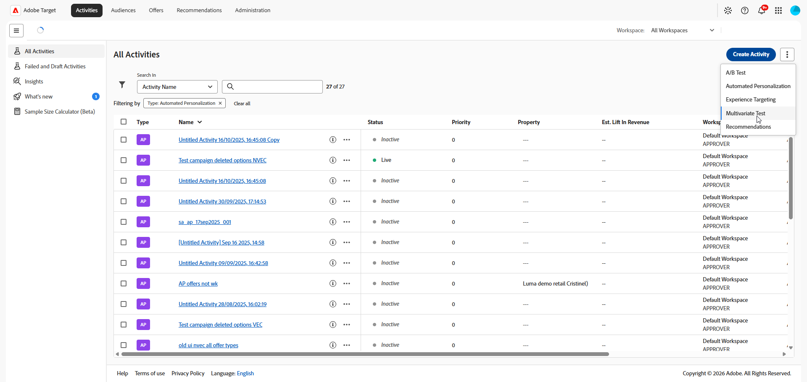

# 创建多变量测试 {#create-mvt}

>[!BEGINSHADEBOX]

**在此页面上：**&#x200B;了解如何在&#x200B;**[!UICONTROL 可视化体验编辑器]** (VEC)中创建&#x200B;**[!UICONTROL 多变量测试]** (MVT)。 您可以创建活动、构建和查看体验、设置定位，然后配置目标和设置。

>[!ENDSHADEBOX]

通过[!DNL Adobe Target]中的&#x200B;**[!UICONTROL 可视化体验编辑器]** (VEC)，可以轻松创建&#x200B;**[!UICONTROL 多变量测试]**，并在[!DNL Target]内修改页面的各个部分。

使用[!DNL Target]点击式编辑器，您可以选择任意位置并添加多个选件。

**[!UICONTROL 多变量测试]** (MVT)生成页面优先报表。 换言之，多变量测试会在某个特定的 URL 上运行，而测试中包含为该页面设计的所有体验。

按照以下步骤创建&#x200B;**[!UICONTROL 多变量测试]** (MVT)：

1. [创建活动](#create-activity)
1. [构建和审查体验](#build-experiences)
1. [设置定位](#set-targeting)
1. [配置目标和设置](#configure-goals-and-settings)

## 创建活动 {#create-activity}

选择活动类型和投放类型，指定要测试的页面，然后命名活动。

1. 单击&#x200B;**[!UICONTROL 创建活动]** > **[!UICONTROL 多变量测试]**。

   有关 [!DNL Target] 中可用的各种活动类型及其差异的更多信息，请参阅[活动](/help/main/c-activities/activities.md#concept_D317A95A1AB54674BA7AB65C7985BA03)。 请参阅 [Target 活动类型](/help/main/c-activities/target-activities-guide.md)，以帮助您确定最符合自己需求的活动类型。

   

1. 选择传递类型：**[!UICONTROL Web]**、**[!UICONTROL Mobile]**、**[!UICONTROL 电子邮件]**&#x200B;或&#x200B;**[!UICONTROL 其他/API]**。

1. （视情况而定）如果您是[Target Premium](/help/main/c-intro/intro.md#premium)客户，请[选择工作区](/help/main/administrating-target/c-user-management/property-channel/property-channel.md)。

1. [为要测试的页面指定URL](/help/main/c-activities/t-test-ab/t-test-create-ab/ab-activity-url.md#ab-activity-url)。 请使用完整的URL，即在开头包含HTTP或HTTPS。

1. 然后，单击&#x200B;**[!UICONTROL 创建]**。 **[!UICONTROL 可视化体验编辑器]**&#x200B;打开。

1. 要命名该活动，请单击&#x200B;**[!UICONTROL 编辑]**&#x200B;图标（）并指定该活动的描述性名称，然后单击&#x200B;**[!UICONTROL 保存]**。

   {{activity-name-rules}}

   

## 构建和审查体验 {#build-experiences}

将选件添加到每个位置，预览生成的体验，并检查测试计划是否可行。

1. [在每个位置中创建产品建议](/help/main/c-activities/c-multivariate-testing/t-create-multivariate-test/add-offers.md#concept_DCE6B45C30F7419B8EC17AFDEE8D8AA6)。

   您可以添加以下类型的选件：

   * HTML
   * 图像
   * 文本

1. 单击&#x200B;**[!UICONTROL 预览]**&#x200B;以[预览您的体验](/help/main/c-activities/c-multivariate-testing/t-create-multivariate-test/preview-experiences.md)。

1. 单击&#x200B;**[!UICONTROL 显示体验]**&#x200B;图标（）以显示左侧框架中的所有体验列表，然后单击列表中的特定体验以查看该体验。

1. [使用流量估算器](/help/main/c-activities/c-multivariate-testing/t-create-multivariate-test/traffic-estimator.md#task_71AA6922AFD447EA8C5E610A78ABA714)来检验测试计划的可行性。

### 排除体验（可选） {#exclude-experiences}

您可能会选择排除显示冲突变体的体验，或在美学上未实现平衡的体验。

1. 单击&#x200B;**[!UICONTROL 管理内容]**&#x200B;图标（）以显示&#x200B;**[!UICONTROL 管理体验]**&#x200B;对话框。

1. 要排除一个体验，请单击该体验旁边的&#x200B;**[!UICONTROL 更多操作]**&#x200B;图标（），然后单击&#x200B;**[!UICONTROL 排除]**。

1. 要排除多个体验，请选中所需体验对应的复选框，然后单击&#x200B;**[!UICONTROL 排除]**。

## 设置定位 {#set-targeting}

选择哪些访客进入测试，并查看测试摘要。

1. 单击&#x200B;**[!UICONTROL 下一步]**&#x200B;访问&#x200B;**[!UICONTROL 定位]**&#x200B;页面。

   流程图会引导您完成以下步骤：分配受众及其流量百分比，选择流量分配方法，以及指定活动中每个体验的流量分配。

1. （视情况而定）单击&#x200B;**[!UICONTROL 所有访客]**&#x200B;控件为该活动选择其他受众。

   已将&#x200B;**[!UICONTROL 所有访客]**&#x200B;受众设置为默认受众。 如果选择其他受众，则其名称将显示在最左侧的控件中。 例如，您可以将准入资格限制为 50% 的访客或 45% 的“加州”受众。

   +++ 选择其他受众的步骤

   此时将显示正确的框架，您可以在其中添加或删除受众，并分配活动的访客百分比。

   1. 要更改受众，请单击右框架中的&#x200B;**[!UICONTROL 替换]**&#x200B;图标（）。
   1. 在&#x200B;**[!UICONTROL 添加受众]**&#x200B;对话框中，[选择所需的受众](/help/main/c-activities/t-test-ab/t-test-create-ab/ab-audience.md)，然后单击&#x200B;**[!UICONTROL 分配受众]**。

      要创建组合多个受众的受众，请单击&#x200B;**[!UICONTROL 组合受众]**。 有关详细信息，请参阅[合并多个受众](/help/main/c-target/combining-multiple-audiences.md)。

      若要新建一个在&#x200B;**[!UICONTROL 受众库]**&#x200B;中没有的受众，请单击&#x200B;**[!UICONTROL 创建受众]**。 在[创建受众工作流](/help/main/c-target/c-audiences/audiences.md)中，选择以下选项之一：

      * **[!UICONTROL 受众库]**：创建保存到&#x200B;**[!UICONTROL 受众库]**&#x200B;的按需受众，该受众可在其他活动中重复使用。
      * **[!UICONTROL 仅限此活动]**：创建未保存到&#x200B;**[!UICONTROL 受众库]**&#x200B;且只能用于当前活动的[特定活动受众](/help/main/c-target/creating-activity-only-audience.md)。

   1. 单击右框中的&#x200B;**[!UICONTROL 访客百分比]**，然后选择您希望参加活动的符合条件的访客所占的百分比。

   +++

1. [查看测试摘要](/help/main/c-activities/c-multivariate-testing/t-create-multivariate-test/test-summary.md#reference_971AB225963A4DC18EEB5B0E20F0A4A7)并进行任何所需的更改，然后单击&#x200B;**[!UICONTROL 下一步]**。

## 配置目标和设置 {#configure-goals-and-settings}

在&#x200B;**[!UICONTROL 目标和设置]**&#x200B;页面上，您指示[!DNL Target]如何度量测试。 可用的设置取决于您是使用[!DNL Target]还是[!DNL Analytics]作为报表源。

1. 查看页面的各个部分，并设置您需要的。 查看[您在“目标和设置”页面](#goals-settings-overview)上设置的内容。

   | 区域 | 设置内容 |
   |---|---|
   | **[!UICONTROL 活动设置]** | 可选目标&#x200B;**[!UICONTROL 优先级]**（在多个活动共享位置和受众时使用）和&#x200B;**[!UICONTROL 持续时间]**（开始和结束日期）。 |
   | **[!UICONTROL 报表设置]** | 报表源、目标量度（例如&#x200B;**[!UICONTROL 转化]**&#x200B;量度）、其他量度和报表的受众。 此处还提供了目标量度的高级设置。 |
   | **[!UICONTROL 其他元数据]** | 有关对您或其他团队成员有用的活动的注释。 |

1. 单击&#x200B;**[!UICONTROL 保存并关闭]**&#x200B;以创建该活动。

有关每个选项的详细信息，请参阅[目标和设置](/help/main/c-activities/t-test-ab/t-test-create-ab/ab-goals-and-settings.md#ab-goals-and-settings)。

## 培训视频：创建多变量测试(9:25) 

本视频演示了如何使用[!DNL Target]三步引导式工作流规划和创建多变量测试。

* 定义和设计多变量测试
* 创建多变量测试

>[!VIDEO](https://video.tv.adobe.com/v/30337?captions=chi_hans)
