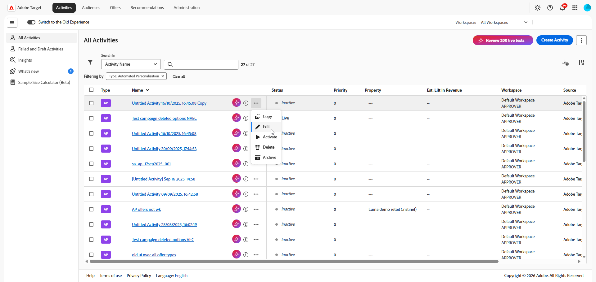

# 编辑活动 {#edit-activity}

>[!BEGINSHADEBOX]

**在此页面上：**&#x200B;了解如何从&#x200B;**[!UICONTROL 活动]**&#x200B;页面编辑现有活动、如何在使用工作区时复制活动以及哪些操作适用于旧版活动。

>[!ENDSHADEBOX]

现有活动可以从[!DNL Adobe Target]界面中的多个位置进行编辑，因此对体验、定位规则或目标的更改不需要重新创建活动。 步骤因所选方法而异。 **[!UICONTROL 另存为草稿]**&#x200B;功能不再可用。 有关详细信息，请参阅[将筛选器应用到活动列表](/help/main/c-activities/activities.md#filters)下的&#x200B;**[!UICONTROL 状态]**。

## 从[!UICONTROL 更多操作]图标进行编辑 {#section_29EE2ECA6B88473A8F9AC5600FFBB174}

要通过逐步执行三步引导式工作流来编辑活动，请执行以下操作：

1. 在&#x200B;**[!UICONTROL 活动]**&#x200B;页面中，单击活动旁边的&#x200B;**[!UICONTROL 更多操作]**&#x200B;图标（），然后单击&#x200B;**[!UICONTROL 编辑]**。

   [!DNL Target]在&#x200B;**[!UICONTROL 可视化体验编辑器]** (VEC)中打开活动并显示&#x200B;**[!UICONTROL 体验]**&#x200B;页面，这是工作流的第一步。

   

1. 使用[VEC选项](/help/main/c-experiences/c-visual-experience-composer/viztarget-options.md)编辑活动。

1. 单击&#x200B;**[!UICONTROL 下一步]**&#x200B;进入下一步，然后进行任何必要的编辑。

1. 在&#x200B;**[!UICONTROL 目标和设置]**&#x200B;页面上，使用以下选项之一保存更改：

   * **[!UICONTROL 保存并关闭]：**&#x200B;保存更改并显示活动的&#x200B;**[!UICONTROL 概述]**&#x200B;页面。
   * **[!UICONTROL 保存]：**&#x200B;单击&#x200B;**[!UICONTROL 更多操作]**&#x200B;图标（），然后选择&#x200B;**[!UICONTROL 保存]**&#x200B;以保存更改并保留在VEC中，以便您可以继续做出更改。 等待保存完成后，可进行其他更改。 保存完成后，VEC 会重新加载以显示刷新的更改。

     

## 从活动名称中编辑 {#section_176180DAD17E40CEA441903F39E0AA1C}

直接转到需要更改的步骤，无需逐步执行工作流：

1. 在&#x200B;**[!UICONTROL 活动]**&#x200B;页面中，单击该活动以将其打开，然后从&#x200B;**[!UICONTROL 编辑活动]**&#x200B;下拉列表中选择一个选项：

   * **[!UICONTROL 编辑体验]：**&#x200B;打开&#x200B;**[!UICONTROL 体验]**&#x200B;页面（工作流的第一步）。
   * **[!UICONTROL 编辑定位]：**&#x200B;打开&#x200B;**[!UICONTROL 定位]**&#x200B;页面（工作流的第二步）。
   * **[!UICONTROL 目标和设置]：**&#x200B;打开&#x200B;**[!UICONTROL 目标和设置]**&#x200B;页面（工作流的第三步）。

     

1. 进行更改，然后使用&#x200B;**[!UICONTROL 保存并关闭]**&#x200B;或&#x200B;**[!UICONTROL 保存]**&#x200B;保存活动，如上一节所述。

## 使用工作区进行复制和编辑 {#section_45A92E1DD3934523B07E71EF90C4F8B6}

工作区允许组织为一组特定用户分配一组特定属性。 工作区在许多方面与 [!DNL Adobe Analytics] 中的报表包相似。

>[!NOTE]
>
>工作区是&#x200B;**[!UICONTROL 属性和权限]**&#x200B;功能的一部分，该功能作为[!DNL Target Premium]解决方案的一部分提供。 如果没有 [!DNL Target Premium] 许可证，它们将无法在 [!DNL Target Standard] 中使用。

如果您所在的组织是跨国组织，则您可能拥有两个工作区：一个用于欧洲网页、属性或网站，而另一个用于美国网页、属性或网站。 如果您所在的组织拥有多个品牌，则您的每个品牌可能有其独立的工作区。

有关工作区和企业用户权限功能的详细信息，请参阅[企业用户权限](/help/main/administrating-target/c-user-management/property-channel/property-channel.md)。

如果您在环境中启用了&#x200B;**[!UICONTROL 企业用户权限]**，则可以将活动复制到同一工作区或另一个工作区。 当前，无法将活动从一个工作区移到另一个工作区。 要将活动复制到另一个工作区，请从&#x200B;**[!UICONTROL 活动]**&#x200B;页面中，单击要复制的活动旁边的&#x200B;**[!UICONTROL 更多操作]**&#x200B;图标（），然后单击&#x200B;**[!UICONTROL 复制]**。

在工作区中使用复制/编辑功能时，请考虑以下信息：

* 如果在同一工作区中复制活动，或者将活动从默认工作区复制到非默认工作区，则会自动打开“活动向导”。 在跨工作区副本中，您可能只需要更新活动属性。
* 将活动从非默认工作区复制到另一个工作区（默认或非默认）时，将打开活动向导，并且需要一些手动输入才能完成设置：
  * **[!UICONTROL 属性]**：工作区之间的属性可能不同。 此情况可能会触发警告：

    * 在&#x200B;**[!UICONTROL 基于表单的体验编辑器]**&#x200B;中，警告将直接显示在用户界面中以便立即可见。

      

    * 在VEC中，单击&#x200B;**[!UICONTROL 配置]** > **[!UICONTROL 属性]**&#x200B;时会显示警告。

      要解决此问题，请单击&#x200B;**[!UICONTROL 添加/删除]**，以便只显示目标工作区中可用的属性以供选择。

  * **受众和选件**：将活动复制到新工作区时，所有关联的[!DNL Target]或原始工作区中的临时受众和选件将以下列格式复制： [!DNL Target]受众和`<Entity Name>`的临时受众和选件`<Entity Name> Copy <Date>`。

    行为详细信息：

    * 在保存并重新打开活动之前，复制的受众和选件不会显示在&#x200B;**[!UICONTROL 受众]**&#x200B;和&#x200B;**[!UICONTROL 选件]**&#x200B;列表中。
    * 复制后无法立即编辑这些实体。 在初始编辑会话期间，客户可能会在VEC中看到这些项目的空内容。
    * 如果需要，客户可以使用目标工作区中的其他受众或选件替换复制的受众或选件。

    此过程可确保更平稳的跨工作区活动复制，同时保持自定义的灵活性。

    在复制活动时，必须手动替换未保存在当前工作区或默认工作区中的非目标受众和选件。

    手动替换这些非目标受众和选件可确保在复制的活动中仅使用有效、可访问的实体，并防止在编辑或交付期间出现错误。

    

>[!NOTE]
>
>如果您的环境未启用&#x200B;**[!UICONTROL 企业用户权限]**&#x200B;功能，则在复制之前，所有活动都会以编辑模式打开。

## 旧版[!DNL Recommendations Classic]活动 {#classic}

**[!UICONTROL 活动]**&#x200B;列表显示在各种源（包括[!DNL Recommendations Classic]）中创建的活动。 以下操作适用于在[!DNL Recommendations Classic]中创建的旧版活动：

* **[!UICONTROL 激活]**
* **[!UICONTROL 停用]**
* **[!UICONTROL 存档]**
* **[!UICONTROL 复制]**
* **[!UICONTROL 删除]**

无法直接编辑[!DNL Recommendations]活动。 要编辑该活动，请使用[!DNL Target Premium]创建活动副本并保存新活动，然后根据需要对其进行编辑。
