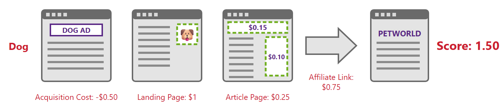

# 印象分数 {#capture-score}

>[!BEGINSHADEBOX]

**在此页面上：**&#x200B;了解捕获得分参与度量度如何计算访问得分，以及如何为页面分配得分。

>[!ENDSHADEBOX]

[!DNL Adobe Target]中的捕获得分参与量度根据分配给访客在您网站上查看的页面的值计算聚合得分。 得分从访客第一次看到活动的第一个显示[!DNL Target]请求时开始。

以下示例显示了如何在测试两个体验（一个具有猫图像，一个具有狗图像）的活动中计算得分。

在此示例中，第一个访客会看到猫体验。 假定全局[!DNL Target]请求根据页面的值传入页面得分。 如果营销人员已捕获与&#x200B;**任意Target请求**&#x200B;关联的成功量度上的页面计数参与度，那么对于在猫图像周围的显示请求之后看到的任何请求，都会累加它们的访问分数。

第一个页面将分数添加1，第二个页面将分数添加0.25，第三个页面将分数添加0.10，第四个页面将分数添加0.10，总计添加1.45。 此总计可解释为货币或点。 在另一次访问中，访客会看到狗狗体验。 虽然此访客查看的页面较少，但分数为2.10，高于另一次访问，因为该访客查看了更有价值的页面。

通过 adbox 和重定向器，您可以考虑购置成本和联属链接收入，详见下述页流程图中的描述。 在此示例中，文章页面上的两个[!DNL Target]请求都传递了一个分数，可能表示已知CPM。

## 分配页面得分

您可以根据网页对您的价值为网站上的任何页面分配一个值。 例如，烹饪网站可能在其专题文章页面上以比在其体验部分中更高的价格销售广告。 因此，功能文章比体验部分更有价值。 通过页面得分，您可以获得访问的整体“价值”，因此，阅读更多专题文章的人比只浏览体验的人获得更多“点数”。

分配网页分数的方法有两种：

* 在[!DNL Target]请求中，创建一个名为`mboxPageValue`的参数。

  示例: `('global_mbox', 'mboxPageValue=10');`

  每次查看带有[!DNL Target]请求的页面时，指定的值都会添加到得分。 如果页面上的多个请求包含得分值，则该页面的得分是所有请求值的总和。 `mboxPageValue`是一个保留的参数，用于将值传入[!DNL Target]请求以捕获参与度分数。 可以传递正值和负值。 将在每次访问结束时计算总和，以确定访问的总分。

* 在页面URL中传递`?mboxPageValue=n`参数。

  示例: `https://www.mydomain.com?mboxPageValue=5`

  页面上每个[!DNL Target]请求的分数都将添加指定的值。 例如，如果传递参数`?mboxPageValue=10`，而页面上有三个[!DNL Target]请求，则页面的得分为30。

>[!NOTE]
>
>计数器以活动的第一个显示请求开头，而不是条目请求，分数中不包含位于该请求上方的[!DNL Target]请求。 例如，如果在主页上输入没有显示请求的活动，然后链接到包含显示请求的目录页面，则当您移动到目录页面时，计数器将开始。

最佳做法是在[!DNL Target]请求中分配值。 通过这种方法，您可以根据每个请求的内容准确地度量值。

>[!NOTE]
>
>为了便于维护，您可以在[!DNL at.js]文件中使用某些条件性JavaScript逻辑配置网站的页面分数值分配。 此方法无需向页面中添加更多代码。 请联系您的客户顾问以寻求帮助。

您可以结合使用上述两种方法，但这可能导致实际分数比应得分数更高。 例如，您为三个[!DNL Target]请求中的每一个分配值10，而为第四个请求分配无分数，然后传递URL参数`?mboxPageValue=5`。 页面得分为50:30，代表分配了值的三个请求，加上20，代表URL参数（页面上四个请求中的每一个为5）。

您还可以为某些特定网页分配负值，因为它们会增加您的成本或者不应该被访客看到。 负值也会影响整体得分。 此技术可用于访客从广告触及的页面，以便您了解CPC是多少。 它也可用于支持或联系页面，访客可以在该页面上致电或请求帮助。
