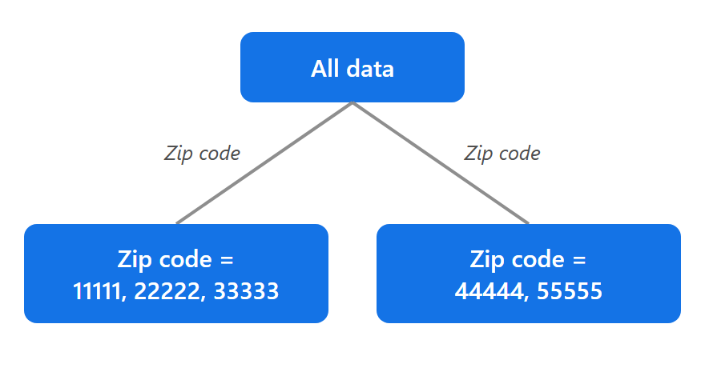

# 随机林算法 {#random-forest-algorithm}

>[!BEGINSHADEBOX]

**在此页面上：**&#x200B;了解[!DNL Target]如何使用随机林算法构建&#x200B;**[!UICONTROL Automated Personalization]**&#x200B;和&#x200B;**[!UICONTROL 自动定位]**&#x200B;活动的个性化模型。

>[!ENDSHADEBOX]

在&#x200B;**[!UICONTROL Automated Personalization]** (AP)和&#x200B;**[!UICONTROL 自动定位]**&#x200B;活动中使用的主要个性化算法是随机林。 它是一种分类或回归方法，通过在训练时构建大量决策树来操作。

随机林是一种组合方法。 提到统计数据时，您可能会想到使用单个回归分析模型来预测结果。 最新的数据科学研究表明，“集成方法”，即从同一数据集创建多个模型，然后智能地组合这些模型，其效果优于基于单个模型的预测，或者优于任何组成学习算法的预测。

## 什么是决策树？ {#section_7F5865D8064447F4856FED426243FDAC}

决策树将系统可以学习的所有访问数据划分到不同的组中。 在目标量度（例如，转化率）方面，每个组中的访问尽可能相似，而各个组中的访问尽可能不同。 为此，树查看训练集中的变量，并以互斥集体穷尽(MECE)方式将数据拆分为可最大化此目标的组（或“叶”）。

在以下简单示例中，目标量度是转化，并且有两个输入变量：

* 性别（具有两个可能的值：男性或女性）
* 邮政编码（小数据集中有五个潜在值：11111、22222、33333、44444或55555）

### 第一次拆分 {#first-split}

该树首先确定两个变量中的哪个解释了访问数据转化率的最大变化量。 假定邮政编码是最具预测性的。 此变量构成树的第一个“分支”。 然后，树将访问数据拆分为多个组，如上所述。 假设11111、22222和33333是一个拆分，而44444和55555是第二个拆分。

{width="440" align="center"}

### 在每个分支内拆分 {#second-split}

这棵树提出了一个问题， “什么是最可预测性的变量？” 再次尝试，并完成一个类似的练习以拆分每个分支&#x200B;*中的数据*。 现在只剩下性别了，所以这就是答案。 在11111、22222和33333分支中，假设男女之间的转化率存在差异。 然后是两个叶子（男人和女人），这个分支是完整的。 在44444和55555分支中，假设男女转化率之间没有统计差异。 在这种情况下，第一个拆分是最终拆分。

{width="480" align="center"}

## 随机林如何使用决策树？ {#section_536C105EF9F540C096D60450CAC6F627}

决策树可堪称是强大的统计工具。 但是，它们也存在一些缺陷。 最关键的是，它们可以“过度拟合”数据，因此单个树无法很好地预测未用于构建初始树的将来数据。 这一难题在统计学习中被称为[偏差-方差权衡](https://en.wikipedia.org/wiki/Bias%E2%80%93variance_tradeoff)。

随机森林有助于克服这一挑战。 随机林是数百个决策树的集合，这些决策树在同一个数据集上的构建方式略有不同，并且“投票”在一起产生比单个树更好的模型。 这些树是通过随机选择具有替换（称为bagging）的访问记录子集和随机选择属性子集来构建的，因此林由稍有不同的决策树组成。 这种方法在树中引入小变量。 添加此受控量的方差有助于提高算法的预测精度。

## [!DNL Target]个性化算法如何使用随机林？ {#section_32FB53CAD8DF40FB9C0F1217FBDBB691}

### 如何构建模型

[!DNL Target]使用它自动收集的数据以及您提供的自定义数据构建其个性化算法。 下图概述了如何为&#x200B;**[!UICONTROL 自动定位]**&#x200B;和&#x200B;**[!UICONTROL Automated Personalization]**&#x200B;活动构建模型：

{width="850" zoomable="yes"}

1. [!DNL Target]在随机提供体验或选件时收集访客数据。
1. 在[!DNL Target]点击关键数量的数据后，[!DNL Target]执行功能工程。
1. [!DNL Target]为每个体验或选件构建随机林模型。
1. [!DNL Target]通过检查模型是否满足阈值质量分数来验证模型。
1. [!DNL Target]将模型推送到生产环境以个性化未来的流量。

这些模型可预测要向访客显示的最佳体验或选件。 通常，每个体验（在&#x200B;**[!UICONTROL 自动定位]**&#x200B;活动中）或每个选件（在&#x200B;**[!UICONTROL Automated Personalization]**&#x200B;活动中）都会生成一个模型。 然后，[!DNL Target]显示产生最高预测成功量度的体验或选件（例如，转化率）。 模型必须先在随机提供的访问中进行训练，然后才能用于预测。 因此，在活动首次启动时，甚至个性化组中的访客也会随机显示不同的体验或选件，直到个性化算法就绪为止。

模型将根据其在曲线(AUC)下的面积进行验证，以确保每个模型在用于活动之前均能很好地预测访客的行为。 模型开始提供个性化体验的确切时间取决于数据的详细信息，因为必须先验证模型。 实际上，出于流量规划目的，在每个模型生效之前，模型所使用的转化次数通常远高于最小转化次数。

当模型变得对体验或选件有效时，体验或选件名称左侧的时钟图标将更改为绿色复选框。 当至少有两个体验或选件可使用有效模型时，某些访问会开始个性化。

### 特征转换

在数据经过个性化算法之前，对其进行特征转换，可以将其视为准备在训练记录中收集的数据以供个性化模型使用。 转换取决于属性的类型（数据科学家有时称之为“特征”）：

| 功能类型 | 描述 | 转换 |
|---|---|---|
| **类别** | 无法计数，但可以划分为不同的组，例如国家/地区、性别或邮政编码。 | 保持一组所有可能的特征并使用似然变换来减小数据大小。 |
| **数值** | 可以测量或计数，如年龄或收入。 | 重新缩放可以确保各个功能之间具有可比性。 |

### 采用多臂老虎机来平衡学习与个性化

在[!DNL Target]构建个性化模型后，您需要在未来访问您的活动时进行权衡。 您可以根据当前模型将所有流量个性化，也可以通过随机提供随机选件继续向新访客学习。 个性化算法应始终了解访客中的新趋势，同时将大多数流量个性化。 多臂老虎机是[!DNL Target]如何实现此目标的：它确保模型始终“花费”一小部分流量以在活动整个生命周期中继续学习，并防止过度利用之前学习到的趋势。

在数据科学世界中，多臂盗贼问题是探索与开发困境的经典例子。在该问题中，给出一组单臂盗贼的集合，每个盗贼的奖励概率未知。 关键思想是开发一种策略，使成功概率最高的手臂得到播放，从而使获得的总奖励最大化。 在建立了在线模型后，使用多臂老虎机进行在线评分。 此过程有助于在探索期间进行在线学习。 当前的多臂算法是epsilon(ε)贪婪算法。 该算法以概率1-ε为选择最优手臂的概率。 在概率ε的情况下，任意其它手臂都是随机选择的。
