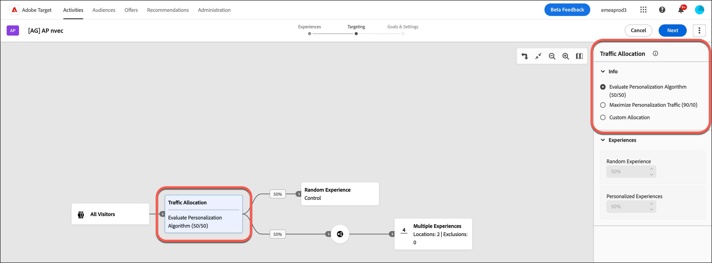

# 创建[!UICONTROL Automated Personalization]活动 {#create-ap-activity}

>[!BEGINSHADEBOX]

**在此页面上：**&#x200B;了解如何在&#x200B;**[!UICONTROL 可视化体验编辑器]** (VEC)中创建&#x200B;**[!UICONTROL Automated Personalization]** (AP)活动。 您可以构建体验，设置定位和控制组，然后配置目标和设置。

>[!ENDSHADEBOX]

[!DNL Target]中的&#x200B;**[!UICONTROL Automated Personalization]**&#x200B;活动工作流与其他活动类型的工作流有所不同。 它遵循&#x200B;**[!UICONTROL 可视化体验编辑器]**&#x200B;中的三步引导式工作流：

1. [构建体验](#build-experiences)
1. [设置定位](#set-targeting)
1. [配置目标和设置](#configure-goals-and-settings)

## 开始之前 {#before-you-begin}

为获得最佳性能，请将&#x200B;**[!UICONTROL Automated Personalization]**&#x200B;和&#x200B;**[!UICONTROL 自动定位]**&#x200B;活动保持在以下限制之内：

* 4-6个位置，每个位置提供4-6个选件。
* 总共5,000个体验以取得最佳结果。 硬限制为30,000，启用&#x200B;**[!UICONTROL 不允许重复项]**&#x200B;选项时，将应用相同的限制。

体验的总数因位置和选件的笛卡尔组合而增加。 较大的配置可能会导致&#x200B;**[!UICONTROL 可视化体验编辑器]**&#x200B;中的加载或编辑速度缓慢。

## 步骤1：构建体验 {#build-experiences}

定义&#x200B;**[!UICONTROL Automated Personalization]**&#x200B;可以个性化的内容变体池。 您的体验和选件越丰富、越清晰，算法就越能更好地将正确的内容与每位访客匹配。

### 创建活动 {#create-activity}

启动活动，并在&#x200B;**[!UICONTROL 可视化体验编辑器]** (VEC)中打开要个性化的页面。

1. 从[!DNL Target] **[!UICONTROL 活动]**&#x200B;列表中，单击&#x200B;**[!UICONTROL 创建活动]** > **[!UICONTROL Automated Personalization]**。

   

1. 选择您的体验编辑器：

   * 要使用&#x200B;**[!UICONTROL 可视化体验编辑器]** (VEC)，请单击&#x200B;**[!UICONTROL 可视化]**。

   * 若要使用&#x200B;**[!UICONTROL 基于表单的体验编辑器]**，请改为选择&#x200B;**[!UICONTROL 表单]**。 请参阅[基于表单的体验编辑器](/help/main/c-experiences/form-experience-composer.md)，以了解更多信息。

     >[!NOTE]
     >
     >除了VEC和&#x200B;**[!UICONTROL 基于表单的体验编辑器]**&#x200B;之外，[!DNL Target]还提供&#x200B;**[!UICONTROL 单页应用程序VEC]**。 有关各种编辑器的更多信息，请参阅[体验和产品建议](/help/main/c-experiences/experiences.md)。 有关VEC的故障诊断信息，请参阅[可视化体验编辑器故障诊断](/help/main/c-experiences/c-visual-experience-composer/r-troubleshoot-composer/troubleshoot-composer.md)。

     

1. （视情况而定） [选择工作区](/help/main/administrating-target/c-user-management/property-channel/property-channel.md)。

1. 在&#x200B;**[!UICONTROL 输入活动URL]**&#x200B;框中，指定您的[活动URL](/help/main/c-activities/t-test-ab/t-test-create-ab/ab-activity-url.md)。 如果您的帐户[配置了默认 URL](/help/main/administrating-target/visual-experience-composer-set-up.md)，则默认情况下将显示该 URL。 您可以根据需要将默认URL更改为其他URL。

   请注意，[!DNL Target]不区分URL协议（[!DNL https]和[!DNL http]）。 因此，[!DNL `http://www.adobe.com/cn`]和[!DNL `https://www.adobe.com/cn`]都匹配。

1. 然后，单击&#x200B;**[!UICONTROL 创建]**。 此时将在VEC中打开具有指定URL的页面。

1. 要命名该活动，请单击&#x200B;**[!UICONTROL 编辑]**&#x200B;图标（）并指定该活动的描述性名称，然后单击&#x200B;**[!UICONTROL 保存]**。

   {{activity-name-rules}}

   

### 设计内容 {#design-content}

设置算法可组合的内容，并排除您不希望出现的任何体验。

1. 按照[可视化体验编辑器选项](/help/main/c-experiences/c-visual-experience-composer/viztarget-options.md)中的说明修改页面元素。

   * 要快速预览多个图像，请从资源管理器中一次选择多个图像。 然后，您可以查看页面，其中包含为活动配置的每个映像。
   * 要更改选件中的文本，请直接在页面上编辑文本元素。

   编辑元素时，该元素上会显示一些条形，表示已对其进行更改。

1. 单击&#x200B;**[!UICONTROL 管理内容]**&#x200B;图标（）以配置可用的组合。

   将打开&#x200B;**[!UICONTROL 管理内容]**&#x200B;对话框，其中包含两个选项卡：**[!UICONTROL 体验]**&#x200B;和&#x200B;**[!UICONTROL 选件]**。

   

1. 在&#x200B;**[!UICONTROL 体验]**&#x200B;选项卡上，查看内容段的列表以及每个内容段分配到的位置。

1. （可选）要从活动中排除体验，请选中要排除的每个体验对应的复选框，然后单击&#x200B;**[!UICONTROL 排除]**&#x200B;图标。

   有关更多选项，请参阅[管理排除项](/help/main/c-activities/t-automated-personalization/managing-exclusions.md)。

   

1. （视情况而定）单击&#x200B;**[!UICONTROL 选件]**&#x200B;选项卡以管理活动中的选件。

   * 要组织报表的选件，请选择内容块并将它们分配给报表组。 有关详细信息，请参阅[Automated Personalization中的选件报表组](/help/main/c-activities/t-automated-personalization/offer-reporting-groups-in-automated-personalization.md)。
   * 要限制能够查看选件的人员，请使用定位功能来仅允许特定访客查看该选件。

<!--
1. (Conditional) Click **[!UICONTROL Exclusion Groups]** to choose any combination of elements that you want to exclude from the activity.

   

   Although you can create up to 30,000 experiences in an AP test, the algorithm performs its best when fewer than 10,000 distinct experiences are used. This same limit is applied even when the activity has enabled the **[!UICONTROL Disallow Duplicates]** option.

   If you do not currently have any exclusion groups included in your activity, click **Create Exclusion Group**. You can filter to create a list that shows only the combinations you want to exclude. Name your exclusion group, then click **Save**.

   To edit an existing exclusion group, hover over the group you want to edit, then click the pencil icon.
-->

1. 完成活动内容的设置后，单击&#x200B;**[!UICONTROL 完成]**。

## 步骤2：设置定位 {#set-targeting}

确定哪些访客进入活动以及您的流量暴露了多少。 将它们与对照组配对，以便[!DNL Target]可以测量个性化交付的提升度。

1. 单击&#x200B;**[!UICONTROL 可视化体验编辑器]**&#x200B;顶部的&#x200B;**[!UICONTROL 定位]**，以进入三步引导式工作流中的下一个步骤。

   

1. （视情况而定）单击&#x200B;**[!UICONTROL 所有访客]**&#x200B;控件以[为活动选择其他受众](/help/main/c-activities/t-test-ab/t-test-create-ab/ab-audience.md)并设置其访客百分比。

   已将&#x200B;**[!UICONTROL 所有访客]**&#x200B;受众设置为默认受众。 如果选择其他受众，则其名称将显示在最左侧的控件中。 例如，您可以将准入资格限制为 50% 的访客或 45% 的“加州”受众。

1. 单击&#x200B;**[!UICONTROL 流量分配]**&#x200B;控件并选择以下选项之一：

   

   +++流量分配目标选项

   | 选项 | 何时使用 |
   |--- |--- |
   | **[!UICONTROL 评估Personalization算法(50/50)]** | 您的目标是测试算法。 对照算法和目标算法之间的访客比例均为50/50。 这种拆分可提供提升度的最准确估计，也是测试算法是否比无个性化（例如，随机提供的控制）性能更佳的最快和最准确的方法。 建议将“随机体验”用作控制。 |
   | **[!UICONTROL 最大化Personalization流量(90/10)]** | 您的目标是创建“始终运行”的活动。 10%的访客进入控制，这将确保算法有足够的数据来不断学习。 当您不太关注确切的提升度时，这是最大程度地增加个性化流量的最快、最准确的方法。 取舍是，你的精确度较低。 无论您的目标如何，当您使用特定体验作为控制时，都建议使用此选项。 |
   | **[!UICONTROL 自定义分配]** | 您希望手动拆分百分比。 |

   +++

1. （视情况而定）从&#x200B;**[!UICONTROL 控制]**&#x200B;下拉列表中，[选择要用作控制的特定体验](/help/main/c-activities/t-automated-personalization/experience-as-control.md)或选择&#x200B;**[!UICONTROL 随机体验]**。

   控制体验通过比较来确定自动化测试所带来的提升量。 **[!UICONTROL Automated Personalization]**&#x200B;始终针对控制组测量性能。 最佳做法是在控制组中至少放入 10% 的参加者。

   >[!NOTE]
   >
   >在&#x200B;**[!UICONTROL Automated Personalization]**&#x200B;活动中，将评估每个请求的参加标准（URL定位、模板规则和受众目标）。 在以前的版本中，每个会话会评估一次参加标准。

## 步骤3：配置目标和设置 {#configure-goals-and-settings}

告诉[!DNL Target]成功是什么样的。 您选择的优化目标是个性化算法所针对的量度，因此请挑选对此活动最重要的结果。

1. 单击&#x200B;**[!UICONTROL 下一步]**&#x200B;以显示&#x200B;**[!UICONTROL 目标和设置]**&#x200B;页面。

1. 使用以下设置配置活动，然后单击&#x200B;**[!UICONTROL 保存并关闭]**。

   | 设置 | 描述 |
   |--- |--- |
   | **[!UICONTROL 名称]** | 命名活动。 请为活动提供一个描述清楚的名称，以便团队成员能够在&#x200B;**[!UICONTROL 活动]**&#x200B;列表中识别该活动。 遵循[步骤1：构建体验](#build-experiences)中所述的活动名称规则。 |
   | **[!UICONTROL 目标]** | （可选）键入测试的目标。 此目标可帮助您记住活动的用途。 |
   | **[!UICONTROL 优先级]** | 决定当多个活动共享某个位置和某个受众时，要显示哪个活动。 请参阅[设置优先级](#set-priority)。 |
   | **[!UICONTROL 持续时间]** | 设置活动的开始和结束日期。 您可以选择&#x200B;**[!UICONTROL 激活时]**，也可以指定特定的日期和时间。 |
   | **[!UICONTROL 优化目标]** | 个性化算法所针对的指标。 请参阅[设置优化目标](#set-optimization-goal)。 |
   | **[!UICONTROL 转化量度]** | 默认情况下，转化量度与优化目标量度相同。 但是，您可以通过取消选中&#x200B;**[!UICONTROL 与优化目标相同]**&#x200B;选项来定义单独的转化量度。 |
   | **[!UICONTROL 其他量度]** | 添加任何其他要使用的报表量度。 您可以添加转化或收入量度。
**注意**： **[!UICONTROL 参与度]**&#x200B;量度不支持作为其他量度。 [!DNL Target] UI可能允许您选择&#x200B;**[!UICONTROL 参与]**&#x200B;量度，但数据在报表中无法准确显示。 |
   | **[!UICONTROL 报表受众]** | 添加受众以在报表中启用按受众筛选功能。 默认情况下，报表会显示所有符合条件的访客结果。 添加受众可筛选结果，从而获得更具体的访客子集。
**注意**：与其他活动类型不同，**[!UICONTROL Automated Personalization]**&#x200B;不能使用&#x200B;**[!UICONTROL Adobe Analytics]**&#x200B;作为其报表源(A4T)。 |
   | **[!UICONTROL 注意]** | 键入对您或其他团队成员有用的有关活动的任何信息。 **[!UICONTROL 注释]**&#x200B;窗格可调整大小。 |

   在命名或重命名度量时，不允许使用以下字符： `/`、`?`、`#`、`:`、`=`、`+`、`-`和`@`。

### 设置优先级 {#set-priority}

如果将具有相同受众的多个活动分配到同一个位置，则需使用优先级。 如果将两个或更多活动分配到同一个位置，则会显示具有最高优先级的活动。

根据您的设置，**[!UICONTROL 优先级]**&#x200B;的[!DNL Target] UI和选项会有所不同：

* **旧版优先级（默认）：**&#x200B;如果未启用细粒度优先级，请指定优先级&#x200B;**[!UICONTROL 低]**、**[!UICONTROL Medium]**&#x200B;或&#x200B;**[!UICONTROL 高]**。
* **细粒度优先级：**&#x200B;指定从0到999的值，其中0 =低，999 =高。 要启用此选项，请单击&#x200B;**[!UICONTROL 管理]** > **[!UICONTROL 报告]**，然后将&#x200B;**[!UICONTROL 启用细粒度优先级]**&#x200B;选项切换到“开”位置。

对于在以前的[!DNL Target Standard/Premium]版本中创建的活动，**[!UICONTROL 低]**&#x200B;优先级已转换为0，**[!UICONTROL Medium]**&#x200B;优先级已转换为5，**[!UICONTROL 高]**&#x200B;优先级已转换为10。 您可以根据需要调整这些值。

>[!NOTE]
>
>在使用细粒度优先级后，您可以禁用这些优先级，但在此之前，必须将所有优先级重新设置为0、5、10。

### 设置优化目标 {#set-optimization-goal}

优化目标包含两个参数：

* 您想要通过活动衡量哪些指标
* 活动参加者采取的表明目标已实现的操作

您可以通过选择&#x200B;**[!UICONTROL 我的主要目标]**&#x200B;右侧的三个圆点来命名优化目标。 **[!UICONTROL Automated Personalization]**&#x200B;活动可以测量&#x200B;**[!UICONTROL 转化]**&#x200B;或&#x200B;**[!UICONTROL 收入]**。 可以通过查看页面或查看mbox来实现转换。 点击次数也可以进行跟踪。

主要目标也可作为建模系统用来计算体验是否成功的建模量度。

达到建模目标后，出于跟踪目的，可以将访客保留在活动中。 例如，通常使用&#x200B;**[!UICONTROL Automated Personalization]**&#x200B;活动来提高点击率，并且设置为建模目标。 但是，了解点击率的增加如何导致最终转化很重要，因此跟踪最终转化至关重要。

#### 使一个指标依赖于另一个指标 {#add-dependency}

您可以提供对多个量度的依赖关系，并且还可以灵活选择是否应实现指定的量度才能递增计数。 在使一个量度依赖于另一个量度之前，您必须定义两个（或多个）成功量度。 通过“**[!UICONTROL 添加依赖项]**”选项，可以指定是否要先实现其他成功量度，然后才能递增该成功量度。

要添加依赖项，请执行以下操作：

1. 添加其他量度后，单击&#x200B;**[!UICONTROL 其他目标]**&#x200B;右侧的三个圆点式菜单下的&#x200B;**[!UICONTROL 高级设置]**。

1. 单击&#x200B;**[!UICONTROL 报表设置]**&#x200B;部分底部的&#x200B;**[!UICONTROL 添加依赖项]**&#x200B;选项。

1. 将所需量度从左侧窗格拖放到右侧窗格中，然后单击&#x200B;**[!UICONTROL 已实现]**，以在&#x200B;**[!UICONTROL 已实现]**&#x200B;和&#x200B;**[!UICONTROL 未实现]**&#x200B;之间进行切换。

添加依赖项后，您可以编辑或删除依赖项。

## 预览体验 {#preview-experiences}

在启动活动之前，请检查您的体验在网站上的外观。

1. 单击&#x200B;**[!UICONTROL 保存并关闭]**&#x200B;后，将显示该活动的&#x200B;**[!UICONTROL 概述]**&#x200B;页面。 单击&#x200B;**预览体验**。

1. 在显示的弹出窗口中，查看和共享指向您网站上的AP体验的链接。 这些链接为您提供了&#x200B;**[!UICONTROL Target]** **[!UICONTROL 可视化体验编辑器]** (VEC)外部体验的“真实预览”。

   >[!NOTE]
   >
   >您必须通过共享消息中的链接来共享预览。 单击链接然后直接从浏览器复制URL不起作用。 复制链接会导致URL包含一个参数，只有在您从消息中的链接访问页面时，该参数才会正确显示页面。

有关报表的信息，请参阅[Automated Personalization报表](/help/main/c-reports/personalization-reports/reports-ap.md)。
