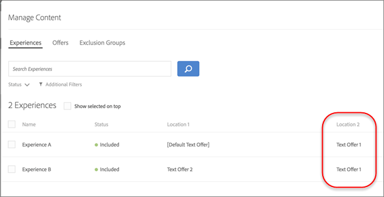
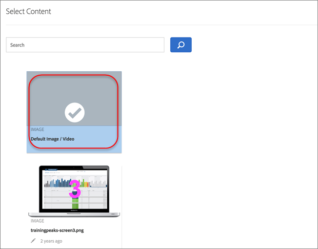

# 管理排除项 {#manage-exclusions}

>[!BEGINSHADEBOX]

**在此页面上：**&#x200B;了解如何在&#x200B;**[!UICONTROL Automated Personalization]**&#x200B;活动中阻止重复的选件、排除特定体验和排除默认内容。

>[!ENDSHADEBOX]

排除项控制&#x200B;**[!UICONTROL Automated Personalization]** (AP)活动提供哪些优惠和体验。 它们可防止同一选件显示两次，删除不兼容的选件组合，并删除默认内容，以使活动提供与您的目标和受众一致的更清晰、更相关的体验。

## 允许或禁止重复的选件 {#allow-duplicate-offers}

在AP活动中的不同位置使用选件库中的选件时，请防止重复这些选件。

例如，一个活动在具有12个选件的页面上可以有6个位置，因此同一选件可以放置在多个位置。 不允许重复的选件，这会阻止在同一活动中的不同位置同时显示同一选件。

1. 在[创建或编辑AP活动](/help/main/c-activities/t-automated-personalization/create-ap-activity.md#create-ap-activity)时，单击&#x200B;**[!UICONTROL 配置]**&#x200B;图标（）。

1. 单击&#x200B;**[!UICONTROL 允许重复的选件]**&#x200B;可根据需要打开或关闭此功能。

   

## 排除特定体验 {#exclude-experiences}

排除特定体验，以从AP活动中删除某些选件组合。 某些组合可能无法正常工作，或者您可以限制测试的体验数量以降低活动的流量要求。

1. 在[创建或编辑AP活动](/help/main/c-activities/t-automated-personalization/create-ap-activity.md#create-ap-activity)时，单击&#x200B;**[!UICONTROL 管理内容]**&#x200B;图标（）。

   “**[!UICONTROL 体验]**”列表显示了所有内容和位置选项经过排列组合而生成的各个体验。

1. 排除您不想测试的体验。

   * 要排除单个体验，请单击&#x200B;**[!UICONTROL 更多操作]**&#x200B;图标（），然后单击&#x200B;**[!UICONTROL 排除]**。
   * 要同时排除多个体验，请选中每个体验对应的复选框，然后单击&#x200B;**[!UICONTROL 排除]**。 选择一个或多个体验时，将显示&#x200B;**[!UICONTROL 排除]**&#x200B;图标。

   

   体验现已从活动中排除，其&#x200B;**[!UICONTROL 状态]**&#x200B;显示为&#x200B;**[!UICONTROL 已排除]**。

## 排除默认内容 {#exclude-default-content}

如果不希望默认内容成为AP活动的一部分，请将其排除，这样某个位置将只包含一个与默认内容不同的选件。 此方法还允许您更改页面其余部分的外观，以适合您测试的选件。 例如，要匹配选件的调色板，您可以更改页面的背景颜色并排除默认的背景颜色。

1. 在[创建或编辑AP活动](/help/main/c-activities/t-automated-personalization/create-ap-activity.md#create-ap-activity)时，选择要替换的内容，然后单击&#x200B;**[!UICONTROL 更改文本/HTML]**、**[!UICONTROL 更改图像选件]**&#x200B;或&#x200B;**[!UICONTROL 更改背景颜色]**。 可用选项因内容类型而异。

   

1. 创建新内容。

1. 单击&#x200B;**[!UICONTROL 更多操作]**&#x200B;图标（），然后单击&#x200B;**排除默认选件/包含默认选件**&#x200B;切换以排除或包含默认选件。

   <!--
   Depending on the content or offer type, the [!UICONTROL Include] checkbox is in a slightly different place. 

   For Text/HTML content: 

   

   For Image/Video content: 

   

   For background color: 

   
   -->

<!--
1. Click **[!UICONTROL Save]**.

   You can see the experiences created from the offers you specified under [!UICONTROL Manage Content]. You notice that no experiences are created in [!UICONTROL Manage Content] using the default offer you excluded. 

   

**To exclude default content using the [!UICONTROL Form-Based Experience Composer]:** 

1. While creating or editing an AP activity, click **[!UICONTROL Change Text/HTML]** or **[!UICONTROL Change Image Offer]** under **[!UICONTROL Content]**. 
1. In the dialog box, create your new content and uncheck **[!UICONTROL Include]** to the right of the default content (or uncheck the Default Image/Video in the [!UICONTROL Select Content] screen). 

   Depending on the content or offer type, the [!UICONTROL Include] checkbox is in a slightly different place. 

   For Text/HTML content: 

   

   For Image/Video content: 

   

1. Click **[!UICONTROL Save]**. 

   You can see the experiences created from the offers you specified under [!UICONTROL Manage Content]. You notice that no experiences are created in [!UICONTROL Manage Content] using the default offer you excluded. 

   
-->
