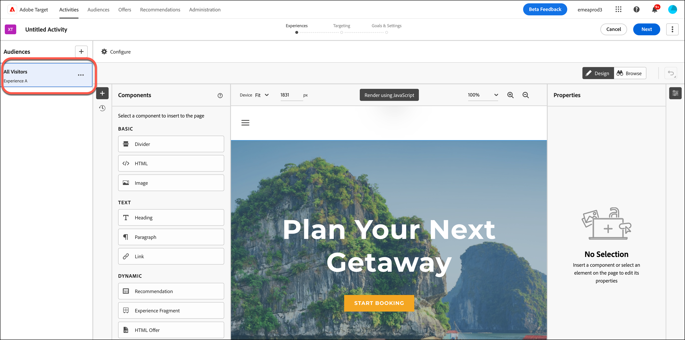
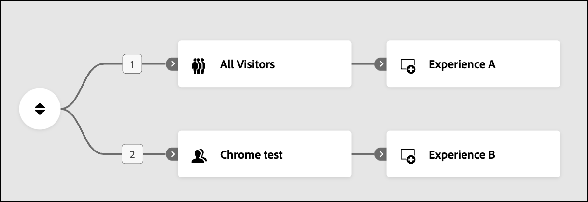
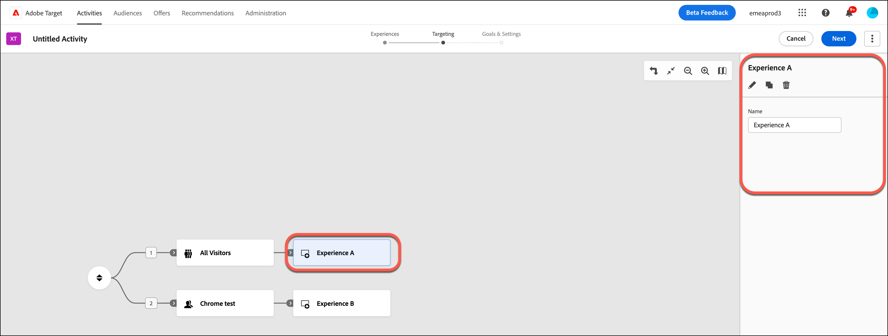

# 在[!UICONTROL 体验定位] (XT)活动中创建体验 {#xt-add-experience}

>[!BEGINSHADEBOX]

**在此页面上：**&#x200B;了解如何在体验定位活动中创建体验并将它们定位到受众、如何对它们进行排序以及如何重命名、编辑、复制或删除它们。

>[!ENDSHADEBOX]

[!DNL Adobe Target]中的&#x200B;**[!UICONTROL 可视化体验编辑器]** (VEC)提供了一个可视化界面，用于编辑&#x200B;**[!UICONTROL 体验定位]** (XT)活动中的页面上的体验。

* [创建目标体验](#create-experiences)
* [重新排序体验](#reorder-experiences)
* [重命名、编辑、复制或删除体验](#manage-experiences)

## 创建目标体验 {#create-experiences}

在[创建&#x200B;**[!UICONTROL 体验定位]**&#x200B;活动](/help/main/c-activities/t-experience-target/t-xt-create/xt-create.md)时，三步引导式工作流（**[!UICONTROL 体验]**）中的第一步会显示具有&#x200B;**[!UICONTROL 所有访客]**&#x200B;受众的默认&#x200B;**[!UICONTROL 体验A]**。

1. 选择要更改的元素，然后进行所需的更改。 您现在所做的任何更改均适用于&#x200B;**[!UICONTROL 体验A]**。

   将鼠标悬停在页面上的元素上时，这些元素会高亮显示。 任何高亮显示的元素都可以使用 VEC 进行更改。 有关为更改体验而可对元素执行的操作列表，请参阅[可视化体验编辑器选项](/help/main/c-experiences/c-visual-experience-composer/viztarget-options.md)。

   >[!NOTE]
   >
   >默认情况下，VEC 不允许更改包含 JavaScript 的元素，如旋转横幅。 您可以禁用JavaScript以使用VEC更改这些元素。

1. 若要创建其他体验，请单击“添加”**&#x200B;**（）。

   此时会显示&#x200B;**[!UICONTROL 添加受众]**&#x200B;对话框。 要将体验定位到某个受众，请在添加体验之前选择该受众。

   +++ 有关受众的更多信息

   受众库中包含以前定义的受众，其中包括作为 [!DNL Target] 的一部分预先构建的一些常用受众。 您可以从库中选择受众或[创建新受众](/help/main/c-target/c-audiences/audiences.md#concept_65BE870D290E412D8BBF557EEA67C271)。

   除了选择现有受众之外，您还可以合并多个受众以创建按需合并受众，而不是创建新受众。 有关更多信息，请参阅[合并多个受众](/help/main/c-target/combining-multiple-audiences.md#concept_A7386F1EA4394BD2AB72399C225981E5)。

   创建受众时，您可以选择位置并指定该位置的参数。 在&#x200B;**[!UICONTROL 自定义]** （**[!UICONTROL 创建受众]** > **[!UICONTROL 自定义]**）下，选择位置，然后指定所需的参数。

   打开受众列表时，系统会自动在后台导入受众，导入的受众为10分钟之前的受众。

   +++

1. 选择一个或多个要使用体验定位的受众，然后单击&#x200B;**[!UICONTROL 分配受众]**。

   **[!UICONTROL 体验B]**&#x200B;现在如上图所示，并且此体验已定位到相应的受众。

1. 选择要为此体验更改的元素，并进行所需的更改，如步骤1中所述。

1. 根据需要重复上述步骤以创建更多目标体验。

1. 完成体验设计后，请单击&#x200B;**[!UICONTROL 下一步]**。

   活动图显示如下：

   

>[!NOTE]
>
>您可以从主页以外的来源（例如在`akamai.net`上托管并在`adobe.com`上交付的图像）交付图像。 在其他位置托管的图像不会显示在流程图中所显示页面的缩略图中。

## 重新排序体验 {#reorder-experiences}

创建或编辑&#x200B;**[!UICONTROL 体验定位]**&#x200B;活动时，您可以拖放受众和体验对以按所需顺序排列它们。 将按从上到下的顺序评估访客的体验。 **[!UICONTROL 体验定位]**&#x200B;假定顺序重要。 如果访客属于第一个受众和体验对，则交付第一个体验。

要重新排列这些对，请单击“重新排列”图标（）以在右侧显示&#x200B;**[!UICONTROL 体验]**&#x200B;列，然后根据需要重新排列体验。

+++ 示例：不互斥的受众

假设您在创建&#x200B;**[!UICONTROL 体验定位]**&#x200B;活动时不知道顺序很重要。 您稍后在测试期间意识到，您认为应该符合体验B或C的访客实际上符合体验A的资格。这种情况可能是因为受众并非相互排斥，并且顺序不正确（例如，体验A =美国，体验B =旧金山，体验C =加利福尼亚）。

在此情景中，所有来自美国的用户都有资格使用体验A，即使他们位于旧金山或加利福尼亚的其他地方也是如此。 您可以重新排序受众和体验对，从限制最严格到限制最少（旧金山>加利福尼亚>美国），而无需重新创建整个活动。

+++

如果您有&#x200B;**[!UICONTROL 所有访客]**&#x200B;受众，请确保它不是图中的第一个受众。 定位到“**[!UICONTROL 所有访客]**”的体验可以用作&#x200B;**[!UICONTROL 体验定位]**&#x200B;活动中的最后一个体验，以“捕获”所有还未进入任何其他体验的访客。

## 重命名、编辑、复制或删除体验 {#manage-experiences}

单击&#x200B;**[!UICONTROL 体验定位]**&#x200B;活动图中的某个体验，可在右侧显示&#x200B;**[!UICONTROL 体验]**&#x200B;列。

根据需要，从以下选项中进行选择：

* **[!UICONTROL 重命名]**：在&#x200B;**[!UICONTROL 名称]**&#x200B;字段中键入所需的名称。
* **[!UICONTROL 编辑]**：单击“编辑”图标（），然后进行所需的更改。
* **[!UICONTROL 复制]**：复制&#x200B;**[!UICONTROL 体验定位]**&#x200B;活动中的体验，以便您可以对其进行细微更改，而无需重新创建整个体验。 单击&#x200B;**[!UICONTROL 复制]**&#x200B;图标（），然后根据需要编辑体验。
* **[!UICONTROL 删除]**：单击&#x200B;**[!UICONTROL 删除]**&#x200B;图标（），然后确认删除操作。

## 培训视频：使用可视化体验编辑器

本视频提供有关使用&#x200B;**[!UICONTROL 体验定位]** (VEC)选项的信息。

* 更改页面的内容
* 更改页面的布局

>[!VIDEO](https://video.tv.adobe.com/v/17399)
