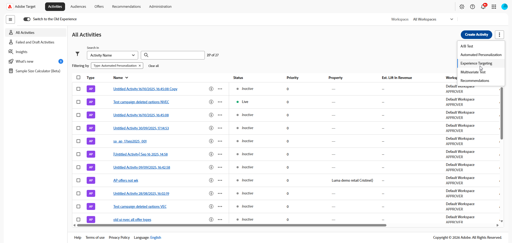
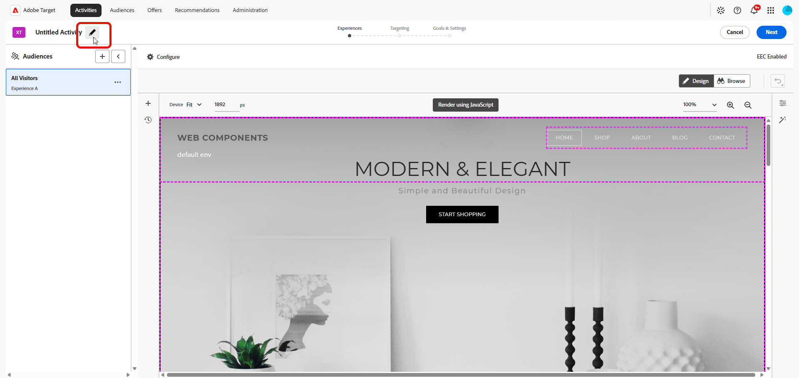

# 创建[!UICONTROL 体验定位] (XT)活动 {#create-xt-activity}

>[!BEGINSHADEBOX]

**在此页面上：**&#x200B;了解如何在&#x200B;**[!UICONTROL 可视化体验编辑器]** (VEC)中创建&#x200B;**[!UICONTROL 体验定位]** (XT)活动。 您可以创建活动，添加定位到不同受众的体验，然后配置目标和设置。

>[!ENDSHADEBOX]

使用&#x200B;**[!UICONTROL 可视化体验编辑器]** (VEC)在启用了[!DNL Target]的页面上创建&#x200B;**[!UICONTROL 体验定位]** (XT)活动，并在[!DNL Adobe Target]内修改页面的各个部分。

**[!UICONTROL 体验定位]** (XT)根据一组营销人员定义的规则和条件向特定受众提供内容。 对于定义规则以将特定体验或内容定位到特定受众（包括[地理定位](/help/main/c-target/c-audiences/c-target-rules/geo.md)）非常有用。 可以在活动中定义多个规则，以将不同的内容变体交付到不同的受众。

有关&#x200B;**[!UICONTROL 体验定位]**、用例情景和培训视频的更多信息，请参阅[体验定位](/help/main/c-activities/t-experience-target/experience-target.md)。

1. 从&#x200B;**[!UICONTROL 活动]**&#x200B;列表中，单击&#x200B;**[!UICONTROL 创建活动]** > **[!UICONTROL 体验定位]**。

   >[!NOTE]
   >
   >可用的活动类型取决于您的 [!DNL Target] 帐户。 有些活动类型可能不会显示在列表中。 例如，**[!UICONTROL Automated Personalization]**&#x200B;是[Target Premium功能](/help/main/c-intro/intro.md#premium)。
   >
   >有关 [!DNL Target] 中可用的各种活动类型及其差异的更多信息，请参阅[活动](/help/main/c-activities/activities.md#concept_D317A95A1AB54674BA7AB65C7985BA03)。 请参阅 [Target 活动类型](/help/main/c-activities/target-activities-guide.md)，以帮助您确定最符合自己需求的活动类型。

   

1. 从&#x200B;**[!UICONTROL 创建体验定位活动]**&#x200B;对话框中，选择您的体验编辑器：

   * **[!UICONTROL 可视化]**。
   * **[!UICONTROL 基于表单的体验编辑器]**，有关详细信息，请参阅[基于表单的体验编辑器](/help/main/c-experiences/form-experience-composer.md)。

   >[!NOTE]
   >
   >除了VEC和&#x200B;**[!UICONTROL 基于表单的体验编辑器]**&#x200B;之外，[!DNL Target]还提供单页应用程序VEC。 有关各种编辑器的更多信息，请参阅[体验和产品建议](/help/main/c-experiences/experiences.md)。
   >
   >有关VEC的故障诊断信息，请参阅[可视化体验编辑器故障诊断](/help/main/c-experiences/c-visual-experience-composer/r-troubleshoot-composer/troubleshoot-composer.md)。

1. （视情况而定）如果您是[!DNL Target Premium]客户，请[选择一个工作区](/help/main/administrating-target/c-user-management/property-channel/property-channel.md)。

1. 指定您的[活动URL](/help/main/c-activities/t-test-ab/t-test-create-ab/ab-activity-url.md#ab-activity-url)，然后单击&#x200B;**[!UICONTROL 创建]**。 此时会打开 VEC，其中显示了在 URL 中指定的页面。

   如果您的帐户[配置了默认 URL](/help/main/administrating-target/visual-experience-composer-set-up.md)，则默认情况下将显示该 URL。 您可以根据需要将默认 URL 更改为其他 URL。

1. 要命名该活动，请单击&#x200B;**[!UICONTROL 编辑]**&#x200B;图标（）并指定该活动的描述性名称，然后单击&#x200B;**[!UICONTROL 保存]**。

   {{activity-name-rules}}

   

1. 创建定位到不同受众的新体验。 有关分步说明，请参阅[添加体验](/help/main/c-activities/t-experience-target/t-xt-create/xt-add-experience.md#xt-add-experience)。

1. 指定活动的[目标和设置](/help/main/c-activities/t-test-ab/t-test-create-ab/ab-goals-and-settings.md#ab-goals-and-settings)。
