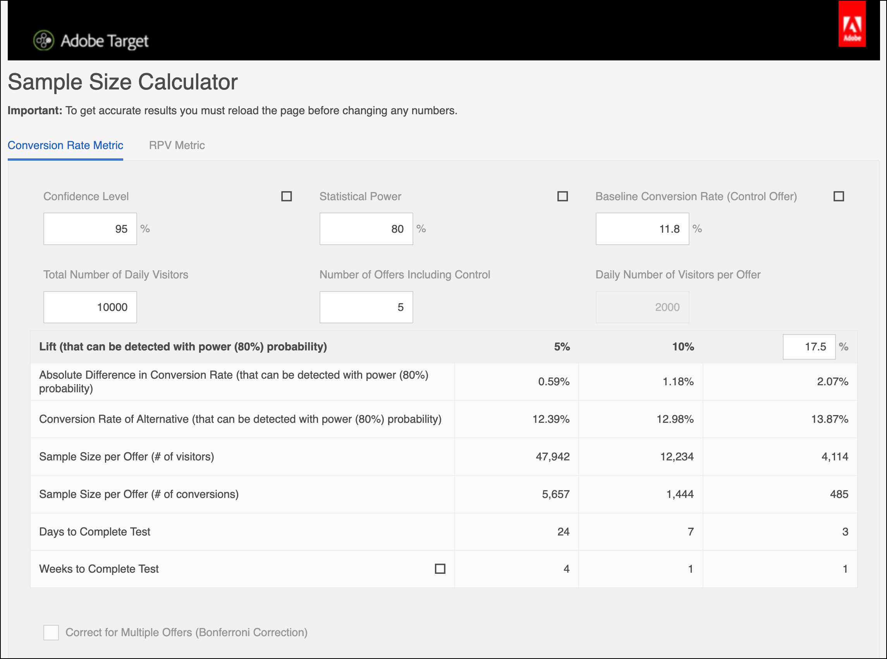
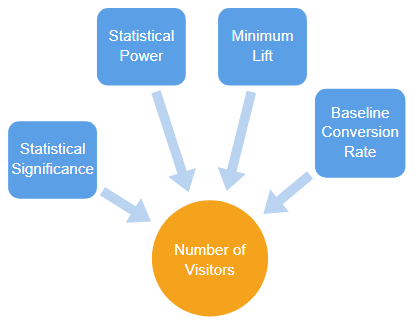
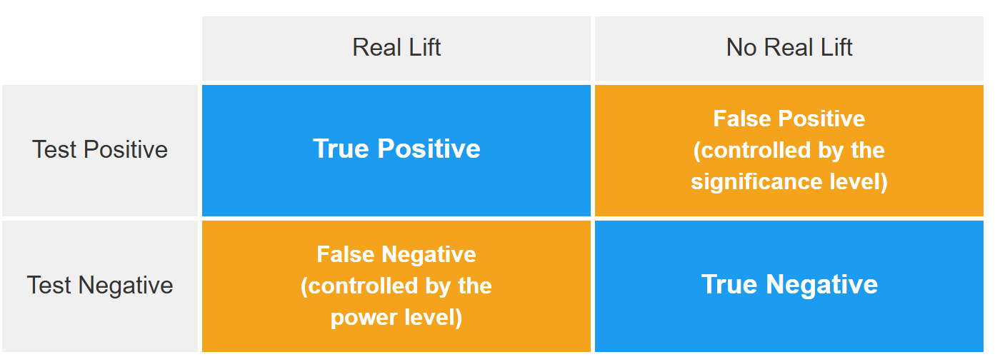
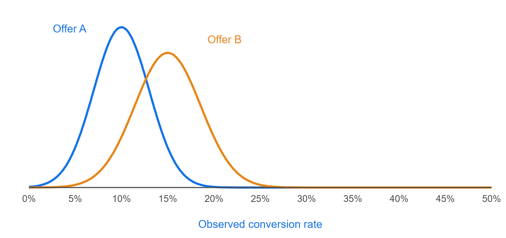
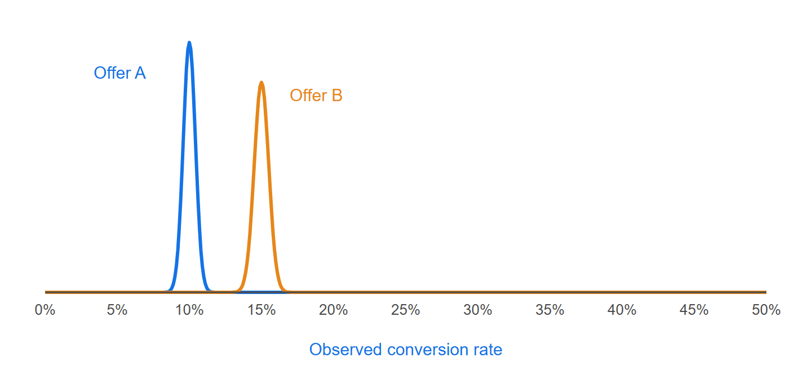
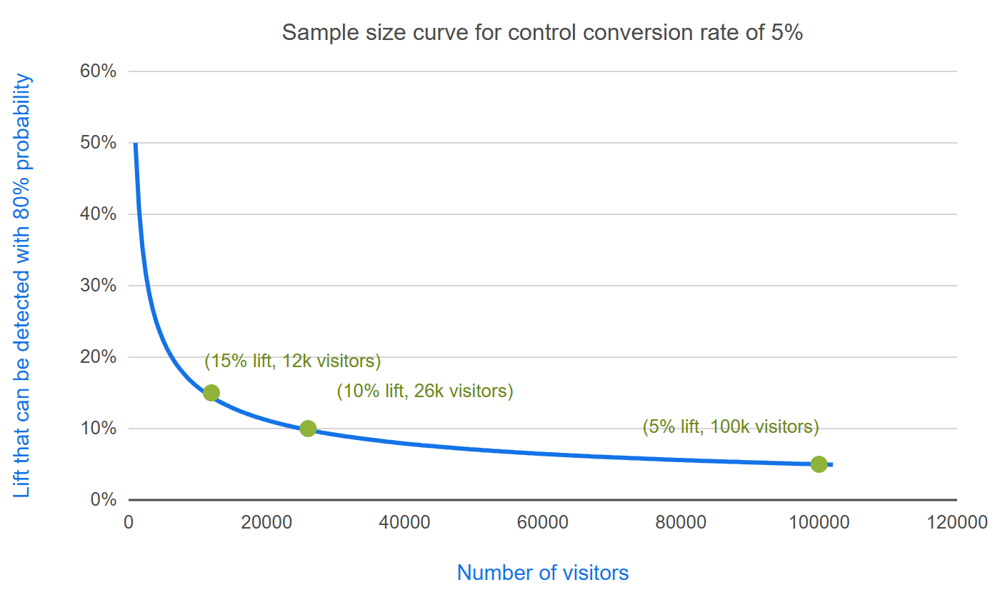

# A/B 测试应该持续多长时间？ {#sample-size-determination}

>[!BEGINSHADEBOX]

**在此页面上：**&#x200B;了解如何确定运行A/B测试的时长：为何不应提前停止活动、自动分配如何帮助以及样本量计算器的五个参数如何协同工作。

>[!ENDSHADEBOX]

在[!DNL Adobe Target]中成功的&#x200B;**[!UICONTROL A/B测试]**&#x200B;活动需要足够的访客（样本量）来提高转化率。 您如何知道运行A/B测试的时长？ 本文包含有关&#x200B;**[!UICONTROL 自动分配]**&#x200B;活动和&#x200B;**[!UICONTROL Adobe Target]**&#x200B;样本量计算器的信息，可帮助您确保活动具有足够的访客来实现您的目标。

## 为何不提前停止活动 {#stop-early}

>[!IMPORTANT]
>
>过早停止活动是执行A/B测试时可能遇到的十大隐患之一。 有关详细信息，请参阅[A/B测试常见的十个隐患以及如何避免它们](/help/main/c-activities/t-test-ab/common-ab-testing-pitfalls.md#section_DF01A97275E44CA5859D825E0DE2F49F)。

如果某个选件在活动的最初几天表现优于或低于其他选件，则很容易停止该活动。 但是，当观察数量较低时，很有可能只是偶然观察到正或负的提升，因为转化率只是少数访客的平均值。 随着活动收集的数据点越来越多，转化率会逐渐靠近真正的长期值。

[!DNL Adobe Target]提供了帮助确保您的活动具有足够大的样本量以实现您的转化目标的工具：[自动分配](#auto-allocate)和[样本量计算器](#section_6B8725BD704C4AFE939EF2A6B6E834E6)。

## 自动分配 {#auto-allocate}

[自动分配](/help/main/c-activities/automated-traffic-allocation/automated-traffic-allocation.md)活动是一种A/B测试，可在两个或更多体验中标识入选者。 **[!UICONTROL 自动分配]**&#x200B;测试会自动为入选者重新分配更多流量以提高转化，同时测试会继续运行和学习。

与标准A/B测试不同，在标准A/B测试中，流量分配保持固定且活动必须运行其整个课程，然后才能对入选者执行操作，**[!UICONTROL 自动分配]**&#x200B;会监视所有体验的目标量度性能，并相应地向高性能体验发送更多新参加者。 同时，也会保留足够的流量来探索其他体验。 有关完整说明，请参阅[自动分配概述](/help/main/c-activities/automated-traffic-allocation/automated-traffic-allocation.md)。

使用&#x200B;**[!UICONTROL 自动分配]**&#x200B;时，[!DNL Target]会在活动页面的顶部显示一个标记，在活动达到最低转化次数，且具有足够的置信度之前，该标记会一直指示“还没有入选者”。 然后，[!DNL Target]通过在活动页面的顶部显示徽章来声明入选体验。

## Adobe [!DNL Target]样本量计算器 {#section_6B8725BD704C4AFE939EF2A6B6E834E6}

如果您选择使用手动&#x200B;**[!UICONTROL A/B测试]**&#x200B;活动而不是&#x200B;**[!UICONTROL 自动分配]**，则[!DNL Target]样本量计算器可帮助您确定成功测试所需的样本量。 手动A/B测试属于固定水平测试，因此该计算器会有所帮助。 为&#x200B;**[!UICONTROL 自动分配]**&#x200B;活动使用计算器是可选的，因为&#x200B;**[!UICONTROL 自动分配]**&#x200B;为您声明了一个入选者。 计算器会给出所需样本量的粗略估计。 继续阅读可了解有关如何使用计算器的更多信息。

在设置A/B测试之前，请访问[!DNL Adobe Target] [样本量计算器](https://experienceleague.adobe.com/tools/calculator/testcalculator.html?lang=zh-Hans)。 您还可以在[!DNL Target]用户界面中使用[样本量计算器](/help/main/c-activities/sample-size-calculator.md)。

在执行任何A/B测试以确定活动应在评估结果之前运行的时间之前，确定足够的样本量（访客数）非常重要。 在达到统计显着性之前简单地监控该活动会导致置信区间被大大低估，从而使测试不可靠。 这个结果背后的直觉是，如果检测到具有统计意义的结果，则停止测试，并宣布入选者。 但是，如果结果没有统计学意义，则允许继续测试。 此过程非常容易产生正面的结果，这会增加误报率，并因此扭曲测试的有效显著性水平。

此过程可能会导致许多误报，这会导致实施的选件最终无法提供预测的提升。 提升度本身很差是一个令人不满意的结果，但更严重的后果是，随着时间的推移，无法准确预测提升度会削弱组织对测试作为一种实践的信任。

本文讨论了确定样本量时必须平衡的因素，并介绍一个计算器，用于估计适当的样本量。 在任何A/B测试开始之前，使用样本量计算器（上面提供的链接）计算样本量，这有助于确保您始终运行符合统计标准的高质量A/B测试。

有五个用户定义的参数可以对 A/B 测试进行定义。 这些参数是相互关联的，因此，当已确定其中的四个参数时，便可以计算出第五个参数：

| 参数 | 它控制的内容 | 典型值 |
|--- |--- |--- |
| [统计显着性](#section_8230FB9C6D1241D8B1786B72B379C3CD) | 对误报的容忍度有多高。 | 5%（置信度为95%） |
| [统计功效](#section_1169C27F8E4643719D38FB9D6EBEB535) | 检测转化率实际差异的概率。 | 80% |
| [最低可靠检测提升](#section_6101367EE9634C298410BBC2148E33A9) | 测试可靠检测到的最小转化率差异。 | 由您的业务需求决定 |
| [基线转化率](#section_39380C9CA3C649B6BE6E1F8A06178B05) | 控制选件（选件A）之转换率。 | 根据经验或一天左右的测试数据 |
| [访客数](#section_19009F165505429E95291E6976E498DD) | 测试所需的样本大小。 | 从其他四个报表包 |

>[!IMPORTANT]
>
>要获得准确的结果，必须在更改任何参数数字之前重新加载页面。 每次更改参数号时都重复此过程。

对于 A/B 测试，由分析人员设置统计意义、统计功效、能够可靠检测到的最小提升度和基准线转化率，然后根据这些数字计算所需的访客数量。

下图说明了 A/B 测试可能出现的四种结果：

最好不要出现误报或漏报。 但是，统计测试永远无法保证获得零误报。 始终存在这种可能的情况：观察到的趋势并不代表潜在的转化率。 例如，在测试中，看看抛硬币时正面或反面是否更有可能出现，即使投的是平价硬币，你也可以偶然在十次掷币时得到10个正面或反面。 统计意义和功效可帮助我们量化误报和漏报率，并使我们能够在给定测试中将它们保持在合理水平。

### 统计意义 {#section_8230FB9C6D1241D8B1786B72B379C3CD}

测试的显着性水平决定了测试报告两个不同选件之间的转化率存在显着差异的可能性，实际上，这种可能性并不存在实际差异。 这种情况称为误报或I型错误。 显着性级别是用户指定的阈值，它是误报容差与必须包含在测试中的访客数量之间的平衡。

在 A/B 测试中，最开始假设两种选件均具有相同的转化率。 然后根据这个假设计算观察到的结果的概率。 如果此概率（p值）小于某个预定义阈值（显着性级别），[!DNL Target]将得出结论认为，初始假设（两个选件具有相同的转化率）不正确。 因此，A和B的转化率在给定显着性水平上有统计学差异。

A/B 测试中常用的显著性水平是 5%，这与 95% 的置信水平相对应（置信度 = 100% - 显著性水平）。 95% 的置信水平意味着每次进行测试时，即使选件之间实际没有差异，也有 5% 的概率检测到具有统计意义的提升度。

下表总结了对置信水平的一般性解释：

| 置信水平 | 解释 |
|--- |--- |
| &lt; 90% | 没有证据表明转化率存在差异 |
| 90-95% | 没有充分的证据表明转化率存在差异 |
| 95-99% | 有比较充分的证据表明转化率存在差异 |
| 99-99.9% | 具有可靠的证据表明转化率存在差异 |
| +99.9% | 具有强有力的证据表明转化率存在差异 |

建议始终使用95%或以上的置信度。

最好使用尽可能最高的置信水平，以便测试产生很少的误报。 然而，置信水平越高，所需的访客数量就越多，从而增加测试所需的时间。 此外，置信水平的提高会导致统计功效下降。

### 统计功效 {#section_1169C27F8E4643719D38FB9D6EBEB535}

A/B 测试的统计功效是指检测到转化率之间存在一定量级实际差异的概率。 由于转化事件的随机（随机）性质，即使两个选件的转化率存在实际差异，也可能不会观察到具有统计意义的差异（只是偶然）。 这种情况称为误报或类型II错误。

统计功效往往会被忽略，因为与统计意义相比，统计功效并不是进行 A/B 测试所必需的。 但是，如果忽略统计功效，则很有可能由于样本量太小，导致测试无法检测到不同选件转化率之间的实际差异。 这种情况导致测试被误报主导。

最好设置较高的统计功效，这样测试识别到转化率之间实际差异的可能性较高，并减少漏报的产生。 但是，需要更多的访客才能提高检测任何给定提升的统计能力，从而增加测试所需的时间。

统计功效的常用值为 80%，这意味着测试有 80% 的概率可以检测到与能够可靠检测到的最小提升度相等的差异。 该测试检测到更小提升度的概率较低，而检测到更大提升度的概率较高。

### 能够可靠检测到的最小提升度 {#section_6101367EE9634C298410BBC2148E33A9}

大多数组织都想要测量转化率中的最小可能差异，因为即使只是小幅提升也值得实施。 但是，如果您希望A/B测试具有较高检测较小提升的概率，则必须在测试中包含的访客数量会大到令人望而却步。 这是因为，如果转化率差异很小，则必须高准确度地估计这两个转化率才能确定差异，这需要许多访客。 因此应根据业务需求，在检测到较小提升度和花费更长时间运行测试这两者之间进行权衡，来确定能够可靠检测到的最小提升度。

+++ 示例：100位访客，而5,000位访客

例如，假设两个选件（A 和 B）分别具有 10% 和 15% 的真正转化率。 如果每个选件向 100 位访客显示，则由于转化的随机性，有 95% 的概率可观察到选件 A 的转化率范围为 4% 到 16%，观察到选件 B 的转化率范围为 8% 至 22%。 这些范围在统计学中被称为置信区间。 它们表示对估算转化率准确度的置信度。 样本量越大（访客越多），您就可以越确信估算转化率的准确度。

下图显示了这些概率的分布情况。

由于两个范围之间的叠加部分较大，因此测试无法确定转化率是否有差异。 因此，这个包含 100 位访客的测试无法区分这两种选件。 但是，如果[!DNL Target]向5,000位访客分别公开这些选件，则观察到的转化率有95%的可能性分别落在9%到11%和14%到16%的范围内。

在这种情况下，测试不太可能得出错误的结论，因此这项包含5000名访客的测试可以区分这两种选件。 对于5,000位访客的测试，置信区间为+/-1%。 这意味着该测试可以检测到约1%的差异。 因此，如果选件的实际转化率为 10% 和 10.5%，而不是 10% 和 15%，则需要更多的访客。

+++

### 基准线转化率 {#section_39380C9CA3C649B6BE6E1F8A06178B05}

基准线转化率是指控制选件（选件 A）的转化率。 通常，您会根据经验了解选件的转化级别。 如果情况并非如此，例如，因为这是一个新的选件或创意，则可以让测试运行一天左右，以便粗略估算可在样本量计算中使用的基准线转化率。

### 访客数量 {#section_19009F165505429E95291E6976E498DD}

要在长时间运行测试的机会成本与产生误报和漏报的风险之间达到平衡，是一件非常困难的事。 显然，您不想做出错误的决定，但因遵守过于严格或苛刻的测试标准而陷于困扰也是不可取的。

作为一般指导原则，建议您使用 95% 的置信水平和 80% 的统计功效。

样本量计算器（上面提供的链接）需要您确定统计意义（建议：95%）和统计功效（建议：80%）。 在输入基准线转化率和所有选件的每日流量之后，电子表格会输出检测到 1%、2%、5%、10%、15% 和 20% 提升度所需的访客数量，检测到这些提升度的概率等于为该测试指定的功效。 电子表格还允许用户输入可靠检测到的最小自定义提升度。 此外，电子表格会根据用户输入的流量级别输出测试所需的周数。 所需的周数会四舍五入到最接近的整周，以避免星期几影响结果。

在测试中可以确定的最小提升度和所需的访客数量之间存在一个权衡问题。 下图显示了随着访客数量增加，收益大幅递减（该数据对基准线（控制）转化率为 5% 时有效）。 在将最初的几位访客添加到测试中时，能够可靠检测到的最小提升度大大增加，但之后需要越来越多的访客来改进测试。 该图表有助于在运行测试所需的时间（由所需访客数量和网站流量决定）与测试能够可靠检测到的最小提升度之间找到充分的权衡。

+++ 示例：计算运行测试的时间

在此示例中，您可能会认为在100次测试中有80次能够检测到100%(相当于替代选件具有(100%+5%)&#42;5% = 5.25%的转化率)的提升度便已足够，因此您需要每个选件的样本量为100,000位访客。 如果网站每天有2万名访客，并且您正在测试两个选件，则应该允许测试运行2&#42;100,000/20,000 = 10天，然后才能确定替代选件是否在统计上显着优于控制选件。

再次建议将所需的时间始终四舍五入至最接近的整周，以避免出现周内效应。 因此在本例中，在评估结果之前，测试将会运行两周。

+++

### “每次访问带来的收入”量度 {#section_C704C0861C9B4641AB02E911648D2DC2}

将每次访问收入(RPV)用作量度时，会添加额外的差异源，因为RPV是每订单收入和转化率`(RPV = Revenue / #visitors = (Revenue per order &#42; #orders) / # visitors = Revenue per order &#42; (#visitors &#42; CTR) / #visitors = Revenue per Order &#42; CTR)`的乘积，每个都有自己的差异。 兑换率的差异可使用数学模型直接估计，但每订单收入的差异特定于活动。 因此，应使用来自过去活动的此差异知识或运行A/B测试数天来估计收入差异。 差异是根据CSV下载文件中找到的销售额总和、销售额平方和以及访客数的值计算的。 建立之后，使用电子表格计算完成测试所需的时间。

样本量计算器（上文提供了链接）可帮助您配置 RPV 量度。 打开计算器时，您将看到一个标签为&#x200B;**[!UICONTROL RPV量度]**&#x200B;的选项卡。 在使用计算器的RPV版本时，您将需要以下信息：

* 控制选件的访客数量
* 控制选件的总收入

  确保选择极端顺序过滤器。

* 控制选件的收入平方和

  确保选中极端顺序过滤器。

一般而言，将RPV用作量度需要20-30%的时间才能获得与测量到的提升水平相同的统计置信水平。 这是因为RPV具有每个转化中不同订单大小的附加方差。 在选择直接转化率和RPV作为最终业务决策所依据的指标时，应考虑这一点。

## 对多个选件的比较进行校正 {#section_1474113764224D0B85472D8B023CCA15}

每次比较两个产品建议时，获得误报（即：即使转化率没有差异，也观察到具有统计意义的显著差异）的概率等于显著性水平。 例如，如果有五个选件 A/B/C/D/E，A 是控制选件，且已经完成了四组比较（控制选件与 B，控制选件与 C，控制选件与 D，控制选件与 E）；那么即使当置信水平为 95% 时，由于 Pr（至少一个误报）= 1 - Pr（无误报）= 1 - 0.954 = 18.5%，误报的概率也有 18.5%。 在这种情况下，误报的定义为：报告的控制选件优于替代选件，或者报告的替代选件优于控制选件，但实际上它们之间没有区别。
