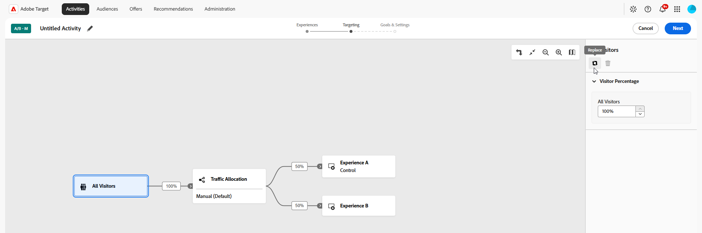

# 选择受众 {#select-audience}

>[!BEGINSHADEBOX]

**在此页面上：**&#x200B;了解如何选择、创建、合并、查看、编辑和复制A/B活动的受众，以及如何设置要包含的访客百分比。

>[!ENDSHADEBOX]

受众可确定哪些符合条件的访客进入了您的[!DNL Adobe Target]活动。

在[创建活动](/help/main/c-activities/t-test-ab/t-test-create-ab/test-create-ab.md)时，三步引导式工作流的&#x200B;**[!UICONTROL 定位]**&#x200B;步骤会显示流程图，该流程图将引导您完成以下步骤：分配受众及其流量百分比、选择流量分配方法并为活动中的每个体验指定流量分配。

有关流程图中所有选项的更多信息，请参阅[创建A/B测试活动](/help/main/c-activities/t-test-ab/t-test-create-ab/test-create-ab.md)。

## 选择活动的受众

受众可控制哪些人会看到您的活动。 只有与受众匹配的访客才能进入该受众，并且您可以决定参加该受众的访客份额。 默认情况下，活动会定位所有访客。

1. 单击&#x200B;**[!UICONTROL 所有访客]**&#x200B;控件为该活动选择其他受众。

   **[!UICONTROL 所有访客]**&#x200B;是默认受众。 对于没有特定受众定位的A/B测试，请保留默认值。 如果选择其他受众，则其名称将显示在最左侧的控件中。

1. 单击&#x200B;**[!UICONTROL 替换]图标** （ ）。

   

1. 在&#x200B;**[!UICONTROL 添加受众]**&#x200B;对话框中，浏览从&#x200B;**[!UICONTROL 受众库]**&#x200B;中选择的受众，或者您可以创建仅限该活动的受众。

   **[!UICONTROL 受众库]**&#x200B;包含以前定义的受众，包括一些作为[!DNL Target]的一部分预先构建的常见受众。

   

1. 单击受众旁边的&#x200B;**[!UICONTROL 信息]**&#x200B;图标（）可查看有关该受众的详细信息，包括其源和属性。

   

   您还可以单击&#x200B;**[!UICONTROL 查看完整详细信息]**&#x200B;查看有关受众的其他详细信息。

1. （视情况而定）单击&#x200B;**[!UICONTROL 合并受众]**&#x200B;以[创建合并多个受众的受众](/help/main/c-target/combining-multiple-audiences.md)。

   +++ 创建新受众的步骤

   若要创建不在&#x200B;**[!UICONTROL 受众库]**&#x200B;中的新受众，请单击&#x200B;**[!UICONTROL 创建受众]**，定义受众，然后单击&#x200B;**[!UICONTROL 完成]**。

   在[创建受众工作流](/help/main/c-target/c-audiences/audiences.md)期间，您可以从以下选项中进行选择：

   * **[!UICONTROL 受众库]**：创建保存到&#x200B;**[!UICONTROL 受众库]**&#x200B;的按需受众，该受众可在其他活动中重复使用。
   * **[!UICONTROL 仅限此活动]**：创建未保存到&#x200B;**[!UICONTROL 受众库]**&#x200B;且只能用于当前活动的[特定活动受众](/help/main/c-target/creating-activity-only-audience.md)。

   +++

1. 您可以通过单击所需受众旁边的&#x200B;**[!UICONTROL 更多操作]**&#x200B;图标（）来编辑或复制受众。

1. 选择受众后，单击&#x200B;**[!UICONTROL 分配受众]**。

1. 单击右侧窗格中的&#x200B;**[!UICONTROL 访客百分比]**，然后指定要包含在活动中的符合条件的访客的百分比。

1. 如果对受众满意，请单击&#x200B;**[!UICONTROL 下一步]**&#x200B;以进入三步引导式工作流的第三步。

>[!NOTE]
>
>打开&#x200B;**[!UICONTROL 受众]**&#x200B;列表时，会在后台自动导入受众，导入的受众为10分钟之前的受众。
