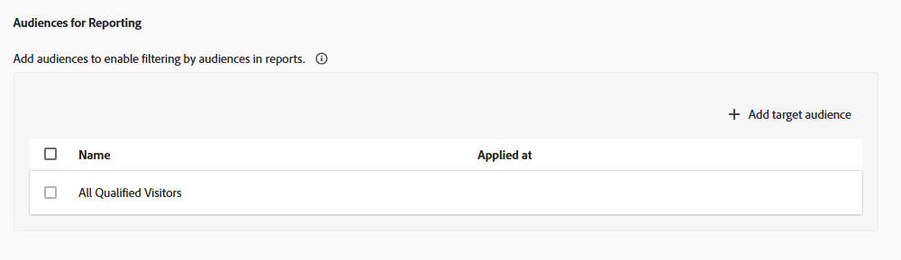

# 目标和设置 {#ab-goals-and-settings}

>[!BEGINSHADEBOX]

**在此页面上：**&#x200B;了解可以在A/B、体验定位(XT)或多变量测试(MVT)活动的&#x200B;**[!UICONTROL 目标和设置]**&#x200B;页面上设置的内容：活动设置、报表设置、高级设置和注释。

>[!ENDSHADEBOX]

在[!DNL Adobe Target]中的&#x200B;**[!UICONTROL 目标和设置]**&#x200B;页面中，您可以指定有关活动目标的信息。

可用的设置取决于您是使用Target还是[Analytics作为报表源](/help/main/c-integrating-target-with-mac/a4t/a4t.md)。

相同的设置适用于[!UICONTROL 体验定位] (XT)和[!UICONTROL 多变量测试] (MVT)活动，但[统计方法](#section_statistical-methodology)除外，它仅适用于A/B活动。

* [活动设置](#section_DCBDC354261F420EBD4B43EA34947BAC)：目标、优先级和持续时间
* [报表设置](#section_13119392051044FBA6387D9B3B1C43CF)：报表源、目标量度、其他量度和受众
* [高级设置](#section_E2FE441AFB324E498793ABB025ED9974)：依赖关系以及访客实现目标后发生的情况
* [统计方法](#section_statistical-methodology)：如何分析结果
* [其他元数据](#section_2E8917BEFB954480A4206B9E9E917F80)：注释

## [!UICONTROL 活动设置] {#section_DCBDC354261F420EBD4B43EA34947BAC}

通过&#x200B;**[!UICONTROL 目标和设置]**&#x200B;页面的&#x200B;**[!UICONTROL 活动设置]**&#x200B;部分，可配置以下选项。

### 目的 {#objective}

键入一个可选目的。 目标可以是任何有助于您和您的团队成员识别活动的信息。

### 优先级 {#priority}

如果将具有相同受众的多个活动分配到同一个位置，则需使用优先级。 如果将两个或更多活动分配到同一个位置，则会显示具有最高优先级的活动。

根据您的设置，**[!UICONTROL 优先级]**&#x200B;的[!DNL Target] UI和选项会有所不同：

* **旧版优先级（默认）：**&#x200B;如果未在&#x200B;**[!UICONTROL 管理]**&#x200B;中启用此选项（默认），请指定优先级&#x200B;**[!UICONTROL 低]**、**[!UICONTROL Medium]**&#x200B;或&#x200B;**[!UICONTROL 高]**。
* **细粒度优先级：**&#x200B;指定从0到999的值，其中0 = **[!UICONTROL 低]**&#x200B;和999 = **[!UICONTROL 高]**。

  若要启用[细粒度优先级](/help/main/administrating-target/reporting.md)，请访问&#x200B;**[!UICONTROL 管理]** > **[!UICONTROL 报告]**，然后切换&#x200B;**[!UICONTROL 启用细粒度优先级]**&#x200B;选项。

对于在以前版本的[!DNL Target]中创建的活动，**[!UICONTROL 低]**&#x200B;优先级已转换为0，**[!UICONTROL Medium]**&#x200B;已转换为5，**[!UICONTROL 高]**&#x200B;已转换为10。 您可以根据需要调整这些值。

>[!NOTE]
>
>在使用细粒度优先级后，您可以禁用这些优先级，但在此之前，必须将所有优先级重新设置为0、5、10。

### 持续时间 {#duration}

活动可以在获得批准时开始，或者您也可以设置特定的日期和时间。 同样，活动可以在停用时结束，或者您也可以设置特定的日期和时间。

时间选择器使用的是 24 小时制时钟，其中 00:00 表示午夜。 时区设置为在浏览器中配置的时区。 要使用不同的时区，请将浏览器设置为其他时区并重新启动浏览器。

## [!UICONTROL 报表设置] {#section_13119392051044FBA6387D9B3B1C43CF}

通过&#x200B;**[!UICONTROL 目标和设置]**&#x200B;页面的&#x200B;**[!UICONTROL 报表设置]**&#x200B;部分，可配置以下选项。

### 报表源 {#reporting-source}

指定从以下来源收集解决方案数据：

* [!DNL Adobe Target]

* [!DNL Adobe Analytics]

  +++ 关于将Analytics作为报表源的更多信息

  请参阅[将 Adobe Analytics 作为 Target 报表源](/help/main/c-integrating-target-with-mac/a4t/a4t.md)，以了解各种报表解决方案之间的差异以及每种解决方案的优点。 选择[!DNL Analytics]作为[!DNL Target]的报告源时，请选择一个[!DNL Analytics]报告包来接收[!DNL Target]活动数据。

  要指定报表源，请先从您的帐户绑定的[!DNL Analytics]家公司中选择任意，然后为活动选择合适的报表包。 只有配置为连接到[!DNL Adobe Target]的报表包才可供选择。 如果您没有看到预期的报表包，请先尝试注销并重新登录到[!DNL Adobe Experience Cloud]以重试。 如果列表中仍缺少报表包，请联系客户关怀团队。

  [!DNL Analytics for Target] (A4T)需要跟踪服务器才能正确报告结果。 默认跟踪服务器显示在&#x200B;**[!UICONTROL 跟踪服务器]**&#x200B;字段中。 如果使用多个跟踪服务器，请确保在此字段中包含正确的跟踪服务器。 有关详细信息，请参阅[使用Analytics跟踪服务器](/help/main/c-integrating-target-with-mac/a4t/analytics-tracking-server.md#task_72077BA7E93C4A65A715A18F32228823)。
  +++

* [!DNL Adobe Customer Journey Analytics]

  +++ 关于将Customer Journey Analytics作为报表源的更多信息

  有关[!DNL Customer Journey Analytics]中支持的活动类型、沙盒和数据视图选择、目标量度和报表设置，请参阅[[!DNL Target] 在 [!DNL Adobe Customer Journey Analytics]](/help/main/c-integrating-target-with-mac/cja/target-reporting-in-cja.md)中报告。
  +++

如果在[帐户设置](/help/main/administrating-target/reporting.md)中指定了报表源，则会使用指定的报表源，并且此设置不可见。

在活动启动后，为保持报表一致，您不能更改报表源。

### 目标量度 {#goal-metric}

>[!NOTE]
>
>如果报表解决方案设置为[!DNL Analytics]，则唯一可用的目标量度是&#x200B;**[!UICONTROL 转化]**。 无法选择[!DNL Analytics]指标作为目标。

选择访客为实现目标而执行的操作。 例如，选择一个&#x200B;**[!UICONTROL 转化]**&#x200B;量度，然后设置用于确定何时获得成功的参数。

有关设置量度的更多信息，请参阅[设置量度](/help/main/c-activities/t-test-ab/t-test-create-ab/ab-set-metrics.md)。

有关更多选项，请单击目标量度旁边的&#x200B;**[!UICONTROL 更多]**&#x200B;图标，然后单击&#x200B;**[!UICONTROL 高级设置]**。 请参阅[高级设置](#section_E2FE441AFB324E498793ABB025ED9974)。

如果启用，**[!UICONTROL 转化的预计值]**&#x200B;字段会为您的目标提供一个值，但此值不适用于其他量度。 以下几点适用于此字段：

* 该值允许[!DNL Target]计算预计收入提升。
* 字段是可选的；但是，如果没有该字段，则无法计算任何非收入量度的增量收入。
* 该字段不适用于&#x200B;**[!UICONTROL 页面得分]**&#x200B;量度。
* 对于所有收入量度（**[!UICONTROL 每位访客带来的收入]**、**[!UICONTROL 平均订单值]**、**[!UICONTROL 总销售额]**&#x200B;和&#x200B;**[!UICONTROL 订单数]**），估计将使用&#x200B;**[!UICONTROL 每位访客带来的收入]**。 数据类型为货币。

### 其他量度 {#additional-metrics}

如果报表解决方案设置为[!DNL Analytics]，则此设置不可用。 在这种情况下，将应用为[!DNL Analytics]报表包定义的量度。

### 报表的受众 {#audiences-for-reporting}

默认情况下，报表会显示所有符合条件的访客的结果信息。 您可以添加报表受众，以仅显示与特定受众相关的信息。

请注意，如果您选择[!DNL Analytics]作为报表解决方案，则此设置不可用。 将应用为[!DNL Analytics]报表包定义的受众。

## 高级设置 {#section_E2FE441AFB324E498793ABB025ED9974}

通过&#x200B;**[!UICONTROL 目标和设置]**&#x200B;页面的&#x200B;**[!UICONTROL 高级设置]**&#x200B;部分，可配置高级选项。

要指定高级设置，请单击&#x200B;**[!UICONTROL 我的主要目标]**&#x200B;部分中的&#x200B;**[!UICONTROL 更多]**&#x200B;图标（），然后单击&#x200B;**[!UICONTROL 高级设置]**。

>[!NOTE]
>
>如果您将 [!DNL Adobe Analytics] 用作报表源，则设置会由 [!DNL Analytics] 服务器来管理。 高级设置选项不可用。

### 递增此量度之前必须实现哪些成功量度？ {#dependencies}

使用此选项可仅将之前达到不同成功量度的用户计为已达到成功量度。 例如，活动转化可能只有在转化之前访客点击了选件或访问了某个特定页面时才有效。

您可以提供对多个量度的依赖关系，并且还可以灵活选择是否应实现指定的量度才能递增计数。 在使一个量度依赖于另一个量度之前，定义两个（或多个）成功量度。 通过“**[!UICONTROL 添加依赖项]**”选项，可以指定是否要先实现其他成功量度，然后才能递增该成功量度。

要添加依赖项，请执行以下操作：

1. 添加其他量度后，单击&#x200B;**[!UICONTROL 高级设置]**。

1. 单击&#x200B;**[!UICONTROL 添加依赖项]**&#x200B;选项。

1. 拖放所需的量度，然后单击&#x200B;**[!UICONTROL 已实现]**&#x200B;以在&#x200B;**[!UICONTROL 已实现]**&#x200B;和&#x200B;**[!UICONTROL 未实现]**&#x200B;之间切换设置。

添加依赖项后，您可以编辑或删除依赖项。

### 用户遇到此目标量度后会出现什么情况？ {#after-goal}

实现活动目标后，访客可继续查看活动内容，除非该访客有资格参加更高优先级的活动。 如果访客再次实现目标，则会计为另一次转化。 这不同于[!DNL Target Classic]中的默认行为，如果访客再次看到该活动，则将其计为新访客。

对于访客实现此目标量度后会出现的情况，提供了以下三个选项：

* **[!UICONTROL 递增计数并保持用户处于活动中]**&#x200B;以指定递增计数的方式。
* **[!UICONTROL 递增计数、释放用户并允许再次进入]**，以指定用户再次进入活动时看到的体验。
* **[!UICONTROL 递增计数、释放用户并阻止再次进入]**，以指定用户看到的内容而非活动内容。

### 如何对增量进行计数？ {#count-increment}

递增计数的方式包括以下三种：

* 每个参加者&#x200B;**[!UICONTROL 一次]**
* 每次展示时&#x200B;**[!UICONTROL （不包括页面刷新）]**
* 每次展示时&#x200B;**&#x200B;**

请参阅[成功量度](/help/main/c-activities/r-success-metrics/success-metrics.md#overview)，以了解有关高级设置的更多信息。

## 统计方法 {#section_statistical-methodology}

通过&#x200B;**[!UICONTROL 目标和设置]**&#x200B;页面的&#x200B;**[!UICONTROL 统计方法]**&#x200B;部分，可选择如何分析实验结果。

### 方法选项 {#methodology-options}

此选项确定用于此活动的&#x200B;**[!UICONTROL 转化]**&#x200B;目标量度的统计框架、结果量度和决策标准：

* **[!UICONTROL Bayesian]：**&#x200B;基于概率的决策，可在数据到达时更新信念，并支持连续监控和较小的样本量。 结果表示为一个变体优于另一个变体的概率，例如“92%的概率变体B胜过控制”。
  * 最适合较小样本量、持续监控、偏好概率的利益相关者或您先前通过测试了解的情况来进行应用。
  * 如果您需要严格的法规或合规性签发，或者需要传统的p值，则不是理想之选。
  * 报告显示了&#x200B;**[!UICONTROL 击败控制项]**&#x200B;的机会和一个可靠的间隔而不是频率最高的&#x200B;**[!UICONTROL 置信度]**&#x200B;列。
* **[!UICONTROL Welch的t检验(Frequentist)]：**&#x200B;现有的传统假设检验方法。 使用p值，并需要固定的样本大小。 报表显示&#x200B;**[!UICONTROL 置信度]**&#x200B;百分比和置信区间。

此设置仅适用于主要目标指标为&#x200B;**[!UICONTROL 转化]**&#x200B;的活动。 具有&#x200B;**[!UICONTROL 收入]**&#x200B;或&#x200B;**[!UICONTROL 参与]**&#x200B;主要目标的活动始终使用&#x200B;**[!UICONTROL Welch的t检验]**。

有关每个方法的计算和报告方式的更多信息，请参阅[A/Bn测试中的统计计算](/help/main/c-reports/statistical-methodology/statistical-calculations.md)。

### 贝叶斯配置 {#bayesian-configuration}

仅当选择&#x200B;**[!UICONTROL Bayesian]**&#x200B;作为&#x200B;**[!UICONTROL 统计方法]**&#x200B;时，此设置才会显示。 配置以下选项：

* **[!UICONTROL 可信间隔]**：设置实际效果预计会下降的范围。
* **[!UICONTROL 决策阈值]**：设置变量在宣布入选者之前必须达到的最小概率（相对于&#x200B;**[!UICONTROL 控制]**）。
* **[!UICONTROL 是否使用过去测试的先验知识？]**：打开此选项以提供过去性能的先验知识，以通知&#x200B;**[!UICONTROL Bayesian]**&#x200B;计算。

## 其他元数据 {#section_2E8917BEFB954480A4206B9E9E917F80}

通过&#x200B;**[!UICONTROL 目标和设置]**&#x200B;页面的&#x200B;**[!UICONTROL 其他元数据]**&#x200B;部分，您可以指定任何有助于自己或其他团队成员随时掌握的活动相关信息。
