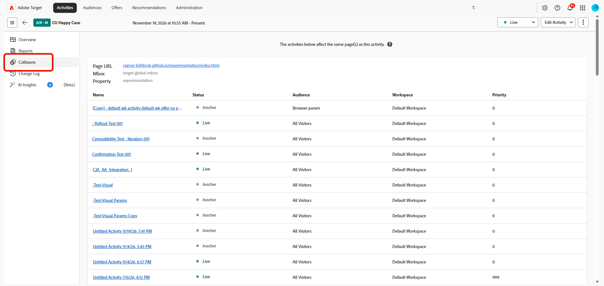

# 活动冲突 {#activity-collisions}

>[!BEGINSHADEBOX]

**在此页面上：**&#x200B;了解如何使用&#x200B;**[!UICONTROL 冲突]**&#x200B;选项卡来查找可能将内容交付到同一页面的活动。

>[!ENDSHADEBOX]

当多个活动被设置为将内容发布到同一页面时，就会发生活动冲突。 如果发生活动冲突，页面上可能不会显示预期的内容。

[!DNL Adobe Target]中“**[!UICONTROL 活动概述]**”页面上的“**[!UICONTROL 冲突]**”选项卡列出了网站上的活动冲突，并显示活动是否包含潜在的冲突。 **[!UICONTROL 冲突]**&#x200B;列表有助于：

* 在设置新活动之前，识别页面上是否已在运行测试
* 在未显示预期内容时，对活动进行故障诊断

## 访问“冲突”选项卡 {#access-collisions}

单击&#x200B;**[!UICONTROL 活动]**，从列表中单击所需的活动，然后访问&#x200B;**[!UICONTROL 冲突]**&#x200B;菜单。

同一 URL 上的所有活动均会列出，而不考虑每个活动中的任何受众定位。 选项卡列出了可能冲突的活动。 如果冲突改变了预期体验，则需编辑相应的活动。

## 阅读冲突列表 {#collisions-list}

**[!UICONTROL 冲突]**&#x200B;列表显示每个使用mbox且使用相同URL的[!DNL Target]方案。 对于每个潜在冲突，此列表都会显示活动URL、发生冲突的mbox名称以及任何符合这两个条件的活动。 如果存在多个 mbox，则会列出每个 mbox。

该列表还会显示每个潜在冲突的状态和优先级，以及其他信息。 状态和优先级有助于确定发生冲突的可能性。 对于两个可能冲突的活动：

* 如果一个活动当前未处于活动状态，则不会发生冲突。 仅当非活动处于活动状态时，才可能出现冲突。
* 如果具有相同优先级和相同受众的两个实时活动之间存在潜在冲突，则会发生冲突。 可以更改优先级或状态以防止冲突。
* 如果受众不同，则仍可能存在冲突，因为特定访客可能属于多个受众。
