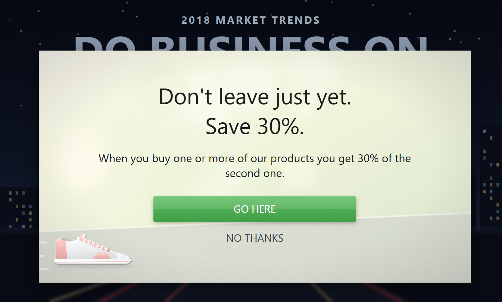

# 体验模板 {#experience-templates}

>[!BEGINSHADEBOX]

**在此页面上：**&#x200B;查找可在自定义代码中使用的[!DNL Adobe Target]体验模板，以及每个模板的常用内容。

>[!ENDSHADEBOX]

[!DNL Adobe Target]体验模板是带有可配置输入的预编码示例，用于执行常见的营销人员用例。 它们作为执行常见用例的起点，通过VEC或基于表单的体验编辑器免费提供给开发人员和营销人员。

Adobe Marketing Cloud GitHub上当前提供以下模板： [Target-Experience-Templates](https://github.com/Adobe-Marketing-Cloud/target-experience-templates)。

## 包含缩览图的横幅轮播 {#banner-carousel-thumbnails}

[包含缩览图的横幅轮播体验模板](https://github.com/Adobe-Marketing-Cloud/target-experience-templates/tree/master/banner-carousel-thumbnails)是一个旋转轮播，通常用于主页和登陆页面或其他大容量条目页面。 此轮播不会自动旋转图像。 通过单击主图像下方的较小图像，可以直接与它交互。

## 横幅轮播 {#banner-carousel}

[横幅轮播体验模板](https://github.com/Adobe-Marketing-Cloud/target-experience-templates/tree/master/banner-carousel)是一个旋转轮播，通常用于主页和登陆页面或其他大容量条目页面。 此轮播不会自动旋转图像。 可通过单击左右箭头直接与进行交互。

## 横幅倒计时 {#banner-countdown}

[横幅倒计时体验模板](https://github.com/Adobe-Marketing-Cloud/target-experience-templates/tree/master/banner-countdown)是一个在中心包含倒计时的大型横幅，通常用于主页和登陆页面或其他大容量条目页面。

## 按钮生成器 {#button-builder}

[按钮生成器体验模板](https://github.com/Adobe-Marketing-Cloud/target-experience-templates/tree/master/button)是一个带有文本行动动员的小按钮。 按钮可配置。 它可放置在页面上的任何位置，用于添加新的call to action，或使用可配置性更强的替代项替换现有按钮。

## 包含倒计时的灯箱 {#lightbox-countdown}

[包含倒计时的灯箱体验模板](https://github.com/Adobe-Marketing-Cloud/target-experience-templates/tree/master/lightbox-countdown)是一个在中心包含倒计时的灯箱覆盖弹出窗口，通常用于主页和登陆页面或其他大容量条目页面。

## 具有退出意图的灯箱 {#lightbox-exit-intent}

[具有退出意图的灯箱体验模板](https://github.com/Adobe-Marketing-Cloud/target-experience-templates/tree/master/lightbox-exit-intent)是一个在退出意图上触发的灯箱覆盖弹出窗口（将鼠标移动到屏幕的右上方）。 它可以部署在需要最后吸引注意力的任意Web资产上。

## 灯箱 {#lightbox}

[灯箱体验模板](https://github.com/Adobe-Marketing-Cloud/target-experience-templates)是一个带有内置延迟的灯箱覆盖弹出窗口，通常用于主页和登陆页面或其他大容量条目页面。

## 功能区 {#ribbon}

[功能区体验模板](https://github.com/Adobe-Marketing-Cloud/target-experience-templates/tree/master/ribbon)是插入网页最顶部的100%宽度功能区。 它通常用于指示闪购、免运费、安全或天气事件或其他重要公告。

