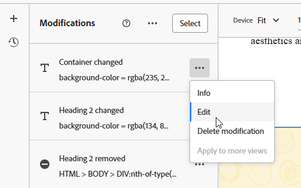

# 修改入门 {#vec-code-editor}

>[!BEGINSHADEBOX]

**在此页面上：**&#x200B;了解如何在[!UICONTROL 可视化体验编辑器] (VEC)的&#x200B;**[!UICONTROL 修改]**&#x200B;面板中查看、编辑、删除和添加修改，以及如何使用自定义代码。

>[!ENDSHADEBOX]

[!DNL Adobe Target]中的&#x200B;**[!UICONTROL 修改]**&#x200B;面板显示对[!UICONTROL 可视化体验编辑器] (VEC)中的页面所做的所有更改，并允许通过单击页面上的每个元素并[选择操作](/help/main/c-experiences/c-visual-experience-composer/viztarget-options.md)进行其他更改。 每个更改都作为单独的操作或元素显示在&#x200B;**[!UICONTROL 修改]**&#x200B;列表中。 修改也可以直接添加到以下类型中： CSS选择器、Mbox和自定义代码。

## 修改概述 {#modifications-overview}

**[!UICONTROL 修改]**&#x200B;页面对[!DNL Target]在VEC配置内容交付方式时选择的选择器进行了小幅更改。 可以更改content或HTML属性。 也可以编辑该代码以在mbox中创建与HTML选件等效的代码。

右侧具有“修改”面板的的操作

**[!UICONTROL 修改]**&#x200B;页面可用于：

* 查看在可视化编辑器中执行的操作。

  

* 编辑现有的操作。 访问高级菜单，然后选择&#x200B;**[!UICONTROL 编辑]**。

  

  进行更改。

  

* 删除现有操作。 访问高级菜单，然后选择&#x200B;**[!UICONTROL 删除修改]**。

  

* 添加新修改。 访问&#x200B;**[!UICONTROL 修改]**&#x200B;菜单高级菜单，选择&#x200B;**[!UICONTROL 添加修改]**，然后按照[添加修改](#add-modifications)中所述指定更改。

  

## 添加修改 {#add-modifications}

修改是从&#x200B;**[!UICONTROL 修改]**&#x200B;面板为在VEC中选择的体验添加的。

1. 要显示&#x200B;**[!UICONTROL 修改]**，请单击&#x200B;**[!UICONTROL 显示修改]**。

   在可视化体验编辑器的工具栏中突出显示

   要在基于表单的体验编辑器中打开&#x200B;**[!UICONTROL 修改]**&#x200B;面板，请创建或编辑HTML选件。 有关更多信息，请参阅[基于表单的体验编辑器](/help/main/c-experiences/form-experience-composer.md)。

1. 要添加修改，请执行以下操作：

   * 如果之前未对体验进行任何修改，请从&#x200B;**[!UICONTROL 修改]**&#x200B;面板中单击&#x200B;**[!UICONTROL 添加修改]**。
   * 如果之前对体验进行了修改，请访问&#x200B;**[!UICONTROL 修改]**&#x200B;菜单高级菜单，然后选择&#x200B;**[!UICONTROL 添加修改]**。

   显示&#x200B;**[!UICONTROL 修改]**&#x200B;面板：

   

1. 从&#x200B;**[!UICONTROL 修改类型]**&#x200B;下拉列表中选择所需的类型：

   | 修改类型 | 详细信息 |
   |--- |--- |
   | CSS 选择器 | 在&#x200B;**[!UICONTROL CSS元素选择器]**&#x200B;框中，指定要修改的CSS元素，选择操作类型（**[!UICONTROL 设置内容]**&#x200B;或&#x200B;**[!UICONTROL 设置属性]**），然后填写所需信息和所需内容。 |
   | Mbox | 指定mbox名称和所需的内容。 |
   | 自定义代码 | 指定可选名称，根据需要选中或取消选中&#x200B;**[!UICONTROL 在`<HEAD>`部分]**&#x200B;中添加代码复选框，然后添加自定义代码。 有关详细信息，请参阅[自定义代码](#custom-code)。 |

   >[!NOTE]
   >
   >使用at.js 2.*x*&#x200B;的页面的VEC不再支持mbox。 解决方法：
   >
   >* 如果使用at.js 2.*x*，请添加CSS选择器修改而不是Mbox修改，然后在mbox正在使用的选择器上添加内容。
   >* 使用基于表单的活动（适用于mbox和at.js 1.*x*&#x200B;以及at.js 2.*x*）。
   >* 在VEC中使用at.js 1.*x*。

1. 根据需要添加其他修改。

## 自定义代码 {#custom-code}

自定义代码提供了一个非可视化界面，用于在 VEC、基于表单的体验编辑器和 HTML 选件编辑器中，查看、编辑和添加新操作。 该面板提供了体验的代码视图，以帮助构建更复杂的体验，微调现有体验并对问题进行故障诊断。

自定义代码适用于熟悉 HTML、JavaScript 和 CSS 的高级用户。 代码视图可帮助调整或微调更改，或修复选择器问题。 您也可以使用它来添加新的自定义代码和操作。 可以添加多个自定义代码，还可以选择命名每个代码。

的修改面板

自定义代码的行为如下所示：

* 选择&#x200B;**[!UICONTROL 在`<HEAD>`分区]**&#x200B;中添加代码后，自定义代码将添加到`<head>`分区，并且不会等待主体或页面加载事件完成后才执行。 只添加 `<script>` 和 `<style>` 元素。 添加`<div>`标记和其他元素可能会导致其余的`<head>`元素出现在`<body>`中。 如果使用at.js，则会异步交付所有选件。
* 取消选择&#x200B;**[!UICONTROL 在`<HEAD>`分区]**&#x200B;中添加代码时，自定义代码会在`<body>`标记之后立即执行。 将所有代码封装在单个`<div>`中以保留DOM结构。 如果使用at.js，则会异步交付所有选件。
* 如果`<BODY>`的HTML包含`<SCRIPT>`和`<DIV>`，则`<DIV>`将附加到`<BODY>`并在`<HEAD>`中执行`<SCRIPT>`。 加载外部文件的`<SCRIPT>`也会附加到`<HEAD>`。
* 脚本是异步运行的。 这意味着无法使用`document.write`和类似的脚本方法。
* 自定义代码目前仅适用于A/B和体验定位(XT)活动。 如果应用了重定向产品建议，自定义代码将无法用于叠加。

自定义代码支持以下用例：

* 添加要在页面顶部执行的自定义JavaScript、HTML或CSS
* 查看或编辑VEC在做出修改后生成的代码
* 为选择器设置 HTML 内容（仅限 CSS 选择器）
* 在 HTML 元素上设置一个属性
* 添加要在区域 mbox 中交付的选件内容
* 使用 jQuery 在 DOM-ready 时进行交换
* 不使用 jQuery 在 DOM-ready 时进行交换（不支持 Internet Explorer 8）
* 通过“elementOnLoad”插件与DOM轮询交换
* 自定义重定向

自定义代码可提供：

* 行号以实现更好的可用性。
* 语法突出显示以帮助避免HTML选件的语法不正确。
* 创建多个自定义代码并为每个自定义代码提供可选名称的功能。 创建多个自定义代码可为将来进行调试提供便利。 例如，可以为每个修改创建单独的自定义代码，并带有一个描述性名称，而不是创建单个自定义代码来完成若干修改。 单独的自定义代码使修改更加模块化和可管理。 不能保证在活动中的多个自定义代码会在创建它们的序列中执行。

**[!UICONTROL 修改]**&#x200B;面板在可视模式和代码模式之间拆分屏幕。 两种模式保持同步。 以可视化方式进行的每一个修改都在代码视图中具有与之对应的一行代码。 同样，在代码视图中进行的每一个更改也会显示在可视化体验中。 单击代码视图中的任意行将在可视页面上选择相应的元素。

自定义代码支持 HTML、脚本和样式。 可以添加或编辑任何有效的 HTML 代码或脚本。

## 自定义代码示例 {#custom-code-examples}

**[!UICONTROL 自定义代码]**&#x200B;面板包含在页面加载开始时执行的代码。 可以在`<head>`标记中执行JavaScript代码。 代码不会等待`<body>`标记出现在DOM中才开始执行。 适用于后续可视化操作的选择器取决于此选项卡中添加的 HTML 元素。

**[!UICONTROL 自定义代码]**&#x200B;面板通常用于将JavaScript或CSS添加到页面顶部。

使用&#x200B;**[!UICONTROL 自定义代码]**&#x200B;选项卡可执行以下操作：

* 使用内联 JavaScript，或链接到外部 JavaScript 文件

  例如，要更改元素的颜色，请执行以下操作：

  ```javascript
  <script type="text/javascript"> 
  document.getElementById("element_id").style.color = "blue"; 
  </script> 
  ```

* 配置内联样式，或链接到外部样式表

  例如，要为叠加元素定义一个类：

  ```html
  <style> 
  .overlay 
  { position: absolute; top:0; left: 0; right: 0; bottom: 0; background: red; } 
  </style> 
  ```

* 添加 HTML 代码片段来定义新元素

  例如，使用以下HTML代码片段创建一个使用上面定义的CSS类的叠加`<div>`：

  ```html
  <div class="overlay"></div>
  ```

* 使用 jQuery 在 DOM-ready 时进行交换

  以下示例假定当[!DNL Target]执行选件时，客户的网站在页面上具有jQuery。

  ```javascript
  <style>#default_content {visibility:hidden;}</style> 
  <script> 
  jQuery( document ).ready(function() { 
      jQuery("#default_content").html( "<span style='color:red'>Hello <strong>Again</strong></span>" ); 
      jQuery("#default_content").css("visibility","visible"); 
  }); 
  </script> 
  ```

* 不使用 jQuery 在 DOM-ready 时进行交换（不支持 Internet Explorer 8）

  ```javascript
  <style>#default_content {visibility:hidden;}</style> 
  <script> 
  document.addEventListener("DOMContentLoaded", function(event) {  
      document.getElementById("default_content").innerHTML = "<span style='color:red'>Hello <strong>Again</strong></span>"; 
      document.getElementById("default_content").style.visibility="visible"; 
  }); 
  </script> 
  ```

* 传递现有参数、`s_tnt`参数（用于与Analytics的旧版集成）、反向链接参数和mbox会话的自定义重定向

  ```javascript
  <style type="text/css">body{display:none!important;}</style> 
  <script type="text/javascript"> 
   var qs='';window.location.search?qs=window.location.search+'&':qs='?'; 
   window.location.replace('//www.mywebsite.com/'+qs+'s_tnt=${campaign.id}:${campaign.recipe.id}:${campaign.recipe.trafficType}&s_tntref='+encodeURIComponent(document.referrer)+'&mboxSession='+mboxFactoryDefault.getSessionId().getId()+''+window.location.hash+''); 
  </script> 
  ```

* 添加[!DNL Adobe Target]体验模板以用于自定义代码

  体验模板是经过预编码的示例，具有可配置的输入，用于执行常见的营销人员用例。 它们作为执行常见用例的起点，通过VEC或基于表单的体验编辑器免费提供给开发人员和营销人员。 用例包括灯箱、轮播、倒数计数等。 有关更多信息，请参阅[体验模板](/help/main/c-experiences/c-visual-experience-composer/c-vec-code-editor/experience-templates.md)。

## 自定义代码最佳实践 {#custom-code-best-practices}

* **始终将自定义代码包装在一个元素中。**

  例如：

```html
<div id="custom-code"> 
// My Code goes here 
</div>
```

如果需要进行修改，请在此容器中进行更改。 如果不再需要自定义代码，请将此容器留空，但不要将其删除。 这可以确保其他体验修改不会受到影响。

* **请勿将元素 ID“CDQID”用于代码编辑器中对页面所做的修改。**

  [!DNL Target]将值为“CDQID”的新元素ID应用于[!DNL Target]修改的页面上的任何元素。 此ID由[!DNL Target]应用，因此不应将其用于代码编辑器中的任何进一步修改或调整。

* **请勿在自定义代码脚本中执行`document.write`操作。**

  脚本是异步执行的。 这通常导致`document.write`操作显示在页面上的错误位置。 不建议在自定义代码内创建的脚本中使用 `document.write`。

* **如果创建并修改了某个元素，请不要删除原始元素。**

  每次更改都会在&#x200B;**[!UICONTROL 修改]**&#x200B;面板中创建一个新元素。 第二个操作将修改元素1，因此如果删除元素1，则该操作将没有任何可修改的内容，并且更改不再有效。 有关详细信息，请参阅[自定义代码疑难解答](#troubleshooting-custom-code)。

* **对指向同一URL的两个活动使用自定义代码功能时，请务必小心。**

  当自定义代码功能用于针对同一URL的两个活动时，JavaScript将从两个活动中注入页面。 [!DNL Target]自动确定已交付内容的顺序。 确保代码与放置无关。 代码作者负责确保代码中没有冲突。

## 自定义代码疑难解答 {#troubleshooting-custom-code}

+++ 为何在使用`triggerView`时自定义代码未执行？

当调用 `triggerView()` 并以 `{page: false}` 作为选项时，不重新呈现 VEC 中的自定义代码产品建议。

+++

+++ 由于页面中的结构更改而无法应用操作的警告意味着什么？

此消息表示自上次保存活动以来，页面结构发生了更改。


可以使用“浏览”模式找到缺少的选择器。 Adobe建议删除并重新创建每个体验，以确保内容按预期显示，如警告消息所示。

+++

+++ “删除此操作可能影响后续操作”警告是什么意思？

例如，可能已采取以下两项操作：

* 将一个类添加到 Element 1
* 为 Element 1 编辑 HTML

每次更改都会在&#x200B;**[!UICONTROL 修改]**&#x200B;面板中创建一个新元素。 第二个操作将修改元素1，因此如果删除元素1，第二个操作将没有任何可修改的内容，并且更改不再有效。

换言之，如果用文本添加某个元素，然后在一个单独的操作中使用不同的文本对该元素进行编辑，则&#x200B;**[!UICONTROL 修改]**&#x200B;面板会将这两个操作显示为单独的元素。 编辑元素将创建一个新元素，该元素会修改原始元素并包含已编辑的文本。 如果随后删除了原始元素，则编辑的文本将找不到已编辑的元素，并且不会显示。 第二个元素会保留在元素列表中，但它不会影响页面，因为它更改的元素不再存在。

+++

+++ 为什么在脚本中使用`document.write`创建的元素没有出现在预期的位置？

脚本是异步执行的。 这通常导致`document.write`操作显示在页面上的错误位置。 Adobe 不建议在自定义代码内创建的脚本中使用 `document.write`。

+++

+++ 为什么JavaScript在自定义代码中显示错误？

任何无效的JavaScript内联JavaScript都会在自定义代码中显示错误。

+++

+++ 为何无法撤消自定义代码中的更改？

当前，在&#x200B;**[!UICONTROL 修改]**&#x200B;面板和自定义代码中，不支持对编辑和删除操作执行撤消操作。 撤消其中一个操作可能会导致 VEC 中的体验与自定义代码中显示的实际操作不一致。 但是，自定义代码中的操作处于正确的状态，不会对投放产生影响。 这是一个用户界面问题。 要刷新体验，请保存该体验并重新打开它，或者继续到下一步后再返回。 这两个操作都会重新加载体验，因此它按预期显示，并与&#x200B;**[!UICONTROL 修改]**&#x200B;面板中的操作一致。

+++

+++ 为什么自定义代码在Internet Explorer 8中未生成预期结果？

[!DNL Target]不再支持Internet Explorer 8。

+++
