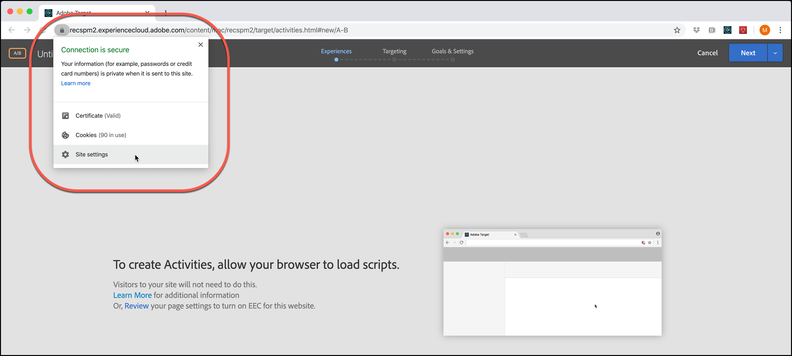

# 在浏览器中启用混合内容 {#mixed-content}

>[!BEGINSHADEBOX]

**在此页面上：**&#x200B;了解如何在[!DNL Google Chrome]、[!DNL Mozilla Firefox]和[!DNL Microsoft Edge]中启用混合内容，以便&#x200B;**[!UICONTROL 可视化体验编辑器]** (VEC)可以打开包含混合内容的HTTP网站和网站。

>[!ENDSHADEBOX]

当通过HTTPS安全地请求页面，但同时加载HTTPS和HTTP内容时，该页面包含混合内容。 HTTPS内容是安全的，而HTTP内容是不安全的，因此现代浏览器可能会阻止此类页面或显示警告消息。

当[!DNL Adobe Target]中的&#x200B;**[!UICONTROL 可视化体验编辑器]** (VEC)尝试打开包含混合内容的页面时，将显示一条警告消息，其中说明要在浏览器中禁用阻止。 禁用阻止可打开HTTP站点或包含混合内容（HTTPS和HTTP）的站点。

以前，当不允许混合内容时，三步引导式工作流步骤1中的某些操作仍然可用。 [!DNL Target]现在阻止步骤1中的所有操作，因此必须先启用混合内容，然后才能继续创建活动。

浏览器的安全设置可能会阻止加载到安全(HTTPS)页面或框架（例如VEC）中的不安全(HTTP)内容。 更改这些设置的替代方法是HTTPS网站。 如果网站在不安全(HTTP)域上运行，则必须允许VEC加载活动的混合内容。

>[!IMPORTANT]
>
>允许混合内容仅影响VEC，而不会影响已上线的网站。

有关更多信息，请参阅“Mozilla 开发人员网络”**(MDN) 网站上的[混合内容](https://developer.mozilla.org/en-US/docs/Web/Security/Mixed_content)。

## 在[!DNL Google Chrome]中启用混合内容

[!DNL Chrome]检查通过安全连接请求的页面内容是否已安全地传输。 请参阅 Google Chrome 帮助中的“[管理有关不安全网站的警告](https://support.google.com/chrome/answer/99020?hl=en)”。

若要将VEC与最新版本[!DNL Chrome]（版本79.0.3945.117或更高版本）一起使用，请按照以下方式更新网站设置。 站点的访客无需完成这些步骤。

1. 单击锁（请小心）图标，然后单击&#x200B;**[!UICONTROL 网站设置]**。

   

1. 在&#x200B;**[!UICONTROL 不安全的内容]**&#x200B;下，将下拉列表中的“阻止（默认值）”更改为“允许”。

   

1. 重新加载 VEC 页面。

## 在[!DNL Mozilla Firefox]中启用混合内容

默认情况下，[!DNL Firefox]会阻止混合了安全内容和不安全内容的页面，因此必须永久更改此设置才能使用[!DNL Target]。 站点的访客无需完成这些步骤。

1. 在[!DNL Firefox]的地址栏中输入`about:config`。
1. 确认[!DNL Firefox]显示的警告消息。

   使用“接受风险并继续”按钮

1. 在搜索栏中输入`block_active`。

   

1. 双击`security.mixed_content.block_active_content`。

   该值会从“True”更改为“False”。 当值显示为“False”时，即表示更改完成。

   

1. 更改此设置后重新启动计算机。

## 在[!DNL Microsoft Edge]中启用混合内容

[!DNL Edge]检查通过安全连接请求的页面内容是否已安全地传输。 若要将VEC与最新版本的[!DNL Edge]一起使用，请更新网站设置，如下所示。 站点的访客无需完成这些步骤。

1. 在[!DNL Edge]中，单击菜单栏中的&#x200B;**[!DNL Microsoft Edge]**，单击&#x200B;**[!UICONTROL 设置]**，然后单击&#x200B;**Cookie和网站权限**。
1. 滚动到&#x200B;**[!UICONTROL 不安全的内容]**&#x200B;并单击它。
1. 在&#x200B;**[!UICONTROL 允许]**&#x200B;旁边，单击&#x200B;**[!UICONTROL 添加]**，输入允许不安全内容的站点，然后单击&#x200B;**[!UICONTROL 添加]**。
1. 重新加载 VEC 页面。
