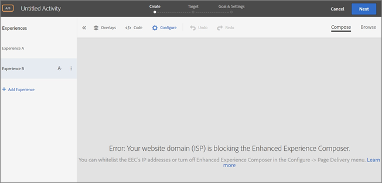

# 与[!UICONTROL 增强型体验编辑器]相关的问题疑难解答 {#eec-issues}

>[!BEGINSHADEBOX]

**在此页面上：**&#x200B;了解如何解决仅影响&#x200B;**[!UICONTROL 增强型体验编辑器]** (EEC)的问题，例如由于EEC代理的IP地址被阻止而未加载的页面。

>[!ENDSHADEBOX]

在某些情况下，[!DNL Adobe Target] **[!UICONTROL 增强型体验编辑器]** (EEC)有时会发生显示问题。 以下项目介绍了仅影响EEC的问题以及如何解决这些问题。

## 允许列表EEC代理的IP地址 {#eec-ip-addresses}

EEC无法加载在公共IP地址上不可访问的内部QA URL。 列入允许列表用于EEC代理的[!DNL Adobe]服务器的IP地址解决了此问题。 仅活动编辑需要这些IP地址，并且站点的访客不需要列入允许列表这些IP地址。 要求IT团队允许列表以下IP地址。

### 美国(va7)

```
40.70.154.136/29
52.254.106.240/28
52.254.106.160/28
52.254.107.16/28
20.186.185.181
20.22.83.112
20.186.185.227
52.254.106.192/28
52.254.106.0/28
52.254.107.128/28
52.254.107.80/28
52.254.106.176/28
52.254.107.32/28
52.254.105.192/28
52.254.107.64/28
52.254.106.208/28
52.254.107.0/28
52.254.106.224/28
20.14.241.153
20.186.185.239
4.152.211.251
52.254.107.144/28
52.254.106.144/28
```

### EMEA (nld2)

```
51.138.17.16/28
51.138.17.48/28
51.138.16.128/28
51.138.17.32/28
51.138.16.240/28
51.138.17.112/28
51.138.16.160/28
51.138.16.208/28
51.138.17.80/28
51.138.17.0/28
51.138.17.96/28
51.138.16.144/28
20.31.145.248
20.126.189.248
51.138.16.224/28
51.138.16.192/28
51.138.12.94
51.138.12.11
51.138.16.176/28
51.138.12.100
51.138.17.64/28
51.138.12.160/28
```

### APAC (aus)

```
20.43.104.160/28
20.227.35.177
20.40.188.227
20.43.104.112/28
20.43.104.128/28
20.43.104.144/28
20.40.188.166
20.53.206.128
20.43.104.80/28
20.43.104.16/28
20.43.105.48/28
20.43.104.96/28
20.43.104.48/28
20.40.188.194
20.43.104.32/28
20.40.191.224/28
20.43.105.16/28
20.40.191.96/28
20.43.104.176/28
20.40.191.240/28
20.43.104.64/28
20.43.105.32/28
20.43.104.192/28
20.43.105.0/28
20.43.104.0/28
```

### 旧版IP地址

在进一步通知之前，应继续列入允许列表以下旧版IP地址。

```
34.254.77.200
54.73.207.147
54.229.152.123
3.224.194.242
54.90.51.39
34.228.136.112
54.150.116.11
18.178.142.8
54.199.107.77
99.80.139.221
54.78.56.224
54.247.179.246
54.80.219.243
34.201.235.54
54.196.224.236
35.75.212.45
52.199.184.130
18.180.161.176
```

+++ EEC显示一条错误消息，指出网站域正在阻止它

以下错误消息可在[!DNL Target]中显示：

`Error: Your website domain (ISP) is blocking the Enhanced Experience Composer. You can allowlist the Enhanced Experience Composer's IP addresses or turn off Enhanced Experience Composer in Configure > Page Delivery menu.`



此错误消息有两个可能的原因：

* 网站域(ISP)阻止EEC。 要解决此问题，请允许列表[中列出的IP地址列入允许列表EEC代理](#eec-ip-addresses)的IP地址。
* IP地址，但网站不支持TLS 1.2。 要解决此问题，请参阅以下项目。

+++

+++ EEC无法在使用TLS 1.0的网站的安全页面上加载

当IP地址列入允许列表但网站不支持TLS 1.2时，可能会显示上一项中描述的错误消息。 [!DNL Target]当前使用版本1.2作为默认配置。 在[!DNL Target] 18.4.1（2018年4月25日）之前，默认配置支持TLS 1.0。 有关更多信息，请参阅 [TLS（传输层安全性）加密更改](https://experienceleague.adobe.com/docs/target-dev/developer/implementation/tls-transport-layer-security-encryption.html?lang=zh-Hans){target=_blank}。

在Firefox中检查网站的TLS版本（其他浏览器具有类似的步骤）：

1. 在 Firefox 中打开受影响的网站。
1. 单击浏览器地址栏上的&#x200B;**[!UICONTROL 显示网站信息]**&#x200B;图标。

   

1. 单击&#x200B;**[!UICONTROL 显示连接详细信息]** > **[!UICONTROL 更多信息]**。

   

1. 检查&#x200B;**[!UICONTROL 技术详细信息]**&#x200B;下的TLS版本信息。

   

1. 如果网站显示TLS 1.0，请参阅[TLS（传输层安全性）加密更改](https://experienceleague.adobe.com/docs/target-dev/developer/implementation/tls-transport-layer-security-encryption.html?lang=zh-Hans){target=_blank}，以了解有关[!DNL Target]的TLS支持策略的信息。 要补救目前的情况（有效期至2018年9月12日），请联系[客户关怀](/help/main/cmp-resources-and-contact-information.md#reference_ACA3391A00EF467B87930A450050077C)以获取TLS版本和域的配置。

+++

+++ 在启用代理的状态下加载网站时，会显示超时或“拒绝访问”错误

请确保代理IP地址在环境中未被阻止。 地址列在[中，列入允许列表EEC代理](#eec-ip-addresses)的IP地址。

+++
