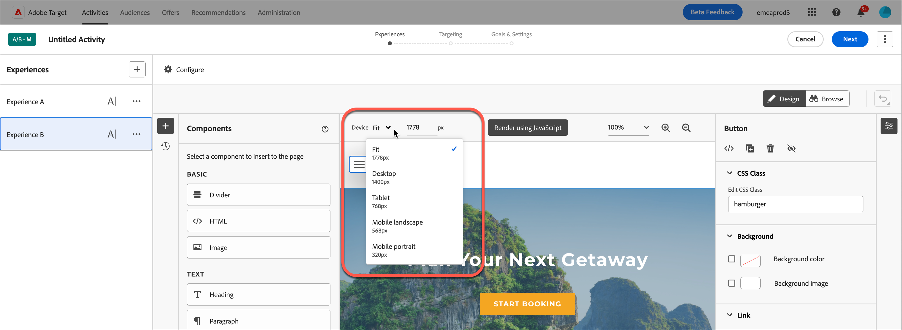
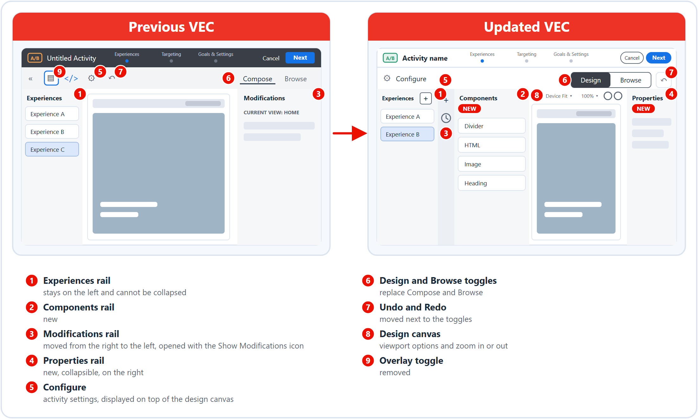

# [!UICONTROL 可视化体验编辑器]更改 {#vec-changes}

>[!BEGINSHADEBOX]

**在此页面：**&#x200B;了解[!DNL Adobe Target Standard/Premium] 25.2.1版本中引入的更新[!UICONTROL 可视化体验编辑器] (VEC)与先前版本有何不同。

>[!ENDSHADEBOX]

[!DNL Adobe Target Standard/Premium] 25.2.1版本（2025年2月17日）引入了更新的[!UICONTROL 可视化体验编辑器] (VEC)。 本文介绍VEC的先前版本与更新版本之间的差异。

>[!IMPORTANT]
>
>更新的[!UICONTROL 可视化体验编辑器]需要[!DNL Chrome Web Store]中提供的[!DNL Adobe Experience Cloud] [**[!UICONTROL 可视化编辑帮助程序&#x200B;]**&#x200B;扩展](/help/main/c-experiences/c-visual-experience-composer/r-troubleshoot-composer/visual-editing-helper-extension.md)。

在创建活动或编辑现有活动时显示VEC。

## VEC的重大更改

以下部分将说明更新后的VEC与先前版本相比所发生的重大更改。

### [!UICONTROL 体验]边栏

与以前的版本一样，**[!UICONTROL 体验]**&#x200B;边栏保留在VEC的左侧。 无法折叠&#x200B;**[!UICONTROL 体验]**&#x200B;边栏。

使用&#x200B;**[!UICONTROL 体验]**&#x200B;边栏创建、重命名或删除体验。

单击&#x200B;**[!UICONTROL 添加]**&#x200B;图标（）以添加新体验。 单击&#x200B;**[!UICONTROL 更多操作]**&#x200B;图标（）以复制、删除或重新定向体验。

### [!UICONTROL 组件]边栏（新）

新的&#x200B;**[!UICONTROL 组件]**&#x200B;边栏向网页添加了多个组件，然后可以根据需要进行编辑。

要添加新组件，请从&#x200B;**[!UICONTROL 组件]**&#x200B;边栏中选择所需的组件，将鼠标悬停在页面中的现有元素上，然后选择在选定元素之前或之后插入该组件。

如果&#x200B;**[!UICONTROL 修改]**&#x200B;边栏显示在此区域中而不是&#x200B;**[!UICONTROL 组件]**&#x200B;边栏，请单击&#x200B;**[!UICONTROL 显示组件]**&#x200B;图标（）。 **[!UICONTROL 显示组件]**&#x200B;图标（）和&#x200B;**[!UICONTROL 显示修改]**&#x200B;图标（）用作显示相应选项的切换。

要在&#x200B;**[!UICONTROL 组件]**&#x200B;边栏打开时折叠&#x200B;**[!UICONTROL 组件]**&#x200B;边栏并放大&#x200B;**[!UICONTROL 设计]**&#x200B;画布，请单击（ ）图标。

### [!UICONTROL 修改]边栏

要打开&#x200B;**[!UICONTROL 修改]**&#x200B;边栏，请单击&#x200B;**[!UICONTROL 组件]**&#x200B;边栏中的&#x200B;**[!UICONTROL 显示修改]**&#x200B;图标（）。 **[!UICONTROL 修改]**&#x200B;边栏从编辑画布的右侧更改为左侧。

>[!NOTE]
>
>要在&#x200B;**[!UICONTROL 修改]**&#x200B;边栏打开时折叠&#x200B;**[!UICONTROL 修改]**&#x200B;边栏并放大&#x200B;**[!UICONTROL 设计]**&#x200B;画布，请单击&#x200B;**[!UICONTROL 显示修改]**&#x200B;图标（）。

**[!UICONTROL 修改]**&#x200B;边栏显示对VEC中的页面所做的所有更改，并允许进行其他更改（如CSS选择器、Mbox和自定义代码）。

单击&#x200B;**[!UICONTROL 更多选项]**&#x200B;图标（）以添加修改、删除所有修改或删除所有无效修改。 单击&#x200B;**[!UICONTROL Select]**&#x200B;以执行批量操作： **[!UICONTROL 应用到所有页面]**&#x200B;或&#x200B;**[!UICONTROL 删除]**。

要再次显示&#x200B;**[!UICONTROL 修改]**&#x200B;边栏，请单击&#x200B;**[!UICONTROL 修改]**&#x200B;边栏中的&#x200B;**[!UICONTROL 隐藏修改]**&#x200B;图标（）。

### [!UICONTROL 属性]边栏（新）

**[!UICONTROL 属性]**&#x200B;边栏更改页面上选定元素的属性，无论这些元素是HTML元素还是特定于[!DNL Target]的对象，例如推荐或选件。

单击边栏顶部的图标可编辑HTML代码或者删除、复制或隐藏元素。 更改显示在&#x200B;**[!UICONTROL 修改]**&#x200B;边栏中。

**[!UICONTROL 属性]**&#x200B;边栏可在右边栏中折叠。 单击边栏右侧的&#x200B;**[!UICONTROL 显示/隐藏属性]**&#x200B;图标（）以折叠或显示&#x200B;**[!UICONTROL 属性]**&#x200B;边栏。

### 活动设置/配置

单击设计画布顶部显示的&#x200B;**[!UICONTROL 配置]**&#x200B;图标（）以显示活动属性菜单。

不同的选项可分配属性、编辑页面交付规则、指定网站首选项、添加其他页面以及启用或禁用多页面或多个受众活动。 分配&#x200B;**[!UICONTROL 属性]**&#x200B;是[[!DNL Target Premium]](/help/main/c-intro/intro.md#premium)功能。

其位置和功能与以前的VEC UI类似。

### [!UICONTROL 设计]/[!UICONTROL 浏览]模式

使用&#x200B;**[!UICONTROL 属性]**&#x200B;边栏顶部显示的&#x200B;**[!UICONTROL 设计]**/**[!UICONTROL 浏览]**&#x200B;切换功能，可在设计和浏览模式之间切换。

使用&#x200B;**[!UICONTROL 浏览]**&#x200B;模式浏览网站并选取要更新的视图或页面。 切换回&#x200B;**[!UICONTROL 设计]**&#x200B;模式以添加或编辑更改。

### [!UICONTROL 撤消]/[!UICONTROL 重做]

单击&#x200B;**[!UICONTROL 撤消]**&#x200B;图标（）可以撤消更改。

VEC中的

要重做操作，请展开&#x200B;**[!UICONTROL 撤消]**/**[!UICONTROL 重做]**&#x200B;按钮组，然后选择&#x200B;**[!UICONTROL 重做]**。

### [!UICONTROL 设计]画布

**[!UICONTROL 设计]**&#x200B;画布允许选择视区，包括适合屏幕大小、**[!UICONTROL 桌面]**、**[!UICONTROL 平板电脑]**、**[!UICONTROL 移动设备横向]**&#x200B;和&#x200B;**[!UICONTROL 移动设备纵向]**。

更新的VEC还允许通过单击相应的图标（或 ）进行放大或缩小。

## 显示UI更改的可视化插图

下图显示了对更新后的VEC所做的高级UI更改。 插图的左侧显示之前的VEC UI，右侧显示更新后的UI。 匹配的数字显示各种元素已移动或更改的位置。

{width="800" zoomable="yes"}

## 有关更新的UI的更多信息

* [[!DNL Target Standard/Premium] 25.2.1（2025年2月17日）发行说明](/help/main/r-release-notes/release-notes-for-previous-releases.md#ui-update-2)：提供&#x200B;**[!UICONTROL 活动]**、**[!UICONTROL 推荐]**&#x200B;和[!UICONTROL 可视化体验编辑器] (VEC)在[!DNL Target]中的主要UI更改摘要。

* [[!DNL Target Standard/Premium] 25.1.1（2025年1月9日）发行说明](/help/main/r-release-notes/release-notes-for-previous-releases.md#ui-update-1)：提供&#x200B;**[!UICONTROL 选件库]**&#x200B;在[!DNL Target]中关键UI更改的摘要。

* [了解 [!DNL Target] UI](/help/main/c-intro/understand-the-target-ui.md)：提供[!DNL Target]的简短概述，其中包含更深入的信息和分步说明的链接。

* [[!UICONTROL 可视化体验编辑器]选项](/help/main/c-experiences/c-visual-experience-composer/viztarget-options.md)：说明更新的VEC UI及其选项。

* [[!DNL Target] UI更新常见问题解答](/help/main/c-intro/updated-ui-faq.md)：解决有关新[!DNL Target] UI和[!UICONTROL 可视化体验编辑器] (VEC)的常见问题，包括导航更改、功能位置以及弃用临时UI版本切换。
