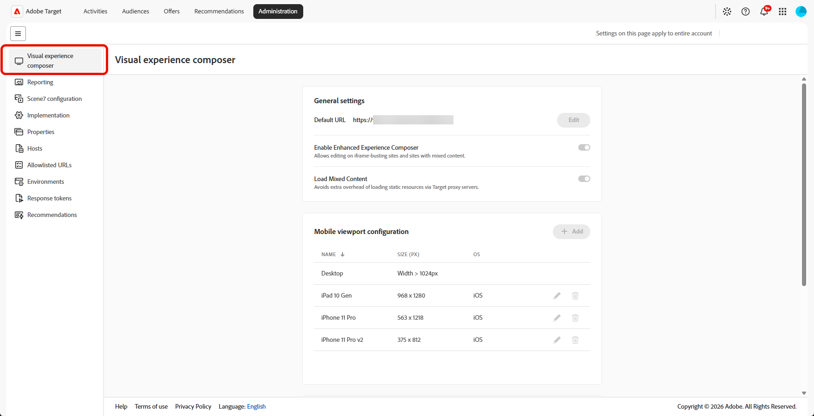

# 开始使用[!UICONTROL 可视化体验编辑器] {#vec-overview}

>[!BEGINSHADEBOX]

**在此页面上：**&#x200B;了解如何打开[!UICONTROL 可视化体验编辑器] (VEC)、编辑体验和管理页面加载。

>[!ENDSHADEBOX]

[!DNL Adobe Target]中的[!UICONTROL 可视化体验编辑器] (VEC)是一个WYSIWYG编辑器，可直接在网站和移动网页上创建和测试个性化体验，而无需编辑代码。

[!DNL Target]活动的体验和选件是通过拖放元素、交换内容以及更改页面布局创建的。 该编辑器还提供了用于编辑HTML和JavaScript的选项。

## 浏览器要求 {#browser-requirements}

[!DNL Adobe Target]接口支持[!DNL Safari]。 可在[!DNL Safari]中创建基于表单的活动，并具有除VEC和[!UICONTROL 增强型体验编辑器] (EEC)之外的所有功能。 如果在[!DNL Safari]中打开VEC，则覆盖将提示用户切换到[!DNL Google Chrome]以编辑体验。

诸如[!DNL Firefox]之类的浏览器可能会阻止包含混合内容的页面在VEC中显示，例如，安全站点内的非安全页面。 如果页面未显示，请单击浏览器地址栏中URL旁边的图标，然后单击&#x200B;**[!UICONTROL 在此页面上禁用保护]**。 此问题不会影响页面向网站访客显示的方式。

## 打开VEC {#open-the-vec}

要设置默认在VEC中打开的页面，请在[!DNL Target] **[!UICONTROL 管理]** > **[!UICONTROL 可视化体验编辑器]**&#x200B;选项卡上输入默认的[!UICONTROL 可视化体验编辑器] URL。 如果未设置默认URL，则VEC会打开一个空白页面，其中可以指定URL。

## 编辑体验 {#edit-experiences}

### 查看和命名体验 {#view-and-name-experiences}

**[!UICONTROL 体验]**&#x200B;边栏中的选项卡显示页面向不同受众或不同体验的显示方式。 每个体验都有一个描述性名称，便于在列表中识别。 例如，在导航栏中测试Home链接的位置时，可将其首先出现的体验命名为“Home link first”。

的重命名图标打开名为“主页”链接的重命名体验对话框

### Select和修改元素 {#select-and-modify-elements}

将光标移动到页面上会突出显示具有上下文相关框的单个元素。 单击高亮显示的元素会显示该元素类型的编辑选项。 例如，选择图像并单击&#x200B;**[!UICONTROL 更改图像选件]**&#x200B;将替换该图像，选择按钮可更改其文本颜色。

无法编辑嵌入到页面中的iframe中的内容。 要编辑该内容，请确保iframe文档已启用[!DNL Target]，然后直接在VEC中加载iframe URL。

在VEC之外更改页面结构可能会影响活动使用的位置。 如果这些位置发生更改，[!DNL Target]可能无法找到已修改的元素，这可能会导致编辑体验时出现问题。

### 浏览和设计 {#browse-and-design}

单击&#x200B;**[!UICONTROL 浏览]**&#x200B;导航到可从当前页面访问的页面，如送货页面或购物车，并在该处测试更改。

在“浏览”模式下，还可以访问悬停鼠标时显示的元素，例如弹出菜单和迷你购物车。 当到达要编辑的页面或元素时，单击&#x200B;**[!UICONTROL 设计]**&#x200B;以编辑体验。

如果悬停状态依赖于JavaScript，请确保未选择&#x200B;**[!UICONTROL 禁用JavaScript]**。 必须启用JavaScript才能编辑依赖它的元素。

有关可用编辑选项的详细信息，请参阅[可视化体验编辑器选项](/help/main/c-experiences/c-visual-experience-composer/viztarget-options.md)。

## 管理页面加载 {#manage-page-loading}

在页面加载时或页面加载失败后，某些编辑选项仍然可用。 也可以取消页面加载以访问这些选项，而无需等待。

### 在页面加载时或页面加载失败后编辑页面 {#loading}

例如，可以在页面完成VEC中的加载之前或加载失败之后进行某些更改，例如，因为自定义代码不再有效。

可用的编辑选项允许执行以下操作：

* 进行简单的更改，例如添加自定义代码或重命名体验
* 从无法再访问的页面中复制现有自定义代码
* 对无法在VEC中加载的页面进行简单编辑

在页面加载时或加载失败后，**[!UICONTROL 体验]**&#x200B;边栏、**[!UICONTROL 组件]**&#x200B;边栏和&#x200B;**[!UICONTROL 配置]**&#x200B;选项仍可访问。

### 在VEC中取消页面加载 {#cancel-loading}

在VEC中取消页面加载可编辑活动，而无需等待页面完成加载。 这可用于：

* 对现有修改进行细微编辑
* 删除一个或多个现有修改
* 插入或编辑自定义代码
* 更正错误输入的页面URL
* 在VEC中加载页面之前，启用或禁用JavaScript
* 将模板测试规则添加到&#x200B;**[!UICONTROL 页面交付]**&#x200B;条件
* 在通过EEC或仅iframe模式下加载页面时，覆盖全局[!UICONTROL 增强型体验编辑器] (EEC)切换开关

取消页面加载后，可以在活动中的体验之间进行切换，而无需等待页面加载完成。 单击&#x200B;**[!UICONTROL 重新加载]**&#x200B;以再次在VEC中显示页面。

>[!IMPORTANT]
>
>如果在取消页面加载后编辑自定义代码或进行其他修改，请执行质量保证(QA)测试，以验证更改是否按预期交付。

要停止加载页面，请在加载页面时单击&#x200B;**[!UICONTROL 取消加载]**。 在当前编辑会话期间，除非重新加载页面，否则此活动的页面仍保持卸载状态。

单击&#x200B;**[!UICONTROL 重新加载]**&#x200B;以继续管理当前活动中的体验或添加新修改。
