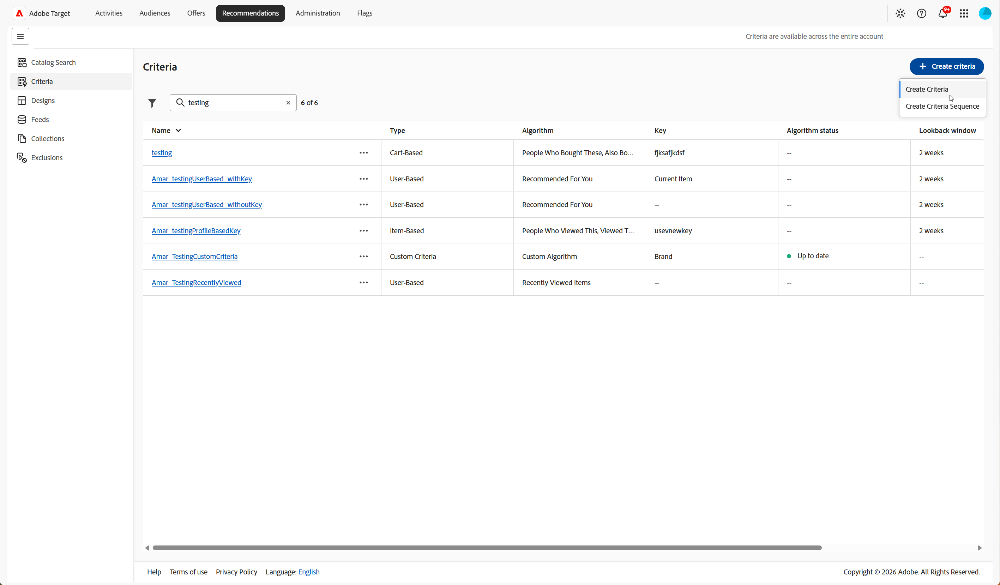
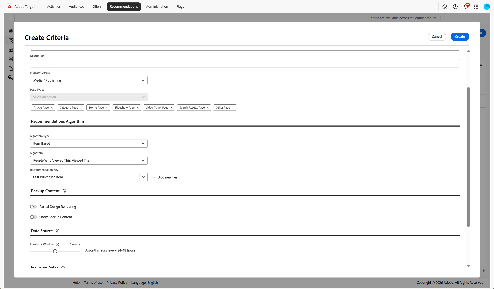

# 开始使用[!UICONTROL 标准] {#get-started-criteria}

>[!BEGINSHADEBOX]

**在此页面上：**&#x200B;了解标准在[!DNL Adobe Target Recommendations]中的工作方式，以及有哪些垂直行业、算法类型和推荐键选项可用。

>[!ENDSHADEBOX]

[!DNL Adobe Target] [!DNL Recommendations]中的&#x200B;**[!UICONTROL 标准]**&#x200B;是一些规则，可根据预先确定的一组访客行为来确定要推荐的产品或内容。 标准可基于流行趋势、访客的当前与过去行为，或相似的产品和内容。 可向活动添加多个标准，以相互测试多种推荐类型。

所选的垂直行业和算法类型决定了创建标准时可用的选项。

## 垂直行业 {#section_936BCFCF234C49A2BEC1C38AAC2D71AF}

创建标准后，将根据推荐活动的目标选择垂直行业。

| 垂直行业 | 目标 |
|--- |--- |
| **[!UICONTROL 零售/电子商务]** | 转化促进完成购买 |
| **[!UICONTROL 潜在客户开发/B2B/金融服务]** | 转化但不购买 |
| **[!UICONTROL 媒体/出版]** | 参与度 |

其他标准选项会根据所选的垂直行业而发生更改。 可以在&#x200B;**[!UICONTROL 管理]** > **[!UICONTROL 推荐]**&#x200B;页面上设置默认垂直行业，也可以为每个标准指定垂直行业。

## 算法类型 {#section_885B3BB1B43048A88A8926F6B76FC482}

选择的算法类型决定了可用的算法。 下表说明了算法类型及其随附的算法。

| 算法类型 | 使用时间 | 可用的算法 |
| --- | --- | --- |
| **[!UICONTROL 基于购物车]** | 根据用户的购物车内容提供推荐。 | <ul><li>**[!UICONTROL 查看过这些项目，也查看过这些项目的人]**</li><li>**[!UICONTROL 查看了这些商品的人们也购买了]**</li><li>**[!UICONTROL 购买了这些商品的人，也购买了]**</li></ul>有关详细信息，请参阅&#x200B;*使推荐基于推荐键*&#x200B;中的[基于购物车的](/help/main/c-recommendations/c-algorithms/base-the-recommendation-on-a-recommendation-key.md#cart-based)。 |
| **[!UICONTROL 基于热门程度]** | 根据项目在网站中的整体热门程度，或根据用户最喜爱或查看次数最多的类别、品牌、流派等中的项目热门程度提供推荐。 | <ul><li>整个网站查看的次数最多&#x200B;**&#x200B;**</li><li>按类别查看的次数最多&#x200B;**&#x200B;**</li><li>**[!UICONTROL 按项目属性查看的次数最多]**</li><li>**[!UICONTROL 按轮廓属性划分的最多浏览量]**</li><li>**[!UICONTROL 网站上的最畅销商品]**</li><li>**[!UICONTROL 按类别划分的最畅销商品]**</li><li>按项目属性&#x200B;**[!UICONTROL 最畅销商品]**</li><li>**[!UICONTROL 按配置文件属性排列的畅销商品排名]**</li><li>**[!UICONTROL 按Analytics指标排名]**</li></ul> |
| **[!UICONTROL 基于项目]** | 根据与用户当前正在查看或最近查看的项目类似的项目提供推荐。 | <ul><li>**[!UICONTROL 查看了这个项目，也查看了那个项目的人]**</li><li>**[!UICONTROL 查看了这个项目，但购买了那个项目的人]**</li><li>**[!UICONTROL 购买了这个项目，也购买了那个项目的人]**</li><li>**[!UICONTROL 具有相似属性的项目]**</li></ul> |
| **[!UICONTROL 基于用户]** | 根据用户的行为提供推荐。 | <ul><li>**[!UICONTROL 最近查看的项目]**</li><li>**[!UICONTROL 为您推荐]**</li></ul> |
| **[!UICONTROL 自定义标准]** | 根据上传的自定义文件提出建议。 | <ul><li>自定义算法</li></ul> |

有关每个算法的详细信息，请参阅[使推荐基于推荐键](/help/main/c-recommendations/c-algorithms/base-the-recommendation-on-a-recommendation-key.md)。

## 使用自定义推荐键 {#custom-key}

推荐也可以基于自定义配置文件属性的值。 例如，可根据用户最近添加到队列中的影片显示推荐的影片。

1. 单击&#x200B;**[!UICONTROL 推荐]** > **[!UICONTROL 标准]**。

1. 单击&#x200B;**[!UICONTROL 创建标准]** > **[!UICONTROL 创建标准]**。

   

1. 在[基本信息部分](/help/main/c-recommendations/c-algorithms/create-new-algorithm.md#info)中填写信息。

1. 在[推荐的算法](/help/main/c-recommendations/c-algorithms/create-new-algorithm.md#rec-algo)部分中，从&#x200B;**[!UICONTROL 算法类型]**&#x200B;列表中选择&#x200B;**[!UICONTROL 基于项目的]**。

1. 查看了这个项目，并从&#x200B;**[!UICONTROL 算法]**&#x200B;列表中查看了&#x200B;**的Select**&#x200B;人员。

1. 从&#x200B;**[!UICONTROL 推荐键]**&#x200B;列表中Select自定义配置文件属性（例如，**[!UICONTROL 上次添加到观看列表的节目]**）。

   >[!NOTE]
   >
   >可通过JavaScript、API或集成将自定义配置文件参数传递到[!DNL Target]。 有关自定义配置文件属性的详细信息，请参阅[访客配置文件](/help/main/c-target/c-visitor-profile/visitor-profile.md)。

   

## 查看标准信息 {#section_7162DE58E4594FD688A4D7FDB829FD8B}

标准详细信息显示了如何配置标准以及哪些活动使用标准。

1. 单击&#x200B;**[!UICONTROL 推荐]** > **[!UICONTROL 标准]**&#x200B;以显示标准列表。

1. 在&#x200B;**[!UICONTROL 名称]**&#x200B;列中单击所需的条件。

1. 查看&#x200B;**[!UICONTROL 属性]**&#x200B;和详细信息部分中选定条件的一般信息，包括其&#x200B;**[!UICONTROL 名称]**、**[!UICONTROL 描述]**、**[!UICONTROL 垂直行业]**、**[!UICONTROL 页面类型]**、**[!UICONTROL 推荐键]**、**[!UICONTROL 推荐逻辑]**、**[!UICONTROL 算法ID]**&#x200B;和上次修改时间信息（日期和修改算法的人员）。

1. 在&#x200B;**[!UICONTROL 使用情况]**&#x200B;部分中查看引用所选条件的活动列表。

   >[!NOTE]
   >
   >当前仅支持[!DNL Recommendations]活动的&#x200B;**[!UICONTROL 算法使用情况]**&#x200B;功能。 当前不支持将此功能用于包含作为选件的[推荐的&#x200B;**[!UICONTROL A/B测试]**、**[!UICONTROL 自动分配]**、**[!UICONTROL 自动定位]**&#x200B;和&#x200B;**[!UICONTROL 体验定位]** (XT)活动](/help/main/c-recommendations/recommendations-as-an-offer.md)。

   
