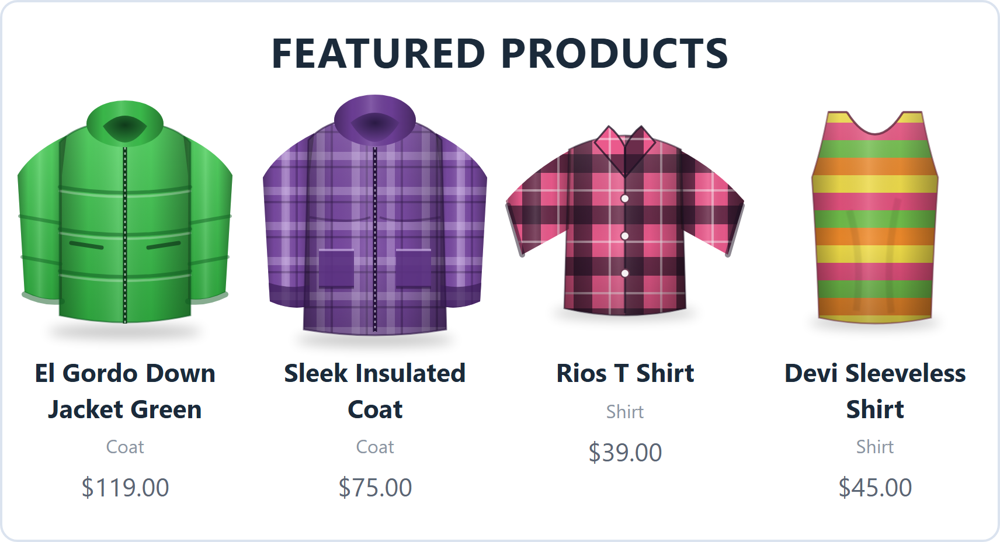

# 创建标准序列 {#create-criteria-sequence}

>[!BEGINSHADEBOX]

**在此页面上：**&#x200B;了解如何创建标准序列以控制[!DNL Adobe Target Recommendations]活动中出现的项。

>[!ENDSHADEBOX]

最多包含五个条件的序列可让您更好地控制[!DNL Adobe Target] **[!UICONTROL 推荐]**&#x200B;活动中出现的项。 返回的项目数也可以受到限制（有时称为“插槽级别控制”）。

当标准未返回足够的结果来填充设计时，标准序列将提供额外的目标推荐，而不是更通用的备用推荐。 通常，标准序列会从更具体的定位（可能会返回更少的结果）到更一般的定位（通常返回更多结果）。

>[!NOTE]
>
>标准序列不能与[!DNL Target Premium]的2016年10月版之前创建的&#x200B;**[!UICONTROL 推荐]**&#x200B;活动一起使用。

要创建标准序列，请先创建要包含在序列中的标准。 有关详细信息，请参阅[创建标准](/help/main/c-recommendations/c-algorithms/create-new-algorithm.md)。

标准序列的顺序可能会因页面类型而异，如以下示例所示：

| 页面类型 | 可能的序列顺序 |
| --- | --- |
| 产品页面 | <ol><li>基于当前项目，来自同一品牌</li><li>基于当前项目，来自所有品牌</li><li>基于内容相似性</li><li>基于最畅销商品</li><li>基于整个网站中查看次数最多的项目</li></ol> |
| 主页 | <ol><li>基于访客上次购买的项目 </li><li>基于访客最喜爱的项目</li><li>基于访客最喜爱的类别</li><li>基于最畅销商品</li><li>基于整个网站中查看次数最多的项目</li></ol> |

## 创建标准序列

从&#x200B;**[!UICONTROL 创建标准序列]**&#x200B;屏幕创建标准序列。 可通过多种方式访问此屏幕。 某些屏幕选项因到达屏幕的方式而异。

* 在&#x200B;**[!UICONTROL 推荐]** > **[!UICONTROL 标准]**&#x200B;库屏幕上，单击&#x200B;**[!UICONTROL 创建标准]** > **[!UICONTROL 创建标准序列]**。 此处创建的标准会自动设置为可用于所有&#x200B;**[!UICONTROL 推荐]**&#x200B;活动。
* 创建&#x200B;**[!UICONTROL 推荐]**&#x200B;活动时，在&#x200B;**[!UICONTROL Select标准]**&#x200B;屏幕中，单击&#x200B;**[!UICONTROL 新建]** > **[!UICONTROL 创建标准序列]**。 可以保存新的标准序列，以便与其他&#x200B;**[!UICONTROL 推荐]**&#x200B;活动一起使用。
* 编辑&#x200B;**[!UICONTROL 推荐]**&#x200B;活动时，在页面上的&#x200B;**[!UICONTROL 推荐位置]**&#x200B;框中单击，然后选择&#x200B;**[!UICONTROL 更改标准]**。 在“**[!UICONTROL 选择标准]**”屏幕上，单击&#x200B;**[!UICONTROL 新建]** > **[!UICONTROL 创建标准序列]**。 可以保存新标准以供其他&#x200B;**[!UICONTROL 推荐]**&#x200B;活动使用。

以下步骤假定从&#x200B;**[!UICONTROL 标准]**&#x200B;菜单访问&#x200B;**[!UICONTROL 创建标准序列]**&#x200B;屏幕。

1. 单击&#x200B;**[!UICONTROL 推荐]** > **[!UICONTROL 标准]**。

1. 单击&#x200B;**[!UICONTROL 创建标准]** > **[!UICONTROL 创建标准序列]**。

   在“创建标准”菜单中选择了“创建标准序列”选项的

1. 在[基本信息](/help/main/c-recommendations/c-algorithms/create-new-algorithm.md#info)部分中填写信息。

1. 在&#x200B;**[!UICONTROL 标准序列]**&#x200B;部分中，单击加号(+)以添加一个或多个标准序列。

   序列顺序定义设计填充的顺序。 如果标准1没有足够的推荐项来填充设计，则剩余的版块将使用标准2来填充，依此类推。

   

1. 在&#x200B;**[!UICONTROL 选择标准]**&#x200B;屏幕上，选择一个标准，然后单击&#x200B;**[!UICONTROL 保存]**。

   可以使用&#x200B;**[!UICONTROL 搜索]**&#x200B;框和筛选器选项查找所需的条件。

1. （可选）启用&#x200B;**[!UICONTROL 限制返回的项目数]**，然后指定项目数（介于1和50之间）。

   将“为您推荐”作为标准1且“限制返回的项目数”选项打开的

   以下用例说明了&#x200B;**[!UICONTROL 限制返回的项目数]**&#x200B;选项（有时称为“槽级控制”）的值。

   +++ 限制返回项目数的用例

   * **用例1**：在单个推荐托盘中混合不同种类的项目，例如，混合外套（夹克）和上衣（衬衫、T恤）。 要实现此目的，请使用活动的集合，该集合包括可显示在设计任何插槽中的所有产品类型。 然后，使用只包括外套的静态过滤器设置第一个标准，使用只包括顶部的静态过滤器设置第二个标准。 最后，将两个标准添加到标准序列中，并将第一个标准限制为2个空位。

     在网站上，推荐栏可能如下所示：

     

   * **用例2**：替代项和补充项的组合。 设置一个条件以使用已查看/已查看的算法和将推荐项目限制在当前项目类别的动态过滤器。 设置第二个条件以使用已查看/已购买算法和动态筛选器，后者仅包含与当前项目类别不匹配的推荐项目。 最后，将两个标准添加到序列中，并将第一个标准限制为2个空位。

   +++

1. 继续将标准添加到序列。 最多可以向序列中添加五个标准。

1. 启用[备份内容选项](/help/main/c-recommendations/c-algorithms/create-new-algorithm.md#content)。

1. 单击&#x200B;**[!UICONTROL 创建]**。

条件序列显示在&#x200B;**[!UICONTROL 条件]**&#x200B;列表中。

有关推荐逻辑选项的详细信息，请参阅[开始使用标准](/help/main/c-recommendations/c-algorithms/algorithms.md)。
