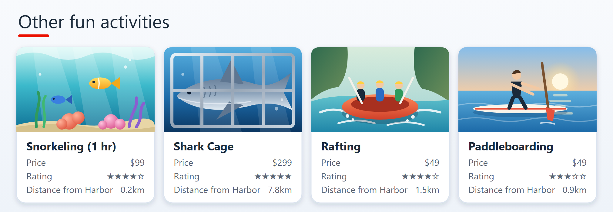

# 创建标准 {#create-criteria}

>[!BEGINSHADEBOX]

**在此页面上：**&#x200B;了解如何在[!DNL Adobe Target Recommendations]中创建标准以及如何配置标准的每个部分。

>[!ENDSHADEBOX]

[!DNL Adobe Target] [!DNL Recommendations]中的标准控制[!DNL Recommendations]活动的内容。 标准使用访客的操作来确定要显示的内容或产品，因此合适的标准会显示最适合该活动的推荐。

## 访问“创建新标准”屏幕 {#access-create-criteria}

可通过多种方式来访问“**[!UICONTROL 创建新标准]**”屏幕。 某些屏幕选项因到达屏幕的方式而异。

* 在&#x200B;**[!UICONTROL 推荐]** > **[!UICONTROL 标准]**&#x200B;库屏幕上，单击&#x200B;**[!UICONTROL 创建标准]** > **[!UICONTROL 创建标准]**。 此处创建的标准会自动设置为可用于所有[!DNL Recommendations]活动。

  

* 使用&#x200B;**[!UICONTROL 可视化体验编辑器]** (VEC)创建[!DNL Recommendations]活动时，在选择该页面上的某个元素并点击&#x200B;**[!UICONTROL 替换为推荐]**、**[!UICONTROL 在之前插入推荐]**&#x200B;或&#x200B;**[!UICONTROL 在之后插入推荐]**&#x200B;后，会立即显示&#x200B;**[!UICONTROL Select标准]**&#x200B;屏幕。 Select一个可用的标准，或单击&#x200B;**[!UICONTROL 创建标准]**。 可以保存新条件以与其他[!DNL Recommendations]活动一起使用。 有关详细信息，请参阅[创建推荐活动](/help/main/c-recommendations/t-create-recs-activity/create-recs-activity.md)。

  使用“创建标准”按钮的“推荐”活动的

* 编辑[!DNL Recommendations]活动时，在页面上的&#x200B;**[!UICONTROL 推荐位置]**&#x200B;框中单击，然后选择&#x200B;**[!UICONTROL 更改标准]**。 在&#x200B;**[!UICONTROL 选择标准]**&#x200B;屏幕上，单击&#x200B;**[!UICONTROL 创建标准]**。 可以保存新条件以与其他[!DNL Recommendations]活动一起使用。

## [!UICONTROL 基本信息] {#info}

基本信息可确定标准并将其分类，以供在其他活动中重复使用。

1. 键入&#x200B;**[!UICONTROL 标准名称]**。

   这是用于描述标准的内部名称。 例如，可以将标准命名为“最高利润产品”，而不公开显示该标题。 在下一步中设置公开标题。

1. 为使用该标准的所有“推荐”键入一个要在页面上公开显示的&#x200B;**[!UICONTROL 显示标题]**。

   例如，使用此标准显示推荐时，可以显示“查看了这个项目，也查看了那个项目的人”或“相似产品”。

1. 键入条件的简短&#x200B;**[!UICONTROL 描述]**。

   描述应有助于识别该标准，并可包含有关其用途的信息。

1. Select是一个基于“推荐”活动目标的垂直行业。

   | 垂直行业 | 目标 |
   |--- |--- |
   | **[!UICONTROL 零售/电子商务]** | 转化促进完成购买 |
   | **[!UICONTROL 潜在客户开发/B2B/金融服务]** | 转化但不购买 |
   | **[!UICONTROL 媒体/出版]** | 参与度 |

   其他标准选项会根据所选的垂直行业而发生更改。

   

1. Select a **[!UICONTROL 页面类型]**。

   可以选择多种页面类型。 垂直行业和页面类型可一起帮助对已保存的标准进行分类，从而使其更易于对其他[!DNL Recommendations]活动重复使用。

## [!UICONTROL 推荐算法] {#rec-algo}

算法可确定如何选择推荐对应的项目。

>[!CONTEXTUALHELP]
>id="target_recommendations_profile_attribute"
>title="轮廓属性"
>abstract="您可以使用轮廓脚本创建轮廓属性。"

1. Select **[!UICONTROL 算法类型]**&#x200B;和&#x200B;**[!UICONTROL 算法]**：

   

   | 算法类型 | 何时使用/可用算法 |
   | --- | --- |
   | **[!UICONTROL 基于购物车]** | 根据用户的购物车内容提供推荐。 <ul><li>**[!UICONTROL 查看过这些项目，也查看过这些项目的人]** </li><li>**[!UICONTROL 查看了这些商品的人们也购买了]**</li><li>**[!UICONTROL 购买了这些商品的人，也购买了]**</li></ul> |
   | **[!UICONTROL 基于热门程度]** | 根据项目在网站中的整体热门程度，或根据用户最喜爱或查看次数最多的类别、品牌、流派等中的项目热门程度提供推荐。 <ul><li>整个网站查看的次数最多&#x200B;**&#x200B;**</li><li>按类别查看的次数最多&#x200B;**&#x200B;**</li><li>**[!UICONTROL 按项目属性查看的次数最多]**</li><li>**[!UICONTROL 按轮廓属性划分的最多浏览量]**</li><li>**[!UICONTROL 网站上的最畅销商品]**</li><li>**[!UICONTROL 按类别划分的最畅销商品]**</li><li>按项目属性&#x200B;**[!UICONTROL 最畅销商品]**</li><li>**[!UICONTROL 按配置文件属性排列的畅销商品排名]**</li><li>**[!UICONTROL 按Analytics指标排名]**</li></ul> |
   | **[!UICONTROL 基于项目]** | 根据与用户当前正在查看或最近查看的项目类似的项目提供推荐。 <ul><li>**[!UICONTROL 查看了这个项目，也查看了那个项目的人]**</li><li>**[!UICONTROL 查看了这个项目，但购买了那个项目的人]**</li><li>**[!UICONTROL 购买了这个项目，也购买了那个项目的人]**</li><li>**[!UICONTROL 具有相似属性的项目]**</li></ul> |
   | **[!UICONTROL 基于用户]** | 根据用户的行为提供推荐。<ul><li>**[!UICONTROL 最近查看的项目]**</li><li>**[!UICONTROL 为您推荐]**</li></ul> |
   | **[!UICONTROL 自定义标准]** | 根据上传的自定义文件提出建议。<ul><li>自定义算法</li></ul> |

   >[!NOTE]
   >
   >当选择&#x200B;**[!UICONTROL 项目]**/**[!UICONTROL 具有相似属性的媒体]**&#x200B;时，可以设置[内容相似度规则](#similarity)。

1. 通过选择要匹配的&#x200B;**[!UICONTROL 推荐键]**、**[!UICONTROL 筛选键]**、**[!UICONTROL 共同发生基础]**、**[!UICONTROL Analytics量度]**&#x200B;和/或&#x200B;**[!UICONTROL 项目属性]**&#x200B;和&#x200B;**[!UICONTROL 配置文件属性]**，根据需要配置算法。 可用的配置选项因所选的算法而异。

   有关选择&#x200B;**[!UICONTROL 推荐键]**&#x200B;的详细信息，请参阅[使推荐基于推荐键](/help/main/c-recommendations/c-algorithms/base-the-recommendation-on-a-recommendation-key.md)。

1. （视情况而定）对于&#x200B;**[!UICONTROL 查看次数最多的配置文件属性]**&#x200B;或&#x200B;**[!UICONTROL 最畅销的配置文件属性]**，请选择一个&#x200B;**[!UICONTROL 配置文件属性]**&#x200B;作为交互数据分组依据。

   配置文件属性来自捕获访客特征的配置文件脚本，如地区或国家/地区。 脚本名称必须带有`recsAttribute`前缀，因此它存储为`user.recsAttribute<Name>`，例如`user.recsAttributeRegion`。 在交付时，[!DNL Target]向每位访客提供与其自身属性值对应的排名列表。

## [!UICONTROL 备份内容] {#content}

**[!UICONTROL 备份内容]**&#x200B;规则确定推荐项目数未填入[推荐设计](/help/main/c-recommendations/c-design-overview/design-overview.md)时会发生什么情况。 标准返回的推荐可能会少于设计调用的数量。 例如，如果设计有四个项目的版块，但标准导致仅推荐两个项目，则其余版块可留空或填入备用推荐，或无法显示任何推荐。

1. （可选）启用&#x200B;**[!UICONTROL 部分设计渲染]**&#x200B;选项。

   尽管会填充尽可能多的版块，但设计模板仍可包含空白空间以放置剩余版块。 如果禁用了此选项，并且内容不足以填充所有可用的版块，则不会提供推荐，而是显示默认内容。

   启用此选项可使用空白插槽提供推荐。 要使用网站中的类似或受欢迎内容填充空版块，请使用备份推荐，如下一步骤中所述。

1. （可选）启用&#x200B;**[!UICONTROL 显示备份内容]**&#x200B;选项。

   备用推荐通过从整个站点中随机选择查看次数最多的产品来填充设计中剩余的空版块，因此设计始终会填充所有可用版块。 以下示例使用4 x 1设计：

   

   如果标准导致仅推荐两个项目，并且启用了&#x200B;**[!UICONTROL 局部设计渲染]**&#x200B;选项，则前两个版块已填满，其余两个版块保持空白。 如果启用了&#x200B;**[!UICONTROL 显示备份内容]**&#x200B;选项，则前两个插槽将根据指定的条件填充，其余两个插槽将根据备份推荐填充。

   +++ 以下矩阵显示&#x200B;**[!UICONTROL 部分设计渲染]**&#x200B;和&#x200B;**[!UICONTROL 备份内容]**&#x200B;选项的每种组合的结果

   | 局部设计渲染 | 备份内容 | 结果 |
   |--- |--- |--- |
   | 禁用 | 禁用 | 如果返回的推荐少于设计所需的推荐，则推荐设计将被替换为默认内容，并且不显示任何推荐。 |
   | 启用 | 禁用 | 设计会呈现，但如果返回的推荐少于设计调用的数量，则可能包含空格。 |
   | 启用 | 启用 | 备用推荐会填充可用的设计“版块”，以完全呈现设计。 如果将包含规则应用于备用推荐时会限制符合条件的备用推荐的数量，以致于设计无法填满，则会局部渲染设计。 如果标准未返回任何推荐，并且包含规则将备用推荐限制为零，则设计将被替换为默认内容。 |
   | 禁用 | 启用 | 备用推荐会填充可用的设计“版块”，以完全呈现设计。 如果将包含规则应用于备用推荐时会限制符合条件的备用推荐的数量，以致于设计无法填满，则设计将被替换为默认内容，并且不会显示任何推荐。 |

   有关详细信息，请参阅[使用备份推荐](/help/main/c-recommendations/c-algorithms/backup-recs.md)。
   +++

1. （视情况而定）如果已启用&#x200B;**[!UICONTROL 显示备份内容]**，则还可以启用&#x200B;**[!UICONTROL 将包含规则应用于备份推荐]**。

   包含规则确定推荐中包含哪些项目。 可用的选项取决于垂直行业。

   有关详细信息，请参阅下面的[指定包含规则](#inclusion)。

## [!UICONTROL 数据Source] {#data-source}

数据源确定标准使用的行为数据以及该数据的时间范围。

1. Select所需的&#x200B;**[!UICONTROL 行为数据Source]**： **[!UICONTROL Adobe Target]**&#x200B;或&#x200B;**[!UICONTROL Analytics]**。

   >[!NOTE]
   >
   >仅当实现使用[Analytics for Source](/help/main/c-integrating-target-with-mac/a4t/a4t.md) (A4T)时，才会显示&#x200B;**[!UICONTROL 行为数据Target]**&#x200B;部分。

   

   对于&#x200B;**[!UICONTROL Analytics]**，请选择所需的报表包。

   +++ 当Analytics为数据源时的标准可用性

   当[!DNL Adobe Analytics]为行为数据源时，新标准可用之前的时间取决于所选报表包和回顾窗口是否已用于任何其他标准：

   * **一次性报表包设置**：首次将报表包与给定数据范围回顾时间范围一起使用时，[!DNL Target Recommendations] 可能需要 2 到 7 天的时间才能从 [!DNL Analytics] 完全下载所选报表包的行为数据。 此时间范围取决于[!DNL Analytics]系统负载。
   * **使用已经可用的报表包新建或编辑标准**：在创建新标准或编辑现有标准时，如果所选报表包已与[!DNL Target Recommendations]一起使用，并且其数据范围等于或大于所选的数据范围，则数据立即可用，而无需一次性设置。 在这种情况下，或者如果在未修改所选报表包或数据范围的情况下对算法的设置进行编辑，则该算法将在 12 小时内运行或者重新运行。
   * **持续的算法运行**：数据每天从 [!DNL Analytics] 流向 [!DNL Target Recommendations]。 例如，对于&#x200B;**[!UICONTROL 查看的亲和度]**&#x200B;推荐，当用户查看产品时，产品查看跟踪调用将以近乎实时的方式传递到[!DNL Analytics]。 [!DNL Analytics] 数据会在第二天早些时候被推送到 [!DNL Target]，然后 [!DNL Target] 会在 12 小时内运行算法。

   有关详细信息，请参阅[将Adobe Analytics与Target推荐一起使用](/help/main/c-recommendations/c-algorithms/use-adobe-analytics-with-recommendations.md)。

   +++

1. 设置&#x200B;**[!UICONTROL 回顾窗口]**&#x200B;以确定在确定要显示的推荐时所使用的可用历史用户行为数据的时间范围。 此选项适用于所有算法，但具有相似属性的&#x200B;**[!UICONTROL 项目]**&#x200B;和&#x200B;**[!UICONTROL 自定义算法]**&#x200B;除外。

   对于有大量流量且行为更改频繁的网站，请选择较短的数据窗口。 较短的时段可使[!DNL Recommendations]对市场和业务的变化做出更快速的响应。 例如，[!DNL Recommendations]然后检测访客行为在访客开始季节性购物时的变化（例如返校购物季或圣诞节），并推荐适合这些购物季的项目。

   如果网站没有大量数据，或访客行为没有频繁更改，请选择更长的窗口。 但是，对于许多网站，较短的窗口会产生质量较高的推荐。

   +++ 可用的数据范围

   | 回顾窗口选项 | 更新频率（悬停时显示） | 支持的算法 |
   | --- | --- | --- |
   | 6小时 | 算法每3-6小时运行一次， | 当所选的&#x200B;**[!UICONTROL 行为数据Source]**&#x200B;为[!DNL Adobe Target]时，**[!UICONTROL 基于热门程度的]**&#x200B;算法 |
   | 一天 | 算法每12-24小时运行一次 | **[!UICONTROL 基于热门程度的]**&#x200B;算法 |
   | 两天 | 算法每12-24小时运行一次 | <ul><li>**[!UICONTROL 基于热门程度的]**&#x200B;算法</li><li>**[!UICONTROL 基于项目的]**&#x200B;算法</li><li>**[!UICONTROL 基于用户的算法]**</li><li>**[!UICONTROL 基于购物车的]**&#x200B;算法</li></ul> |
   | 一周 | 算法每24-48小时运行一次 | <ul><li>**[!UICONTROL 基于热门程度的]**&#x200B;算法</li><li>**[!UICONTROL 基于项目的]**&#x200B;算法</li><li>**[!UICONTROL 基于用户的算法]**</li><li>**[!UICONTROL 基于购物车的]**&#x200B;算法</li></ul> |
   | 两周 | 算法每24-48小时运行一次 | <ul><li>**[!UICONTROL 基于热门程度的]**&#x200B;算法</li><li>**[!UICONTROL 基于项目的]**&#x200B;算法</li><li>所有&#x200B;**[!UICONTROL 基于用户的]**&#x200B;算法</li><li>**[!UICONTROL 基于购物车的]**&#x200B;算法</li></ul> |
   | 一个月（30天） | 算法每24-48小时运行一次 | <ul><li>**[!UICONTROL 基于热门程度的]**&#x200B;算法</li><li>**[!UICONTROL 基于项目的]**&#x200B;算法</li><li>**[!UICONTROL 基于用户的算法]**</li><li>**[!UICONTROL 基于购物车的]**&#x200B;算法</li></ul> |
   | 两个月（61天） | 算法每24-48小时运行一次 | <ul><li>**[!UICONTROL 基于热门程度的]**&#x200B;算法</li><li>**[!UICONTROL 基于项目的]**&#x200B;算法</li><li>**[!UICONTROL 基于用户的算法]**</li><li>**[!UICONTROL 基于购物车的]**&#x200B;算法</li></ul> |

   +++

## 内容相似度 {#similarity}

使用“**[!UICONTROL 内容相似度]**”规则，可根据项目或媒体属性进行推荐。

内容相似度会比较项目属性关键字，并根据不同项目共有的关键字数量进行推荐。 基于内容相似度的推荐不需要过去的数据。

内容相似度对新项目有效，对于使用&#x200B;*查看了这个项目，也查看了*&#x200B;的人和基于过去行为的其他逻辑的推荐，这些新项目不太可能显示。 它还可以为没有过去购买或其他历史数据的新访客生成推荐。

当选择&#x200B;**[!UICONTROL 基于项目的]**/**[!UICONTROL 具有相似属性的项目]**&#x200B;时，可以创建规则以增加或减少特定项目属性在确定推荐中的重要性。 对于诸如书籍之类的项目，可提升诸如&#x200B;*流派*、*作者*、*系列*&#x200B;等属性的重要性以推荐类似的书籍。

内容相似度使用关键字来比较项目，因此某些属性（如&#x200B;*消息*&#x200B;或&#x200B;*描述*）可能会将“噪音”引入比较中。 可以创建规则以忽略这些属性。

默认情况下，所有属性都设置为“基准线”**。 只需使用规则即可更改此设置。

>[!NOTE]
>
>内容相似度算法可能使用随机抽样来计算项目之间的相似度。 因此，在算法运行之间，项目之间的相似性评级可能会有所不同。

## 包含规则 {#inclusion}

包含规则可缩小在推荐中显示的项目范围。 在创建标准或促销活动时，可以使用它们。 包含规则是可选的；但是，设置这些详细信息可让您更好地控制推荐中显示的项目。 配置的每个详细信息可进一步缩小显示条件。

例如，只能显示库存超过50双且价格在25美元至45美元之间的女鞋。 还可以对每个属性进行加权，以便最有可能显示对业务更重要的项目。 再比如，职位空缺只显示给来自特定城市访问网站并具有所需大学学位的访客。

包含规则选项会因垂直行业而异。 默认情况下，包含规则会应用于备用推荐。 包含规则使用AND进行连接，因此必须符合所有规则才能在推荐中包含项目。

>[!IMPORTANT]
>
>谨慎使用包含规则。 例如，如果组织有规则规定在显示另一个品牌时不推荐一个品牌，则这些规则非常有用。 但是，此功能存在机会成本：限制活动标准通常显示的项目可能会损失提升的百分比。

以下步骤创建一个简单的包含规则，该规则仅显示库存超过50双且价格在25美元至45美元之间的女鞋：

1. （视情况而定）启用&#x200B;**[!UICONTROL 允许推荐最近购买的项目]**。

   此设置基于 `productPurchasedId`。 默认行为是不推荐以前购买的项目。 在大多数情况下，不应促销客户最近购买的项目。 该设置对于人们通常只购买一次的商品（例如皮划艇）非常有用。 对于人们重复购买的项目，如洗发水或其他个人物品，请启用此选项。

1. 设置要推荐的产品的价格范围。

1. 设置要推荐的产品的最低库存量。

1. 将推荐配置为仅显示满足特定条件的项目。

   只有当列表中的属性之一满足或不匹配一个或多个指定条件时，才能包含项目。

   可用的计算器取决于在第一个下拉框中选择的值。 可以列出多个项目，并使用OR对其进行评估。 多个规则会使用“与”连接在一起。

   >[!NOTE]
   >
   >此选项限制了在推荐中显示的项目数。 它不影响推荐在哪些页面上显示。 要限制显示推荐的位置，请在体验编辑器中选择页面。

有关详细信息，请参阅[使用动态和静态包含规则](/help/main/c-recommendations/c-algorithms/use-dynamic-and-static-inclusion-rules.md)。

## 属性权重 {#weighting}

可添加多个规则以根据有关内容目录的重要信息或元数据“轻推”算法，以便更有可能显示某些项目。

例如，可以对待售项目应用较高的权重，以便它们更频繁地出现在推荐中。 非促销项目不会完全排除，但它们的显示频率会降低。 可以将多个加权属性应用到同一算法，并且可以在推荐中对拆分流量测试加权属性。

1. 选择一个值。

   该值会根据多个可用标准中的一个标准确定更有可能显示的项目类型。

1. 选择计算器。

1. 键入关键字以完成规则属性。

   例如，完整的规则可以是“类别包含子字符串鞋子”。

1. 选择要分配给规则的权重。

   选项介于 0 到 100 之间，增量为 25。

1. 如果需要，添加其他规则。

完成后，单击&#x200B;**[!UICONTROL 创建]**。

创建新的&#x200B;**[!UICONTROL 推荐]**&#x200B;活动或编辑现有活动时，默认情况下会选中&#x200B;**[!UICONTROL 保存条件供以后使用]**&#x200B;复选框。 要防止在其他活动中使用该标准，请在保存之前清除该复选框。
