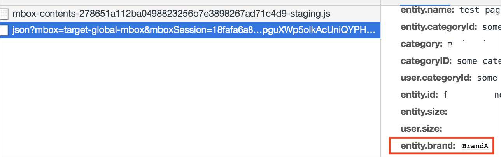
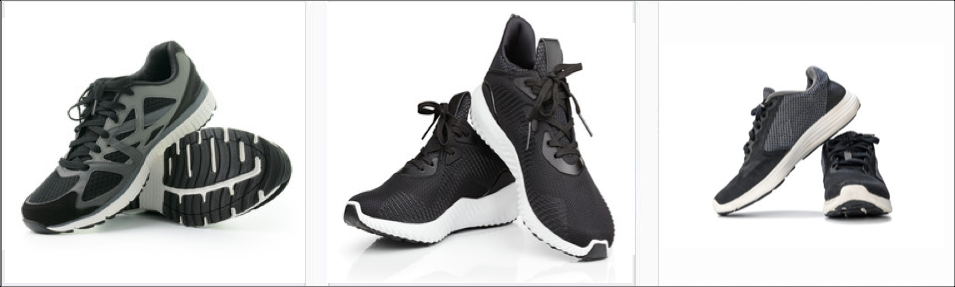

# 实体属性匹配 {#entity-attribute-matching}

>[!BEGINSHADEBOX]

**在此页面上：**&#x200B;了解如何在[!DNL Adobe Target Recommendations]中动态筛选推荐，方法是比较一组潜在的推荐项目与访客与之交互的特定项目。

>[!ENDSHADEBOX]

**[!UICONTROL 实体属性匹配]**&#x200B;只建议与访客与之交互的项的属性匹配的项。 如用例和示例所述，针对标准和促销活动创建和使用包含规则的过程类似。 有关详细信息，请参阅[使用动态和静态包含规则](/help/main/c-recommendations/c-algorithms/use-dynamic-and-static-inclusion-rules.md)。

## 实体属性匹配示例

**[!UICONTROL 实体属性匹配]**&#x200B;只能推荐匹配的项，例如：

* 访客当前正在查看的项目中的属性
* 访客最近查看的项目
* 访客最近购买的项目
* 访客最常查看的项目
* 在访客配置文件的自定义属性中存储的项目

### 根据品牌推荐项目

构建实体属性规则后，这些规则会筛选掉所有属性与页面上传递的实体值不匹配的推荐。 `entity.brand`值必须在页面上的mbox中交付，此进程才能正常工作。

对于这种类型的动态包含规则，只需指定一个推荐规则即可返回所有品牌页面上的相关品牌结果，而无需为每个品牌名称指定一个收藏集或静态筛选器。

例如，当显示具有品牌A产品的页面时，该页面会将`entity.brand`参数的值设置为“品牌A”。 在品牌登录页面上，mbox返回`entity.brand=brandA`。



然后，页面上的推荐将仅包含品牌A产品。


当显示品牌B产品页面时，`entity.brand`值将重置为“品牌B”，并且仅推荐品牌B产品。 同样，在品牌B的品牌登陆页面上，仅返回品牌B产品。



### 追加销售到更昂贵的产品

为了鼓励访客考虑价格更高、因此利润更高的商品，“等于”和“介于”运营商可以促销同一类别和同一品牌中更贵的商品。 例如，鞋子retailer可以促销更昂贵的跑鞋，以便向正在查看跑鞋的访客追加销售，如下面的示例所示：


```
Entity Attribute Matching
category - equals - current item's - category 
And 
Entity Attribute Matching
brand - equals - current item's - brand 
And 
Entity Attribute Matching
value - is between - 100% and 1000% of - current item's - value
```

### 推广贴牌产品

可以将动态和静态筛选器混合使用，以促销私有标签产品。 例如，一家办公用品公司可以推广公司自有品牌的碳粉盒，以便针对正在查看碳粉的访客实现更有利可图的销售，而针对正在查看笔的访客推广公司自有品牌的笔，如下面的示例所示：


```
Entity Attribute Matching
category - equals - current item's - category 
And
Static Filter
IsHouseBrand - equals - true
```
