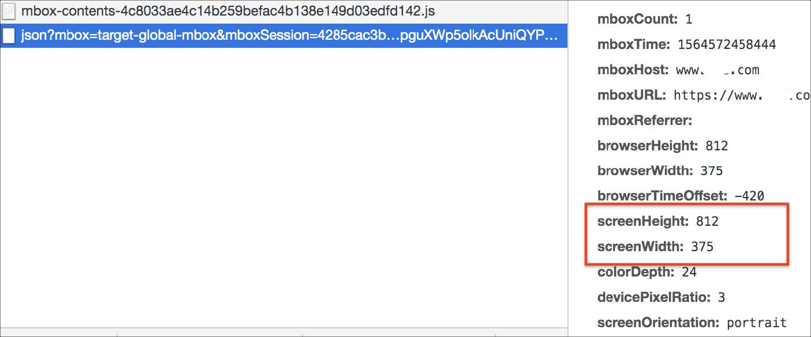

# 参数匹配 {#parameter-matching}

>[!BEGINSHADEBOX]

**在此页面上：**&#x200B;了解如何通过比较项目（实体）与请求（API或mbox）中的值在[!DNL Adobe Target Recommendations]中动态筛选推荐。

>[!ENDSHADEBOX]

**[!UICONTROL 参数匹配]**&#x200B;建议仅使用与页面参数或访客参数匹配的内容，如设备维度或地理位置。 例如，只能推荐与“行业”页面参数匹配的内容。 如用例和示例所述，针对标准和促销活动创建和使用包含规则的过程类似。 有关详细信息，请参阅[使用动态和静态包含规则](/help/main/c-recommendations/c-algorithms/use-dynamic-and-static-inclusion-rules.md)。

其他示例包括：

* 屏幕宽度和高度的Mbox参数可用于定位移动访客，并仅推荐移动设备和附件。
* 推荐规则只能返回与访客用于查看页面的移动设备的屏幕高度匹配或超过该屏幕高度的畅销手机。
* 区域地理位置参数可用于在冬季返回对工具的推荐。 在下雪地区的访客可以推荐使用吹雪机和其他降雪工具，但不在下雪地区的访客可以推荐使用。

## 参数匹配示例

[!DNL Recommendations]可以匹配[!DNL Target]调用中发送的参数值。 在以下示例中，[!DNL Target]根据[!DNL Target]调用中发送的屏幕高度和宽度参数检测访客正在使用移动设备，并仅推荐属于移动设备的项目。

请考虑以下示例[!DNL Target]调用：

在访客查看的页面上，将显示移动设备产品。

