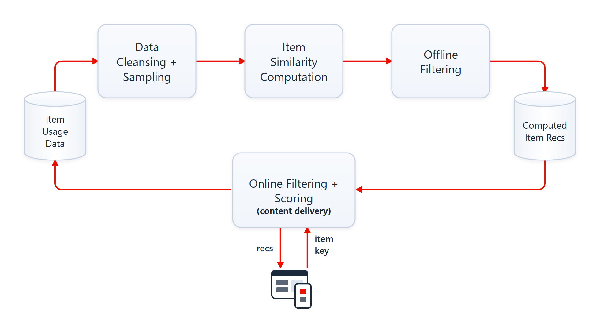
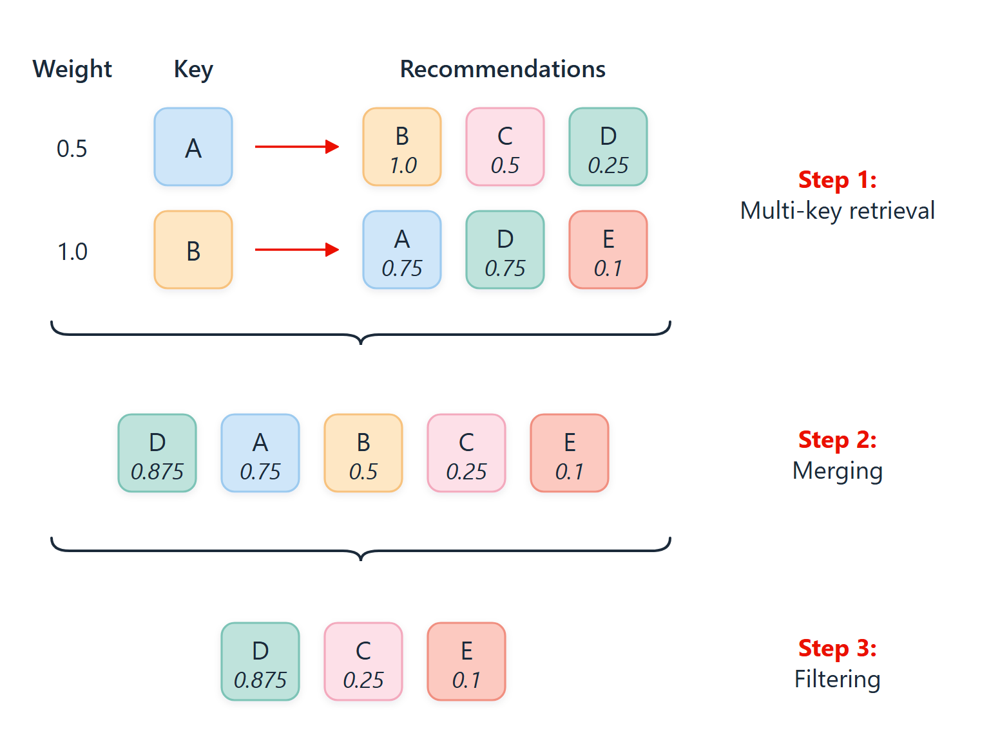

# Target 的推荐算法背后的科学原理 {#recommendations-algorithms}

>[!BEGINSHADEBOX]

**在此页面上：**&#x200B;了解[!DNL Adobe Target Recommendations]中的算法的工作原理，包括模型训练和模型服务的逻辑和数学详细信息。

>[!ENDSHADEBOX]

模型训练是[!DNL Adobe Target]学习算法生成推荐的过程。 模型服务（也称为内容交付）是[!DNL Target]如何向网站访客提供这些推荐的。

[!DNL Target]在[!DNL Recommendations]中提供以下类型的算法：

* **基于项目的算法**：遵循逻辑“查看/购买此项目的用户也查看/购买了这些项目”。 这些算法被分组到项 — 项协同过滤下。 此类型还包括具有相似属性的&#x200B;**[!UICONTROL 项目]**&#x200B;算法。

* **基于用户的算法**：包含为您推荐的&#x200B;**[!UICONTROL 最近查看的项目]**&#x200B;和&#x200B;**[!UICONTROL 算法]**。

* **基于热门程度的算法**：返回网站中查看次数最多或购买次数最多的项目，或者返回类别或项目属性。

* **基于购物车的算法**：使用逻辑“查看/购买了这些项目的用户也查看/购买了这些项目”来提供多项目推荐。

* **自定义标准**：使用上载到[!DNL Target]的自定义文件作为推荐的源。

有关每种算法类型及其算法的详细信息，请参阅[使推荐基于推荐键](/help/main/c-recommendations/c-algorithms/base-the-recommendation-on-a-recommendation-key.md)。

这些算法中有许多依赖一个或多个键，[!DNL Target]在内容交付时（产生推荐时）使用这些键来检索相似项目。 客户指定的键可以是访客正在查看的当前项目、上次查看或购买的项目、最常查看的项目、当前类别或访客最喜爱的类别。 其他算法（如基于购物车的算法和基于用户的算法）则使用客户无法配置的隐式密钥。 有关详细信息，请参阅[推荐键](/help/main/c-recommendations/c-algorithms/base-the-recommendation-on-a-recommendation-key.md#keys)。

密钥仅在模型提供服务时应用（内容交付）。 它们不会影响离线模型训练逻辑。

以下部分按照模型训练逻辑的相似性对算法分组，因此这些分组与上述类型略有不同。

## 项目 — 项目协同筛选

算法包括：

* **[!UICONTROL 查看了这个项目，也查看了那个项目的人]**
* **[!UICONTROL 查看了这个项目，但购买了那个项目的人]**
* **[!UICONTROL 购买了这个项目，也购买了那个项目的人]**

项目协同过滤算法利用许多用户的行为模式（因此是协作的）来推荐与给定项目相关的项目，从而过滤可能项目的目录。 许多不同的算法都属于协同过滤的一般框架，它们都使用行为数据作为输入。 在[!DNL Target Recommendations]中，这些输入是用户独特的项目查看和购买。

对于“已查看/购买此项目的用户也已查看/购买这些项目”算法，目标是计算所有项目对之间的相似度(A，B)。 对于给定的项目A，排名最前的推荐是按照项目相似度s(A，B)排序的项目。

相似性的一个示例是项目之间的共存：购买两个项目的用户的计数。 此量度直观但天真，因为它偏向于推荐热门项目。 例如，在大多数人购买面包的retailer杂货店，面包与所有物品的高共发生率，但它不一定是好的推荐。 [!DNL Target]改为使用对数似然比(LLR)。 当A和B两个项目同时发生的概率与其不同时发生的概率差别很大时，该数量就很大。 例如，对于&#x200B;**[!UICONTROL 查看了这个项目，也购买了那个项目]**&#x200B;的算法，当某人购买了B的概率是&#x200B;*而不是*&#x200B;时，LLR相似性就会很大，这与其是否查看了A无关。

如果物料A具有以下保留条件，则不建议使用物料B：

已查看/已购买算法的

有关对数似然比相似性计算的完整详细信息，请参阅[此PDF](/help/main/c-recommendations/c-algorithms/assets/log-likelihood-ratios-recommendation-algorithms.pdf)。

下图显示了算法实现的逻辑流程：

已查看/已购买算法的

步骤如下：

* **输入数据**：在您[实施Target](https://experienceleague.adobe.com/docs/target-dev/developer/recommendations.html?lang=zh-Hans){target=_blank}时或从[Adobe Analytics](/help/main/c-recommendations/c-algorithms/use-adobe-analytics-with-recommendations.md){target=_blank}收集的访客查看和购买形式的行为数据。

* **模型训练**：

  * **数据清理和采样**：对于具有N天回溯的算法，将首先过滤行为数据以仅包括这N天的数据。 然后，应用收集规则和全局排除以删除任何不应推荐的项目。 最后，与超过1000个项目交互的任何访客的使用数据将被采样到1000个项目。
  * **项目相似度计算**：核心计算步骤。 [!DNL Target]计算所有候选项目对之间的对数似然比相似度，并按此得分对项目对进行排名。
  * **脱机筛选**：应用任何其他适用的动态筛选器（例如，动态类别排除）。 随后，预先计算的推荐会被全局缓存，以便随时提供服务。

* **模型服务**：从[!DNL Target]的[全局“Edge”网络](/help/main/c-intro/how-target-works.md#concept_0AE2ED8E9DE64288A8B30FCBF1040934)交付推荐。 向[!DNL Target]发出mbox请求并确定应将推荐内容传递到页面时，将从请求中解析算法所需的[项目键](/help/main/c-recommendations/c-algorithms/base-the-recommendation-on-a-recommendation-key.md#keys)，或从访客配置文件中查找该键。 [!DNL Target]使用此键检索在先前步骤中计算的推荐，应用更多的动态筛选器，然后呈现适当的[设计](/help/main/c-recommendations/c-design-overview/create-design.md)。

## 内容相似度

包含的算法：

* **[!UICONTROL 具有相似属性的项目]**

使用这种算法，如果两个项目的名称和文本描述在语义上相似，则两个项目是相关的。 与大多数推荐算法需要行为数据不同，内容相似度算法从产品目录元数据中获取产品之间的相似度。 因此，[!DNL Target]可以在所谓的“冷启动”方案中提出推荐，在这种方案中，尚未收集行为数据（例如，在[!DNL Target]活动开始时）。

内容相似度算法的模型服务和内容投放与其他基于项目的算法相同。 模型训练有很大的不同：它涉及一系列自然语言的处理和预处理步骤，如下图所示。 相似度计算的核心是修改后的tf-idf向量余弦相似度，该向量代表目录中的每个项目。

步骤如下：

* **输入数据**：此算法仅使用目录数据，通过[目录馈送、实体API或页面更新](https://experienceleague.adobe.com/docs/target-dev/developer/recommendations.html?lang=zh-Hans){target=_blank}引入到[!DNL Target]。

* **模型训练**：

  * **属性提取**：在应用静态筛选器、目录规则和全局排除项后，算法将从实体架构中提取相关文本字段。 [!DNL Target]自动使用实体属性的名称、消息和类别字段。 它还尝试从自定义[实体属性](/help/main/c-recommendations/c-products/entity-attributes.md)中提取任何字符串字段。 当字段的大部分值无法解析为数字、日期或布尔值时，该字段被视为字符串字段。
  * **词干和停用词删除**：为了使文本相似度匹配更准确，[!DNL Target]删除了不会显着改变项含义的非常常见的“停用词”（例如，“was”、“is”和“and”）。 词干将具有不同后缀的词减少到其根词，根词具有相同的含义（例如，“connect”、“connecting”和“connection”都具有根词“connect”）。 [!DNL Target]使用Snowball词干器。 它首先执行自动语言检测，最多可以删除50种语言的停用词，并对18种语言执行词干处理。
  * **n-gram创建**：在前面的步骤之后，每个单词都被视为一个令牌。 将令牌的连续序列组合成单个令牌称为n元组创建。 [!DNL Target]考虑最多2克。
  * **tf-idf计算**：下一步将创建tf-idf向量，以反映项描述中令牌的相对重要性。 对于项目i中的每个令牌或术语t，使用的目录D |D|项，[!DNL Target]首先计算项频率TF(t，i)，这是项在项i中出现的次数，并且计算文档频率DF(t，D)，这是令牌t存在的项数。 然后，tf-idf度量为：

    

    [!DNL Target]使用Apache Spark的&#x200B;*tf-idf*&#x200B;功能化实现，该实现将每个令牌散列为218个令牌。 在此步骤中，还通过调整每个矢量中的项频度，应用[标准](/help/main/c-recommendations/c-algorithms/create-new-algorithm.md#similarity)中指定的属性升序和掩埋。

  * **项目相似度计算**：最终项目相似度是使用近似余弦相似度计算的。 对于包含向量tA和tB的两个项目&#x200B;*A*&#x200B;和&#x200B;*B*，余弦相似度定义为：

    

    为了避免计算所有N x N项之间相似度的巨大复杂性，*tf-idf*&#x200B;矢量被截断为它的最大500个项，项之间的余弦相似度从此截断表示中计算。 与其他近似最近邻算法（如局部敏感哈希算法）相比，该算法对稀疏向量相似度计算具有更好的鲁棒性。

* **模型服务**：此进程与上一节中所述的用于项 — 项协同筛选的进程相同。

## 多键建议

算法包括：

* 基于购物车的推荐
* **[!UICONTROL 为您推荐]**

**[!UICONTROL 为您推荐]**&#x200B;和基于Cart的算法使用协作筛选技术形成单个基于项目的推荐。 在运行时，会将多个项目用作键以检索这些基于项目的推荐：访客的浏览历史记录中的项目（对于&#x200B;**[!UICONTROL 为您推荐]**）或访客当前购物车中的项目（对于基于购物车的推荐）。 检索到的推荐将合并以形成最终列表。 通过多键算法，当访客有任何浏览历史记录时，即可使用推荐，并且推荐会进行更新以反映最新的访客行为。

这些算法基于基于项目的推荐部分中描述的协同过滤技术，并且还使用超参数调整来确定项目之间的最佳相似度量度。 该算法按时间顺序分割每个用户的行为数据，并基于较早的数据训练推荐模型，同时试图预测用户稍后查看或购买的项目。 然后选取平均精度最高的相似性度量。

下图显示了模型训练和评分步骤的逻辑：

步骤如下：

* **输入数据**：与项 — 项协同筛选(CF)方法相同。 **[!UICONTROL 为您推荐的]**&#x200B;和基于购物车的算法都使用在您[实施Target](https://experienceleague.adobe.com/docs/target-dev/developer/recommendations.html?lang=zh-Hans){target=_blank}时或从[Adobe Analytics](/help/main/c-recommendations/c-algorithms/use-adobe-analytics-with-recommendations.md){target=_blank}收集的用户查看和购买形式的行为数据。

* **模型训练**：

  * **数据清理和采样**：与协作筛选方法相同。 回顾窗口会将行为数据过滤到适当的日期范围，然后应用目录规则和全局排除。 对于与1,000多个项目进行交互的访客，只考虑最近1,000个使用情况。
  * **训练测试拆分**：按时间顺序拆分每个用户的使用情况。 前80%用于训练数据，其余20%用于测试数据。
  * **项目相似度模型训练**：核心项目相似度计算在&#x200B;**[!UICONTROL 推荐给您]**&#x200B;和基于购物车的候选项目向量的构建方式上有所不同。 对于&#x200B;**[!UICONTROL Recommended for You]**，项向量具有维度NUsers，每个条目都是用户为项提供的隐式评分的总和。 购买者的权重是浏览次数的2倍。 对于基于购物车的推荐，项目矢量具有二进制条目。 如果只考虑会话内行为，则每个会话都有一个条目。 否则，每个访客都有一个条目。

    训练步骤计算几种类型的向量相似度：LLR相似度（[请参阅PDF](/help/main/c-recommendations/c-algorithms/assets/log-likelihood-ratios-recommendation-algorithms.pdf)）、余弦相似度（以前定义）和规范化L2相似度(定义为：

    

  * **项目相似度模型评估**：通过对测试数据集进行预测来评估上一步中生成的推荐。 通过按时间顺序对测试数据集中的每个用户的项目使用情况排序，然后为排序的项目子集提出100个推荐来模拟在线评分阶段，以预测随后的查看和购买。 这些推荐的质量使用平均平均精确度（一种信息检索量度）进行评估。 此量度会考虑推荐的顺序，并支持列表中排名较高的相关项目，这是排名系统的一个重要属性。
  * **模型选择**：在离线评估后，选择具有最高平均精确度的模型，并为其计算所有单个项推荐。
  * **脱机筛选**：模型训练的最后阶段应用任何适用的动态筛选器。 随后，预先计算的推荐会被全局缓存，以便随时提供服务。

* **模型服务**：与以前的算法不同（这些算法指定单个键进行检索，然后应用业务规则），**[!UICONTROL 为您推荐]**&#x200B;和基于Cart的算法使用更复杂的运行时进程：

  * **多键检索和合并**：对于基于购物车的推荐，最多使用购物车中传递的10个项目作为检索键，并且来自每个键的推荐均等加权。 对于&#x200B;**[!UICONTROL 为您推荐]**，最多使用最近五个唯一查看的项目和最近五个唯一购买的项目作为键，并且购买项目中的推荐的权重是查看项目中的推荐的两倍。 在合并推荐时，将添加出现在多个列表中的项目的加权相似度分数。 结果是重新加权的推荐的合并列表，按降序排列。
  * **筛选**：随后将应用筛选规则（如删除以前查看或购买的项目）和其他动态业务规则。

下图说明了查看了项目A并购买了项目B的访客的这些流程。系统将使用每个项目标签下显示的离线相似度得分来检索各个推荐，然后与汇总的加权相似度得分合并。 最后，当客户已指定必须过滤掉以前查看过的和购买过的项目时，过滤步骤将从推荐列表中删除项目A和B。

## 基于热门程度

算法包括：

* 整个网站查看的次数最多&#x200B;**&#x200B;**
* 按类别查看的次数最多&#x200B;**&#x200B;**
* **[!UICONTROL 按项目属性查看的次数最多]**
* **[!UICONTROL 按轮廓属性划分的最多浏览量]**
* **[!UICONTROL 网站上的最畅销商品]**
* **[!UICONTROL 按类别划分的最畅销商品]**
* 按项目属性&#x200B;**[!UICONTROL 最畅销商品]**
* **[!UICONTROL 按配置文件属性排列的畅销商品排名]**

[!DNL Target]为网站中的查看次数最多的项目和最畅销的项目提供基于热门程度的算法，或者按项目属性或类别进行划分。 这些算法按照在给定时间范围内查看或购买项目的会话数对项目进行排名。

所有这些算法都整合了聚合的行为数据，这些数据记录以小时和每日分辨率查看和购买项目的会话总数。 然后，每个算法都会查找客户配置的回顾时间范围内查看次数最多或购买次数最多的项目。

这些算法的不同之处如下：

* **[!UICONTROL 在网站中查看次数最多]**，在网站中为&#x200B;**[!UICONTROL 最畅销商品]**&#x200B;分别按查看或购买项目的会话总数排名项目。 输出是推荐项目的单个（无键）列表。
* 按类别或项目属性显示的“查看次数最多”和“最畅销商品”还按聚合会话计数对项目排序，但按项目类别或特定项目属性对项目分组。 输出是推荐项目列表，由类别或项目属性的值作为键值。
* **[!UICONTROL 按配置文件属性查看次数最多]**&#x200B;和&#x200B;**[!UICONTROL 按配置文件属性最畅销商品]**&#x200B;也按汇总视图或购买计数对项目进行排名，但它们按访客配置文件属性（如国家/地区、成员层）分组，而不是按项目属性分组。 每个会话的计数都归因于访客在交互时持有的配置文件值，而不是项目的任何属性。 结果是一组推荐列表，由该配置文件属性的不同值作为键值。

## 最近查看的项目

“最近查看的”算法提供了推荐的会话内个性化。 它不需要离线模型训练。 相反，[!DNL Target]使用唯一的[访客配置文件](/help/main/c-target/c-visitor-profile/visitor-profile.md)来维护会话中查看的项目的运行列表，并可以在推荐活动中显示这些项目。 这样可实时更新推荐和下一页面个性化。

## 自定义标准

自定义标准允许客户[将自己的推荐](/help/main/c-recommendations/c-algorithms/recommendations-csv.md)上传到Target，这提供了灵活性并允许“自带模型”功能。 自定义标准替换了&#x200B;**[!UICONTROL 基于项目的]**&#x200B;推荐的离线训练部分。 在在线内容交付过程中，它们的行为与基于项目的算法类似：使用单个键来检索推荐，然后应用业务规则和过滤器。
