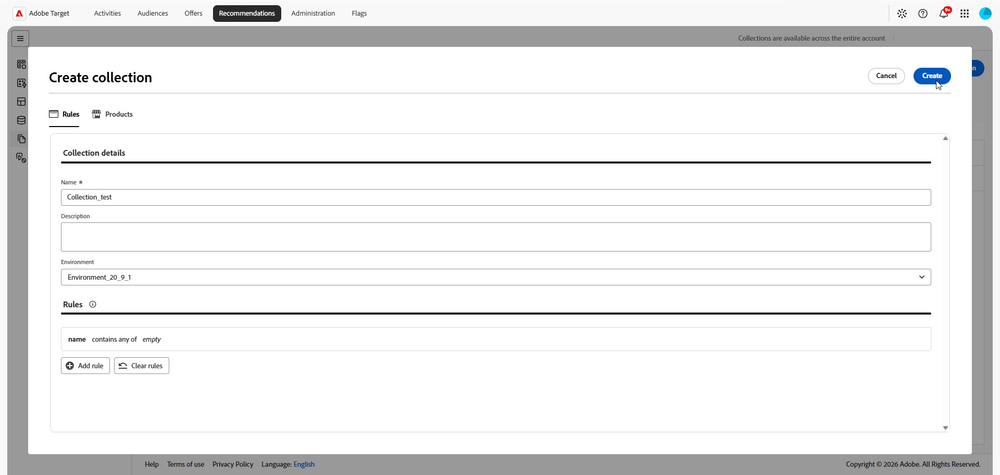

# 收藏集 {#collections}

>[!BEGINSHADEBOX]

**在此页面上：**&#x200B;了解如何在[!DNL Adobe Target Recommendations]中创建、管理和使用项目集合。

>[!ENDSHADEBOX]

收藏集是一组符合推荐标准的产品或项目。 集合由项目必须满足才能成为其一部分的条件定义。 项目可以按业务适用的任何方式进行分组，例如类似或相关的项目、特定价格范围或颜色的产品，或可能在特定地理区域引起兴趣的项目。

收藏集将产品组织到逻辑存储桶中。 例如，如果某些项目在一个区域可用，但在另一个区域不可用，则收藏集可以排除访客所在区域不可用的项目。 收藏集还可以组织季节性项目或适用于该业务的任何其他组织参数。 项目可以分组到目录中，然后可以为每个收藏集创建单独的推荐。

以下几点描述了收藏集如何与[!DNL Recommendations]的其余部分进行交互：

* 针对每个标准生成的[备份推荐](/help/main/c-recommendations/c-algorithms/backup-recs.md)也使用该集合，因此只有集合中的项目包含在备份推荐中。 因此，只会显示对某个位置有意义的产品。
* 每次运行各个标准时，都会重新构建或更新收藏集。
* 收集规则适用于运行标准后生成的推荐项。 它们只影响输出中的实体推荐(ER)，而不影响键。
* 使用&#x200B;**[!UICONTROL 最近查看的项目]**&#x200B;推荐键时，不会应用收藏集。
* 包含标准可能会产生相似的结果，但每次创建活动时都必须设置这些结果。 收藏集创建一次，之后可以重复使用，而无需再次设置。
* 创建或编辑[!DNL Recommendations]活动时，收藏集名称会显示在活动图上的&#x200B;**[!UICONTROL 标准]**&#x200B;标签旁边。

## 创建收藏集 {#task_1256DFF6842141FCAADD9E1428EF7F08}

收藏集可在整个帐户中使用，因此可在任何[!DNL Recommendations]活动中选择一次创建的收藏集。 规则在集合中定义，因此无需为每个活动再次设置它们。

1. 单击&#x200B;**[!UICONTROL 推荐]** > **[!UICONTROL 收藏集]**&#x200B;以显示现有收藏集列表。

   要编辑、复制或删除现有收藏集，请单击收藏集旁边的“更多操作”图标（），然后单击所需的选项。

   >[!NOTE]
   >
   >**[!UICONTROL 收藏集]**&#x200B;列表视图中为每个收藏集报告的“项目数”是指，在配置的默认“推荐”[主机组](/help/main/administrating-target/hosts.md)（环境）中与该收藏集的规则相匹配的产品数。 请参阅[设置](https://experienceleague.adobe.com/docs/target-dev/developer/recommendations.html?lang=zh-Hans){target=_blank}以更改默认主机组。

1. 单击&#x200B;**[!UICONTROL 创建收藏集]**。

   使用“创建收藏集”按钮的

1. 键入集合的&#x200B;**[!UICONTROL 名称]**。 也可以输入可选的&#x200B;**[!UICONTROL 描述]**。

1. （视情况而定）从&#x200B;**[!UICONTROL 环境]**&#x200B;筛选器中选择[环境](/help/main/administrating-target/environments.md)以预览该环境中集合的内容。 默认情况下，会显示默认主机组的结果。

1. 设置用于构建收藏集的规则。

   收藏集可以围绕产品ID或类别、边距或列表中的任何其他参数构建。 添加规则以使用多个参数定义集合。 多个规则使用AND运算符相连，因此所有指定的规则都必须匹配才能应用集合。

1. 单击&#x200B;**[!UICONTROL 创建]**。

1. 创建集合后，单击“更多操作”图标（ ）并选择适当的选项： **[!UICONTROL 编辑]**、**[!UICONTROL 复制]**&#x200B;或&#x200B;**[!UICONTROL 删除]**。

   

<!--
## Create a collection using [!UICONTROL Advanced Search]

You can also create collections using [!UICONTROL Advanced Search] on the [Catalog Search](/help/main/c-recommendations/c-products/catalog-search.md#save-as) page ([!UICONTROL Recommendations] > [!UICONTROL Catalog Search] > [!UICONTROL Advanced Search]). 

After creating a search using "id > contains," for example, you can then click [!UICONTROL Save As] > [!UICONTROL Collection].

>[!IMPORTANT]
>
>The [!UICONTROL Advanced Search] functionality is case-insensitive; however, products returned at the time of delivery are based on case-sensitive search. This mismatch might lead to confusion. Ensure that you consider case-sensitivity when you create collections based on results using the [!UICONTROL Advanced Search] functionality. For example, if you perform a search for "Holiday," that initial search lists results containing "Holiday" and "holiday." If you then create a catalog with the intent to return products containing "holiday," only products containing "holiday" are returned. Products containing "Holiday" are not returned.
-->

## 在活动中使用收藏集 {#use-collection}

为[!DNL Recommendations]活动的每个体验选择一个集合。 收藏集可确定哪些项目符合条件将显示在该体验的推荐中。

1. [创建集合](#task_1256DFF6842141FCAADD9E1428EF7F08)。

   

1. 单击&#x200B;**[!UICONTROL 活动]**&#x200B;和[新建推荐活动](/help/main/c-recommendations/t-create-recs-activity/create-recs-activity.md)或编辑现有活动。

   在“创建活动”菜单中选择推荐的

1. 选择标准和设计后，在&#x200B;**[!UICONTROL 选项]**&#x200B;页面上选择所需的集合。

1. （视情况而定）要更改现有活动的集合，请单击&#x200B;**[!UICONTROL 体验]**&#x200B;页面上的推荐位置，单击&#x200B;**[!UICONTROL 更改集合]**，然后选择所需的集合。
