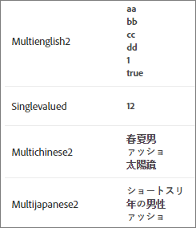

# 自定义实体属性 {#custom-entity-attributes}

>[!BEGINSHADEBOX]

**在此页面上：**&#x200B;了解如何定义、发送和使用描述[!DNL Adobe Target Recommendations]目录中的项目的单值和多值自定义实体属性。

>[!ENDSHADEBOX]

在[!DNL Adobe Target Recommendations]中使用单值和多值自定义实体属性来定义有关目录中项目的其他信息。 然后，此信息可用于算法包含规则、目录规则和排除规则，并可在设计中显示。

## 限制 {#limits}

您最多可以包含 100 个自定义实体属性，来对目录中的项目定义其他相关信息。 例如，您可以创建一个名为 `entity.genre` 的自定义属性，用来定义一本书籍或一部电影。 或者，票务供应商可以为活动场地创建属性以包括辅助表演，例如体育赛事中的客队或音乐会上的开场表演。

单值实体自定义属性的最大长度为 15,000 个字符（对于单字节和双字节 UTF-8 编码语言，例如英语和其他拉丁文字字母）或 10,000 字符（对于三字节 UTF-8 编码语言，例如中文、日语和韩语）。

多值实体自定义属性最多可以包含 500 个值。 每个值的限制为 100 个字符。 所有值的字符总数必须符合单值实体自定义属性的最大长度限制（请参阅上文）。

## 自定义实体属性值 {#section_313331A9F8194A89B5EDD89363018651}

自定义实体属性可以包含单个值或多个值。 实体属性值会显示在产品视图中。



具有单个值的自定义实体属性的构成方式与单值预定义实体属性相同：

`entity.genre=genre1`

多值自定义实体属性必须作为有效的 JSON 数组来发送：

`entity.genre=["genre1", "genre2"]`

[!DNL Recommendations] 支持的有效 JSON 数组的示例：

* `["AB","BC"]` 所有值均为字符串
* `[1,2]` 所有值均为数字

>[!NOTE]
>
>[!DNL Recommendations] 不支持多值实体属性中存在混合值类型。 例如，`["AB",1,true, [1,2,3]]` 是有效的 JSON 数组，但在 [!DNL Recommendations] 中不受支持，因为它包含混合值类型（字符串、数字、布尔值、对象）。

将自定义属性作为有效的 JSON 数组发送后，该属性会被视为目录中所有产品的多值属性。

>[!NOTE]
>
>要将多值属性更改为单值属性，您必须删除目录并上传已更正的产品数据。 删除目录不会删除与您的产品 ID 关联的历史数据。 有关更多信息，请参阅 Adobe Recommendations Classic ** 文档中的[删除系统中的所有项目](/help/main/assets/adobe-recommendations-classic.pdf)。

**限制**：

* 您无法将预定义实体属性的名称用于自定义实体属性。 （请参阅[实体属性](/help/main/c-recommendations/c-products/entity-attributes.md#entity-attributes)。）
* `entity.environment` 属性由系统保留，该属性不能用于自定义实体属性。 尝试使用 `entity.environment`、信息源或 API 来传递 `targetPageParams` 的操作将会被忽略。
* 数组必须包含单值类型。 不支持混合值数组 ( `["AB",1,true]` )。
* 包含嵌套 JSON 数组 ( `[10,12,[1,2,3]]` ) 的多值属性会被视为单值属性。

## 实施多值属性 {#section_80FEFE49E8AF415D99B739AA3CBA2A14}

使用信息源(CSV)、`targetPageParams`和交付API上传产品时，支持多值自定义实体属性。 新值会替换当前值，而不进行附加。 空数组( [])被视为没有值。

必须对双引号进行转义。 例如，`"[""test"", ""value""]"` 是可在 CSV 中使用的有效 JSON 数组。

### 使用targetPageParams

以下示例说明如何使用`targetPageParams`：

```javascript
function targetPageParams() { 
  return { 
    'entity.id':                   '123', 
    'entity.categoryId':            '["A", "A:B", "A:B:C", "A:B:C:D"]',        
    'entity.MultiValueAttribute':   '["X", "Y", "Z"]', 
    'entity.event.detailsOnly':     'true', 
    'excludedIds':                  '[123, 3232, 2323, 4344]', 
    'orderId':                      '123456', 
    'orderTotal':                   '195.32', 
    'productPurchaseId':            '[001,002,003]' 
  }; 
}
```

### 使用CSV

您可以使用文本编辑器以原始格式管理 CSV 文件，也可以使用电子表格软件。

原始 CSV 将如下所示：


电子表格中的相同目录将如下所示：


转换为.csv格式时，电子表格软件会在单元格内容两侧添加双引号，以防止单元格内的逗号充当列分隔符。 它还会在自定义多值属性中包含的 JSON 字符串值两侧添加双引号标记。 这样可直接处理庞杂的原始文件。 例如：

* 电子表格：`["1","2","3"]`
* 原始：`"[""1"",""2"",""3""]"`

直接编辑原始目录 CSV 文件时务必要小心。

### 使用API

您可以使用投放API在mbox参数中传递多值属性，作为包含转义JSON数组的字符串值。

```javascript
"execute": {
    "mboxes": [
      {
        "index": 0,
        "name": "first-mbox",
        "parameters": {
          "entity.id": "32323",
          "entity.categoryId": "My Category",
          "entity.MultiValueAttribute": "[\"X\", \"Y\", \"Z\"]"
        }
      }
    ]
  }
```

有关使用交付和保存实体API的信息，请参阅[Adobe Recommendations API文档](https://experienceleague.adobe.com/docs/target-dev/developer/recommendations.html?lang=zh-Hans){target=_blank}。

## 将运算符用于多值属性 {#section_83C2288A805242D9A02EBC4F07DEE945}

在算法包含规则、目录规则和排除规则中将运算符应用于多值自定义属性时，如果列表中至少有一个值符合运算规则（布尔运算“或”**），则结果将为 *true*。

在以下示例中，规则是`message contains abc`。

* 用例 1：`entity.genre = ["ab", "bc", "de"]`。 结果为 false，因为没有值包含 `abc`。
* 用例 2：`entity.genre = ["abcde","de","ef"]` 结果为 true，因为有一个值包含 `abc`。

对于否定运算符，所有属性值必须都符合运算规则（布尔运算“和”**）。 例如，如果运算符为`notEquals`，则当有任何值匹配时，结果将为&#x200B;*false*。

下表总结了每个运算符的行为方式，并提供了每个示例规则的情况。

| 运算符 | 在以下情况下结果为true | 示例规则 | 属性值 | 结果 | 原因 |
|---|---|---|---|---|---|
| 等于 | 任何属性值均等于输入值。 | `genre equals abc` | `["ab", "bc", "de"]` | false | 没有值等于`abc`。 |
|  |  |  | `["abc", "de", "ef"]` | true | 一个值等于`abc`。 |
|  |  |  | `["abcde", "de", "ef"]` | false | `abc`不等于列表中的任何元素。 |
| 不等于 | 没有属性值等于输入值。 | `genre not equals abc` | `["ab", "bc", "de"]` | true | 没有值等于`abc`。 |
|  |  |  | `["abc", "de", "ef"]` | false | 一个值等于`abc`。 |
|  |  |  | `["abcde", "de", "ef"]` | true | `abc`不等于列表中的任何元素。 |
| 包含 | 任何属性值都包含输入值。 | `genre contains abc` | `["ab", "bc", "de"]` | false | 没有值包含`abc`。 |
|  |  |  | `["abcde", "de", "ef"]` | true | 一个值包含`abc`。 |
| 不包含 | 没有属性值包含输入值。 | `genre does not contain abc` | `["ab", "bc", "de"]` | true | 没有值包含`abc`。 |
|  |  |  | `["abcde", "de", "ef"]` | false | 一个值包含`abc`。 |
| 开始于 | 任何属性值都以输入值开头。 | `genre starts with abc` | `["ab", "bc", "de"]` | false | 没有值以`abc`开头。 |
|  |  |  | `["abcde", "de", "ef"]` | true | 一个值以`abc`开头。 |
|  |  |  | `["ab", "de", "abc"]` | true | 一个值以`abc`开头（不一定是列表中的第一个元素）。 |
| 结束于 | 任何属性值都以输入值结尾。 | `genre ends with abc` | `["ab", "bc", "de"]` | false | 没有值结束于`abc`。 |
|  |  |  | `["deabc", "de", "ef"]` | true | 一个值以`abc`结尾。 |
| 大于或等于（仅限数字值） | 任何属性值都大于或等于输入值。 每个值都会转换为double，并且在规则运行时会跳过无法转换的值。 | `price greater than or equal to 100` | `["10", "20", "45", "de"]` | false | 没有值大于或等于100。 跳过了值 `de`，因为无法将其转换为双精度类型。 |
|  |  |  | `["100", "101", "90", "80"]` | true | 两个值大于或等于100。 |
| 小于或等于（仅限数字值） | 任何属性值都小于或等于输入值。 每个值都会转换为double，并且在规则运行时会跳过无法转换的值。 | `price less than or equal to 100` | `["101", "200", "141", "de"]` | false | 没有值小于或等于100。 跳过了值 `de`，因为无法将其转换为双精度类型。 |
|  |  |  | `["100", "101", "90", "80"]` | true | 两个值小于或等于100。 |
| 动态匹配（仅在基于项目的算法中可用） | 任何属性值都与输入值匹配。 | `genre matches abc` | `["ab", "bc", "de"]` | false | 没有值与`abc`匹配。 |
|  |  |  | `["abc", "de", "ef"]` | true | 一个值与`abc`匹配。 |
| 动态不匹配（仅在基于项目的算法中可用） | 没有与输入值匹配的属性值。 如果有任何属性值匹配，则结果为false。 | `genre does not match abc` | `["ab", "bc", "de"]` | true | 没有值与`abc`匹配。 |
|  |  |  | `["abc", "de", "ef"]` | false | 一个值与`abc`匹配。 |
| 动态范围（仅在基于项目的算法中可用，仅限数字值） | 任何数字属性值都位于指定的范围内。 | `price dynamically ranges in 80% to 120% of 100` | `["101", "200", "125", "de"]` | true | `101`在100的80%到120%范围内。 跳过了值 `de`，因为无法将其转换为双精度类型。 |
|  |  |  | `["130", "191", "60", "75"]` | false | 没有值在100的80%到120%范围内。 |

>[!NOTE]
>
>*双精度类型*&#x200B;是一种 Java 数据类型。 对于需要使用数字值的运算符，转换为双精度类型可避免在结果中考虑非数字值。

## 设计中的多值属性 {#section_F672E4F6E1D44B3196B7ADE89334ED4A}

在设计中所引用的多值属性会显示为以逗号分隔的列表。

示例：

当 `entity.genre=["genre1","genre2"]` 在设计中以 `$entity<N>.genre` 方式引用时，结果为 `genre1, genre2`。

## 相关主题

* [实体属性](/help/main/c-recommendations/c-products/entity-attributes.md#entity-attributes)
