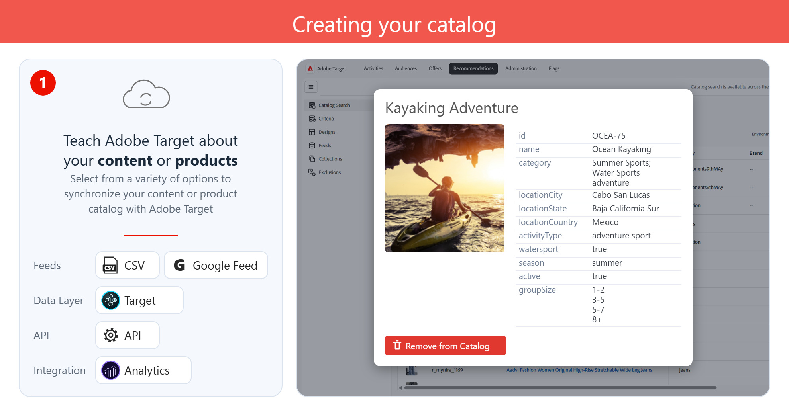
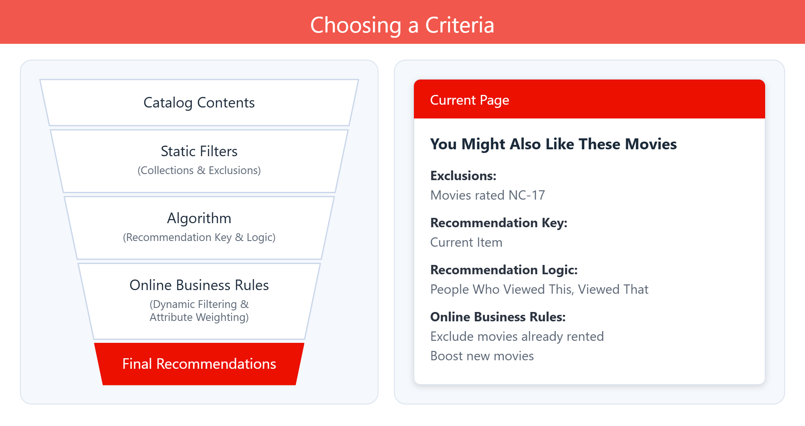
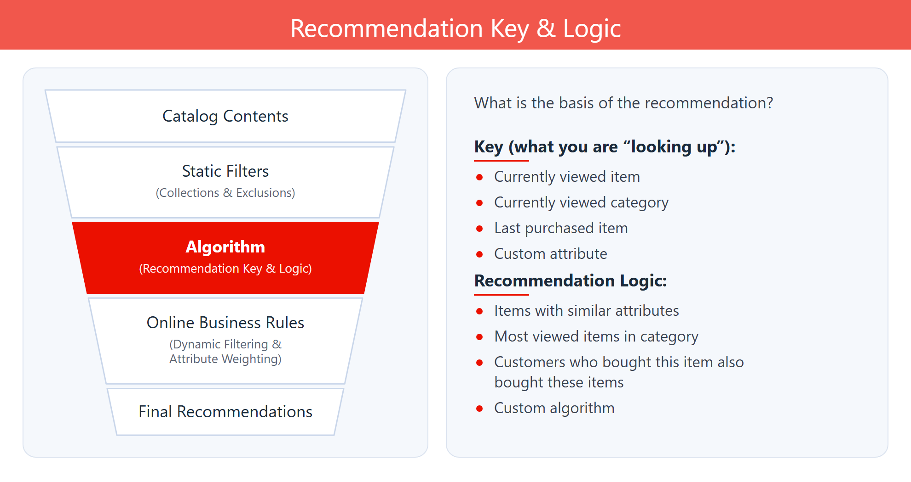
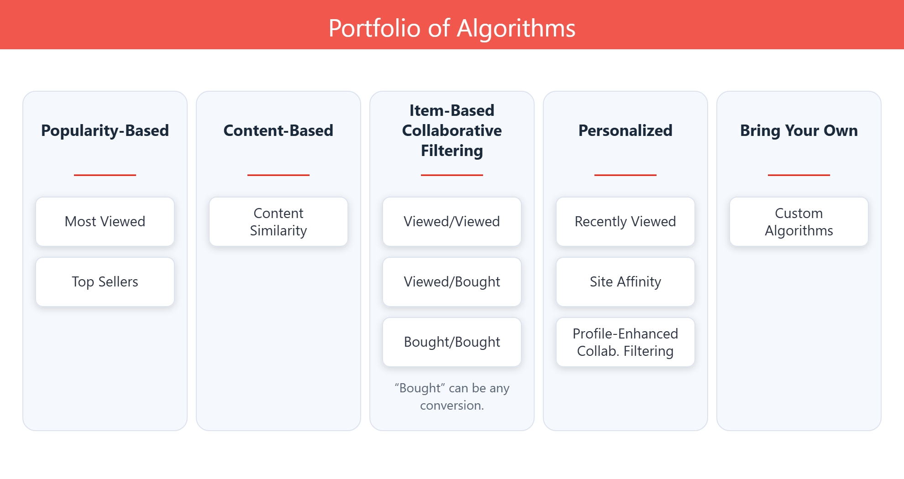
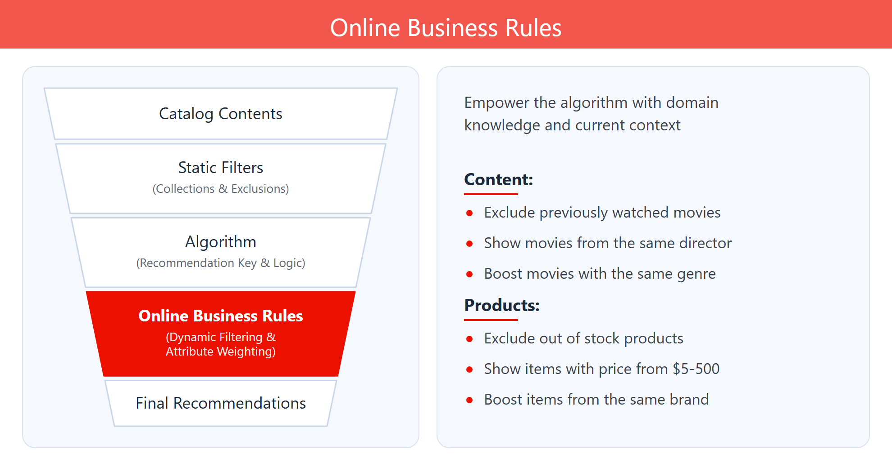

# 推荐简介 {#introduction-to-recommendations}

>[!BEGINSHADEBOX]

**在此页面上：**&#x200B;了解[!DNL Adobe Target]中的[!DNL Recommendations]活动如何向访客显示相关产品或内容，以及如何规划和构建[!DNL Recommendations]实施和活动。

>[!ENDSHADEBOX]

此页面基于&#x200B;*Recommendations简介*&#x200B;网络研讨会。 [!DNL Recommendations]活动可根据先前的访问优化实时建议，从而自动显示客户可能感兴趣的产品或内容。 该页还介绍了如何在[!DNL Target] UI中构建[!DNL Recommendations]活动。

## 简介

客户越来越期待获得推荐，并将这些推荐作为探索其他可用选项的起点。 几乎每个人都购买了他们在推荐中首先看到的产品，无论是在商店中还是在数字财产上。

人们使用媒体和内容的方式越来越多地受到个性化推荐的驱动，Netflix、Spotify和YouTube等数字优先品牌通过推荐开始客户体验。 由于有更多的替代方案可用，因此关键是在交互时为客户确定最相关的内容。

营销人员可以使用 [!DNL Adobe Target] 在各种行业、客户类型和渠道中推动个性化体验。 下表列出了一些客户如何使用[!DNL Target]来提供个性化推荐的示例。

| 用例 | 示例 |
|---|---|
| 发布 | Web发布者使用[!DNL Target Recommendations]向网站访客推荐文章并提高参与度。 |
| 视频教程 | [!DNL Adobe Creative Cloud]使用[!DNL Target]向Photoshop应用程序中的Photoshop用户推荐视频教程。 |
| 游戏 | 游戏公司使用[!DNL Target]向其控制台上的用户推荐游戏和内容。 |
| B2B销售 | 企业对企业的公司使用[!DNL Target]向B2B潜在用户推荐视频、白皮书和博客文章、提供下载，并向现有客户提供帮助。 |
| 旅行 | 一家德国旅游预订公司使用[!DNL Target]向旅客推荐酒店等产品。 有关详细信息，请参阅[Adobe Summit会话](https://2017.summit.adobe.com/na/sessions/summit-online/online-2017/#17608){target=_blank}。 |
| 零售 | 一家领先的B2B retailer使用[!DNL Target]在浏览器及其移动设备应用程序中推荐顶级类别和产品以吸引访客。 |

## 绝佳建议的要素

出色的推荐具有相关性和个性化。 三个元素驱动了相关性和个性化：

* **营销人员控件**&#x200B;以驱动推荐项目的相关性。 营销人员知道推荐模型应考虑其产品或内容的哪些属性。 例如，在视频网站上，用户可能对同一导演的电影感兴趣，但可能对同一工作室的电影不感兴趣。 [!DNL Target]提供控件以使用此域知识增强算法。
* **复杂的模型**，用于了解数百万个目录项和交互事件。 [!DNL Target]拥有经过十多年经验积累的机器学习功能，每年处理数十亿条推荐。
* **用户上下文**&#x200B;以确保推荐及时且相关。 例如，推荐不得包含某个用户刚刚观看的视频或刚刚添加到购物车的衬衫。 [!DNL Target]用户配置文件可用于推荐，以确保个性化。

## 实现 [!DNL Target] 推荐

从定义以下各点的策略开始：

* **要推荐的项目**：产品、视频或内容。
* **推荐的位置**：渠道（Web、移动设备、店内、网亭等）、客户历程的部分以及包含推荐的网站页面。
* **成功测量**：如何确定推荐是否成功，例如，通过将没有推荐的体验与具有推荐的体验进行比较，或者通过比较两种不同类型的推荐。 某些量度（例如对客户存留期值的影响）很难直接衡量，因此通常更容易使用更具体的量度，例如每次访问带来的收入、平均订单值或点击次数。 在某些情况下，目标是最小化某个量度，例如支持调用的数量。

定义策略后，[!DNL Target Recommendations]的实现涉及三个广泛的步骤：

### 向[!DNL Target]讲授您的内容或产品

当您开始使用[!DNL Recommendations]时，您会传递有关每个要推荐项目的信息。

最简单且最常用的方法是：每天或每周从产品信息管理系统或内容管理系统发送CSV文件。 其他选项包括：使用[!DNL Adobe Target] JavaScript库从页面传递数据层上的信息，使用API直接从源系统传递信息，或者使用[!DNL Adobe Analytics]集成（如果您已将目录数据传递到[!DNL Analytics]）。 您可以同时使用多个选项，例如，每天通过CSV文件传递大多数数据，并通过API更频繁地传递库存更新。 IT部门通常会参与此步骤的设置。

无论您选择哪种方法，都可以在三个类别中包含有关每个项目的元数据：

* **要向收到推荐的用户显示的数据。** 例如，电影的名称和缩略图图像 URL。
* **对应用营销和促销控件有用的数据。** 例如，电影的评级，这样您就不会推荐评级为 NC-17 的电影。
* **用于确定项目与其他项目相似度的数据。** 例如，电影的流派或者电影中的演员。

### 捕获用户行为

添加标记或使用现有[!DNL Analytics]实施，以便[!DNL Target]了解您的用户查看和购买的项目。 如果购买与上下文无关，请跟踪不同类型的转化事件，例如，下载PDF、完成调查、订阅新闻稿或观看视频。

如果您已经使用[!DNL Target]在网站上运行A/B测试活动，则可能已经完成此步骤。 如果您已使用[!DNL Adobe Analytics]报告网站访问和转化行为，则可以使用[!DNL Analytics]作为行为数据源。 否则，最简单的选项是使用标签管理器（如[[!DNL Adobe Experience Platform]](https://experienceleague.adobe.com/docs/target-dev/developer/client-side/at-js-implementation/deploy-at-js/implement-target-using-adobe-launch.html){target=_blank}中的标签）设置此项。 也可以通过实时API将离线或应用程序内的交互发送到[!DNL Target]。

### 使用正确的上下文信息获取推荐

除了聚合用户行为之外，[!DNL Target]还需要显示推荐的特定上下文，其中包括有关页面的信息和来自用户配置文件的信息。 [!DNL Target]使用此信息来筛选项目并改进推荐的个性化。

## 构建第一个“推荐”活动

[!DNL Recommendations]活动结合了受众、标准和设计。 [!DNL Target]包括14个内置受众、42个内置标准和10个内置设计模板。 您可以自定义每个项目或添加您自己的项目。

[!DNL Target]使用条件卡的概念，就像个性化的方法一样。 选择或创建正确的标准对于实现预期的个性化结果很重要。 标准卡片的工作方式与funnel类似，可将您从整个目录带到最终的一组推荐。

以下部分介绍了此funnel的各个部分及其在[!DNL Target]中的工作方式。

### 静态筛选器（收藏集和排除项）

静态筛选器是与您不希望频繁更改的目录属性相关的广泛适用的规则，因此您可以在多个推荐中使用它们。

### 算法（推荐键和推荐逻辑）

下一步是选择作为推荐基础的推荐键和逻辑。 推荐键是您要“查找”以选择推荐的内容。

[!DNL Target]包含算法组合。

### 在线业务规则

最后一步是应用在线业务规则，这些规则会根据访客对数字资产所做的操作，通过领域知识和当前上下文来增强算法。

