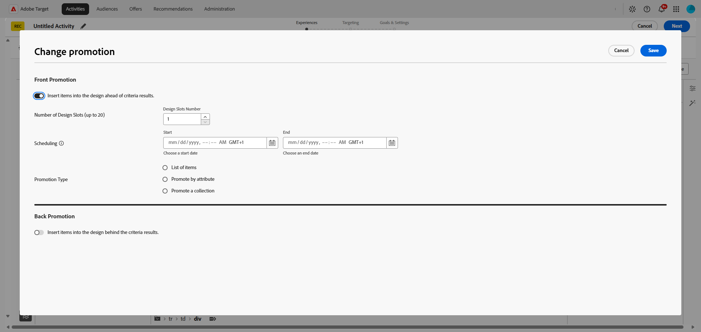

# 添加促销活动 {#add-promotions}

>[!BEGINSHADEBOX]

**在此页面上：**&#x200B;了解如何将促销项目添加到[!DNL Recommendations]设计，以及如何确定它们的排序顺序。

>[!ENDSHADEBOX]

除了条件推荐的项目之外，促销活动还会在[!DNL Recommendations]设计中放置特定项目。 它们在设计中使用可用的版块，并优先于标准结果和备用推荐。 例如，如果一个设计有六个版块，其中两个用于促销活动，则对于根据标准推荐的项目，将保留四个版块。

系统将根据按标准为活动推荐的项目删除重复的促销活动，以便给定的项目不会在单个推荐栏中出现两次。

>[!NOTE]
>
>使用促销活动会更改CSV结构和输出。 这些更改可能会影响任何涉及CSV的外部流程，例如电子邮件。

## 添加促销活动 {#add-promotion}

促销活动定义促销哪些项目、它们使用多少设计版块，以及它们显示的时段。

1. 在&#x200B;**[!UICONTROL 选项]**&#x200B;页面上，单击&#x200B;**[!UICONTROL 前端促销活动]**&#x200B;或&#x200B;**[!UICONTROL 后端促销活动]**&#x200B;切换开关。

   下图显示了&#x200B;**[!UICONTROL 前端促销活动]**&#x200B;切换开关位于“开启”位置。 促销活动可在标准结果之前和之后插入。

   

1. 设置要用于促销项目的&#x200B;**[!UICONTROL 设计版块数量]**。

   根据[!DNL Recommendations]设计，最多可使用20个版块。 使用的每个版块都将变得对根据标准返回的推荐不可用。

1. 为促销项目设置&#x200B;**开始**&#x200B;日期和&#x200B;**结束**&#x200B;日期。

   如果未设置开始日期，促销活动将立即开始。 如果未设置结束日期，促销活动将无限期地运行。

1. Select a **[!UICONTROL 促销活动类型]**：

   * **[!UICONTROL 项列表]**：输入要提升的项的`entity.id`值，值之间用逗号分隔。
   * **[!UICONTROL 按属性促销]**：添加规则以定义要促销的项目的属性。 此选项允许通过静态和动态包含规则进行动态匹配。 有关详细信息、示例和用例情景，请参阅[使用动态和静态包含规则](/help/main/c-recommendations/c-algorithms/use-dynamic-and-static-inclusion-rules.md#inclusion-rules)。
   * **[!UICONTROL 提升集合]**：选择要提升的项目集合。 可以为促销活动创建新收藏集。 请参阅[创建收藏集](/help/main/c-recommendations/c-products/collections.md#task_1256DFF6842141FCAADD9E1428EF7F08)。

   促销活动类型还决定了促销项目的排序顺序。 查看[促销活动类型和排序顺序](#promotion-sort-order)。

   

1. 单击&#x200B;**[!UICONTROL 保存]**。

促销活动会应用到活动中的所有体验。

## 促销类型和排序顺序 {#promotion-sort-order}

升级项目的排序顺序取决于升级类型，如下表所示。

| 促销活动类型 | 默认排序 | 备份排序 | 动态筛选选项 |
| --- | --- | --- | --- |
| **[!UICONTROL 项列表]** | 在[!DNL Target] UI或API中输入的顺序 | 随机（通过UI或API选择时） | 否 |
| **[!UICONTROL 按属性促销]** | `entity.value` （降序） | 无随机化 | 是 |
| **[!UICONTROL 提升收藏集]** | `entity.value` （降序） | 无随机化 | 否 |

* **[!UICONTROL 项目列表]**：默认排序顺序是[!DNL Target] UI或API中输入的顺序。 **[!UICONTROL 随机排列项目顺序]**&#x200B;复选框适用于此类型。 当列表中包含的项目数量多于为促销活动设置的版块数量时，此选项会随机确定哪些促销项目会显示在设计中。 每次点击时，[!DNL Target]都会从整个促销活动集中随机选择在模板中为促销活动启用的项目。
* **[!UICONTROL 按属性提升]**&#x200B;和&#x200B;**[!UICONTROL 提升集合]**：默认顺序基于`entity.value`属性，按降序数字排序。 随机排列顺序不适用。

如果实体没有`entity.value`属性（例如，企业不销售产品），则可以将发布日期等数值传递到`entity.value`属性中。 然后，提升的项目按最近发布日期降序排序。 `entity.value`属性为double类型，不接受字符串。
