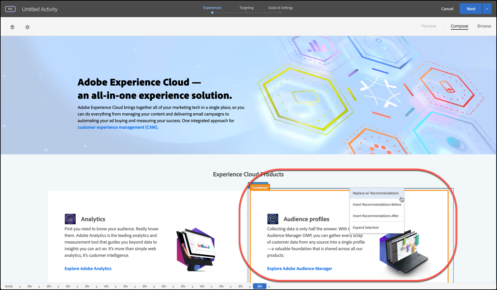

# 创建[!DNL Recommendations]活动 {#create-recs-activity}

>[!BEGINSHADEBOX]

**在此页面上：**&#x200B;了解如何在[!DNL Target] **[!UICONTROL 可视化体验编辑器]** (VEC)中创建[!DNL Recommendations]活动，从选择位置到设置活动。

>[!ENDSHADEBOX]

[!DNL Recommendations]活动在页面上显示推荐的项目。 在[!DNL Target] **[!UICONTROL 可视化体验编辑器]** (VEC)中创建活动时，可以将推荐直接放置到启用了[!DNL Target]的页面上，且恰好是访客应该看到推荐的位置。

## 创建活动并选择位置 {#create-activity}

活动URL和位置定义了页面以及该页面中推荐显示的区域。

1. 从&#x200B;**[!UICONTROL 活动]**&#x200B;菜单中，单击&#x200B;**[!UICONTROL 创建活动]** > **[!UICONTROL 推荐]**。

   

1. Select **[!UICONTROL 可视化]**（如有必要）。

   若要改用&#x200B;**[!UICONTROL 基于表单的体验编辑器]**，请选择&#x200B;**[!UICONTROL 表单]**。 请参阅[基于表单的体验编辑器](/help/main/c-experiences/form-experience-composer.md)。 有关包括&#x200B;**[!UICONTROL 单页应用程序]** VEC在内的编辑器的比较，请参阅[体验和选件](/help/main/c-experiences/experiences.md)。 有关VEC问题，请参阅[可视化体验编辑器故障诊断](/help/main/c-experiences/c-visual-experience-composer/r-troubleshoot-composer/troubleshoot-composer.md)。

1. （视情况而定）选择[工作区](/help/main/administrating-target/c-user-management/property-channel/property-channel.md)。

1. 指定活动URL，然后单击&#x200B;**[!UICONTROL 创建]**。

   活动URL是显示推荐的页面。 [!DNL Target]不区分URL协议（[!DNL https]和[!DNL http]），因此`http://www.adobe.com`和`https://www.adobe.com`都匹配。

   此时将打开VEC并显示页面。

1. 单击推荐应显示的元素，然后选择&#x200B;**[!UICONTROL 替换内容]** > **[!UICONTROL 推荐]**。

   <!--
   * **[!UICONTROL Replace w/ Recommendations]**: Deletes the current content of the element and replaces it with the recommendations.
   * **[!UICONTROL Insert Recommendations Before]**: Places the recommendations before the element, above or to the left of it, depending on the page construction.
   * **[!UICONTROL Insert Recommendations After]**: Places the recommendations after the element, below or to the right of it, depending on the page construction.

   

   Use **[!UICONTROL Expand Selection]** to expand the selection to the parent container, so that it includes the desired page elements.
   -->

   符合推荐条件的访客可在指定区域查看推荐项目。 不符合条件的访客将看到默认内容。

   >[!NOTE]
   >
   >**[!UICONTROL 推荐]**&#x200B;活动一次仅支持一个修改或推荐。 要显示多个推荐，请创建多个[!DNL Recommendations]活动，或使用A/B或XT测试。

   

<!--
1. Select a page type: Cart Page, Category Page, Home Page, Landing Page, Product Page, Search Results Page, Thank You Page, or Other.

   

   The page type determines which criteria are suggested in the next section.
-->

1. 访问&#x200B;**[!UICONTROL 显示属性]**&#x200B;菜单并单击&#x200B;**[!UICONTROL Select推荐]**。

   

## Select标准 {#select-criteria}

标准确定推荐哪些项目以及如何为每个访客选择这些项目。

1. Select一个或多个[标准](/help/main/c-recommendations/c-algorithms/algorithms.md)的复选框。

   

   如果选择多个标准，则流量会平均分配到两个标准，并且不能为每个标准更改百分比。 例如，如果选择了两个标准并且活动向20%的参加者显示默认内容，则40%的参加者会看到每个标准的推荐。

   >[!NOTE]
   >
   >并非每个标准都在每个页面上正确运行。 要兼容当前项目或当前类别推荐，页面或mbox必须传入`entity.id`或`entity.categoryId`。 最好只显示兼容的标准。 要使不兼容的标准可用于该活动，请清除&#x200B;**[!UICONTROL 兼容]**&#x200B;复选框。 此复选框可能不会显示，具体取决于&#x200B;**[!UICONTROL 管理]** > **[!UICONTROL 推荐]** > **[!UICONTROL 筛选不兼容的标准]**&#x200B;设置。 有关更多信息，请参阅[设置](https://experienceleague.adobe.com/docs/target-dev/developer/recommendations.html){target=_blank}。

1. （可选）查找或创建标准：

   * 要在列表较长时搜索现有标准，请在搜索字段中键入相应内容直到显示所需标准为止。 [!DNL Recommendations]提供了一些标准，团队也可以创建自定义标准。
   * 要创建新标准，请单击&#x200B;**[!UICONTROL 创建标准]**，然后输入有关新标准的信息。 请参阅[创建标准](/help/main/c-recommendations/c-algorithms/create-new-algorithm.md)。
   * 要将标准分组到序列中，请创建标准序列。 请参阅[创建标准序列](/help/main/c-recommendations/c-algorithms/create-criteria-sequence.md)。

1. 单击&#x200B;**[!UICONTROL 下一步]**。

## Select设计和促销活动 {#select-design}

设计是一个模板，可确定推荐在选定位置的外观，而收藏集可确定哪些项目符合显示条件。 可以选择将促销活动添加到推荐中。

1. 选择一个[设计](/help/main/c-recommendations/c-design-overview/design-overview.md)。

   

   * 要使用现有设计，请选中一个或多个设计的复选框，然后单击&#x200B;**[!UICONTROL 下一步]**。 在选择了多个标准时，只能选择一个设计。
   * 要创建自定义设计，请单击&#x200B;**[!UICONTROL 创建设计]**，然后输入新设计的名称和代码。 单击&#x200B;**[!UICONTROL 下一步]**，选择或上传图像，然后单击&#x200B;**[!UICONTROL 完成]** > **[!UICONTROL 完成]**。

   [!DNL Target]包含多个预配置的设计。 有关自定义设计的详细信息，请参阅[创建设计](/help/main/c-recommendations/c-design-overview/create-design.md#create-design)和[使用Velocity自定义设计](/help/main/c-recommendations/c-design-overview/customizing-a-template.md#customize-design)。

1. 单击&#x200B;**[!UICONTROL 下一步]**。

1. 在&#x200B;**[!UICONTROL 选项]**&#x200B;页面上，选择收藏集。

   收藏集可确定哪些项目符合在推荐中显示的条件。 有关详细信息（包括如何创建集合），请参阅[在活动中使用集合](/help/main/c-recommendations/c-products/collections.md#use-collection)。

1. （可选）将前端和后端促销活动添加到推荐中。 请参阅[添加促销活动](/help/main/c-recommendations/t-create-recs-activity/adding-promotions.md#add-promotions)。

1. 单击&#x200B;**[!UICONTROL 保存]**。

   VEC屏幕会在页面上显示推荐设计。

## 查看并完成活动 {#complete-activity}

在保存之前查看建议和活动流程，有助于确认受众、标准和设计是否正确。

1. （可选）单击&#x200B;**[!UICONTROL 预览]**&#x200B;查看向访客显示的活动的外观。 此模式允许与推荐进行交互，因为访客将与这些推荐进行交互。 单击&#x200B;**[!UICONTROL 撰写]**&#x200B;以返回到VEC。

1. 在VEC中查看推荐，然后单击&#x200B;**[!UICONTROL 下一步]**。

1. 在流程图中查看活动，并做出任何必需的更改。 完成后，单击&#x200B;**[!UICONTROL 下一步]**。

   

   流程图涵盖了活动的受众、体验和成功量度。 从图中，可以进行以下更改：

   * **受众**：默认情况下，所有访客都会看到推荐，但可以改为选择现有受众。 作为创建新受众的替代方法，可以创建[仅限该活动的受众](/help/main/c-target/creating-activity-only-audience.md#concept_A6BADCF530ED4AE1852E677FEBE68483)，或者[可以合并多个受众](/help/main/c-target/combining-multiple-audiences.md#section_2F1CE9434CC04174B4BA2BFC89B85D77)，以构建临时受众。
   * **标准**：查看标准或更改集合（在&#x200B;**[!UICONTROL 标准]**&#x200B;标签旁边）。
   * **控制组**：更改查看控制体验的参加者所占的百分比。 在[!DNL Recommendations]活动中，控制组会看到没有任何推荐的页面。
   * **设计**：查看设计代码，或更改或删除设计。

1. 指定活动设置，例如名称（必需）和目标（可选）。 有关设置，包括活动名称的规则，请参阅[推荐活动设置](/help/main/c-recommendations/t-create-recs-activity/recs-activity-settings.md#recs-activity-settings)。

1. 单击&#x200B;**[!UICONTROL 保存并关闭]**。

## 管理活动 {#manage-activity}

保存活动后，**[!UICONTROL 概述]**&#x200B;页面会显示该活动的摘要。 在此页面中，可以使用以下操作：

* 激活、编辑活动或QA。
* 将活动共享到Experience Cloud信息源。
* 查看体验URL并下载数据。
* 更改查看控制体验的活动参加者所占的百分比。
* 显示或隐藏标准详细信息，并查看设计代码。

该活动中还提供了两个其他页面：

* **[!UICONTROL 报告]**：显示[!DNL Recommendations]活动性能报告。
* **[!UICONTROL 冲突]**：显示可能发生的所有[活动冲突](/help/main/c-experiences/c-visual-experience-composer/activity-collisions.md)。 当多个活动向同一页面交付内容时出现冲突，这可能会导致显示意外内容。

## 培训视频：创建推荐活动(7:15) 

>[!VIDEO](https://video.tv.adobe.com/v/27688)
